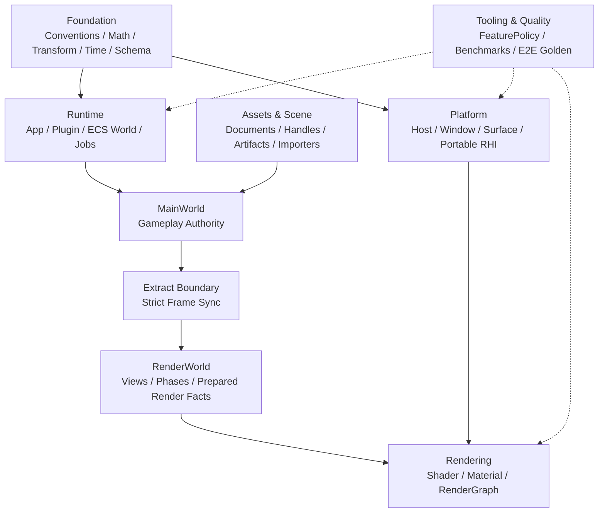
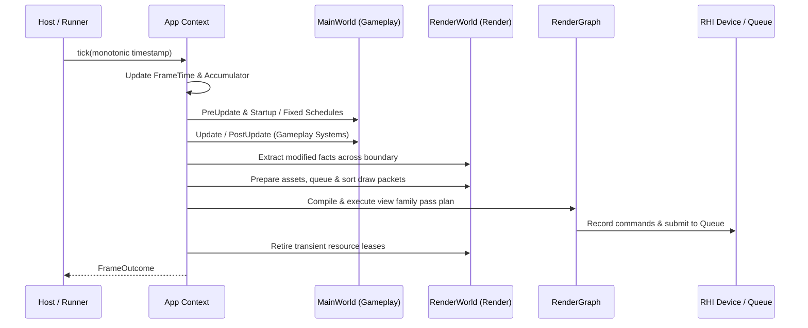
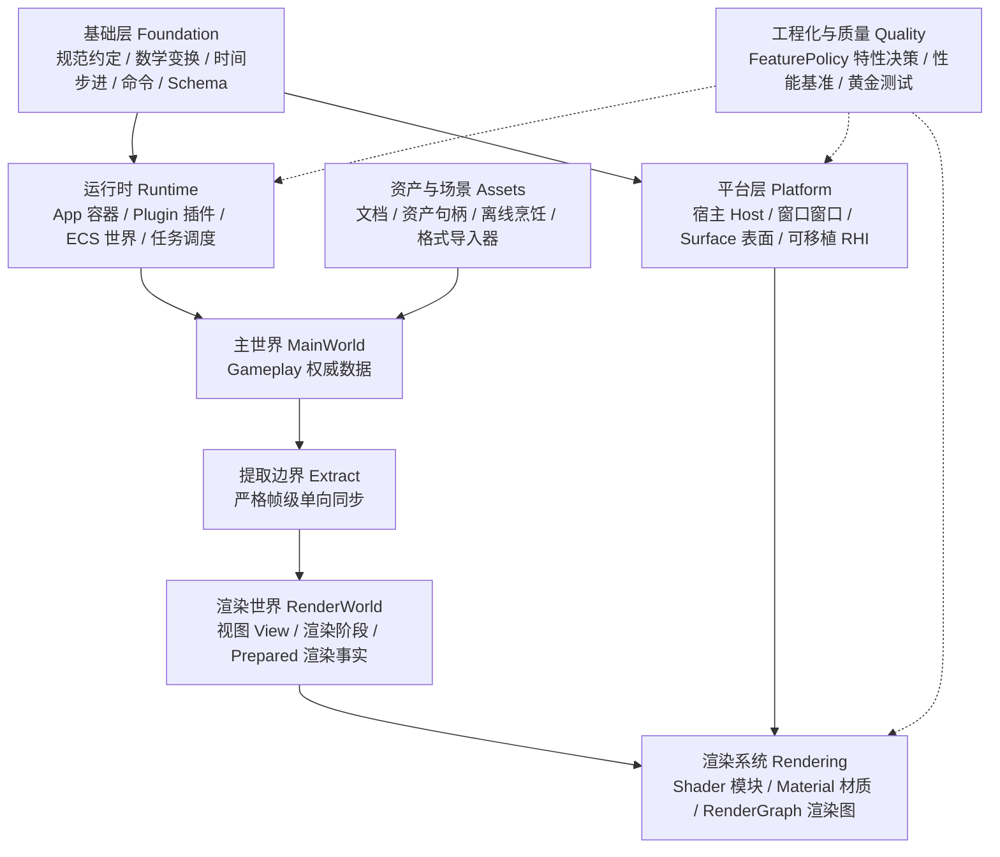
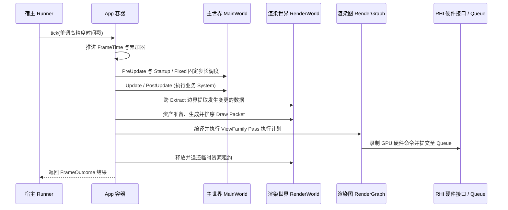

# AetherEngine

<div align="center">

[](https://www.typescriptlang.org/)
[](https://www.w3.org/TR/webgpu/)
[](https://www.khronos.org/registry/webgl/specs/latest/2.0/)
[](https://vitest.dev/)
[](https://playwright.dev/)
[](LICENSE)

**A modular, type-safe, WebGPU-native 3D rendering and game engine written in TypeScript.**

**基于 TypeScript 构建的模块化、类型安全、WebGPU 原生优先现代 3D 渲染与游戏引擎。**

---

[English](#english) | [简体中文](#简体中文)

---

</div>

<a id="english"></a>

## English

### 1. Overview & Philosophy

**AetherEngine** is a modern, high-performance real-time 3D engine built from the ground up for modern browsers and platforms. Designed with strict engineering discipline, strong typing, and domain-driven separation of concerns, AetherEngine treats design contracts as the ultimate source of intent and avoids the hidden global state, loose string typing, and monolithic coupling common in legacy web graphics frameworks.

#### Core Design Principles

- **WebGPU-First, Explicit WebGL2 Fallback**: Built natively around modern WebGPU idioms (bind groups, pipelines, explicit command recording, compute passes). WebGL2 is supported as a first-class, strictly bounded compatibility path that emulates stateless explicit APIs over stateful drivers, with zero runtime capability guesswork.
- **Strict Authority & Identity Separation**: Clear domain boundaries prevent state contamination:
  - `MainWorld`: The single authoritative source for gameplay state, entities, and components.
  - `RenderWorld`: The isolated authority for prepared render facts, views, and draw phases.
  - `Extract Boundary`: The strictly ordered one-way extraction boundary transferring facts from `MainWorld` to `RenderWorld`.
  - `SceneDocument`: Stable, persistent design documents, decoupled from ephemeral runtime memory slots.
  - `Asset Runtime`: Versioned CPU payloads and GPU-prepared variants decoupled from raw GPU lifecycles.
- **Five Dedicated Identity Domains**:
  1. `DocumentEntityId`: Stable across saves and serialized scenes/prefabs.
  2. `Entity`: Ephemeral, generation-protected slot unique to a single `World` instance.
  3. `AssetId`: Content-addressed, stable asset identity within the asset graph.
  4. `AssetHandle<T>`: Runtime typed handle with hot-module-reloading (HMR) object identity preservation.
  5. `RHIResourceId`: Ephemeral resource handle valid only within a specific GPU Device generation.
- **Decoupled ECS Core**: Pure data-driven Entity-Component-System (ECS) architecture featuring chunked packed storage, sparse object components, zero-payload tag components, archetype edge caching, monotonic `ChangeTick` change tracking, and transactional `CommandBuffer` apply points.
- **Compiler-Driven RenderGraph DAG**: Directed Acyclic Graph (DAG) for frame rendering that compiles passes, calculates hazard barriers, fuses compatible raster passes, automatically manages transient resource aliasing, and eliminates runtime garbage collection.
- **WGSL Single Source of Truth**: All rendering equations, materials, and lighting logic are written in pure WebGPU Shading Language (WGSL). No parallel CPU-side JavaScript/TypeScript rasterizers or shader evaluators are maintained. Naga validates shaders and lowers them to GLSL ES 3.00 for WebGL2.
- **Headless & 100% Testable**: Zero-DOM and headless by design. The entire runtime, ECS, time loop, transform hierarchies, and RHI can be verified in headless environments (e.g., CI runners) via `NullDevice`, fake ports, and deterministic clocks without requiring a physical GPU or display.

---

### 2. Architecture & Data Flow

#### Subsystem Layering



#### Frame Execution Flow



---

### 3. Key Subsystems & Features

| Subsystem               | Key Capabilities & Architecture                                                                                                                                                                                                                                                                    |
| :---------------------- | :------------------------------------------------------------------------------------------------------------------------------------------------------------------------------------------------------------------------------------------------------------------------------------------------- |
| **App & Runtime**       | Transactional `AppBuilder`, plugin dependency graph resolution with cycle detection, strict `Schedule` stages (`Startup`, `PreUpdate`, `Update`, `PostUpdate`, `PreRender`), scoped services, and enumerable extensions.                                                                           |
| **ECS Engine**          | Archetype-based storage, generation handles, custom relations (`ChildOf`, `IsA`), query planner, age-clamped monotonic change detection (`ChangeReader`), deferred commands with transactional rollback (`CommandBuffer`, `SpawnTicket`).                                                          |
| **Portable RHI**        | Unified stateless WebGPU-like interface: `RHIDevice`, `RHIQueue`, `RHICommandEncoder`, `RHIRenderPass`, `RHIComputePass`, `RHIBuffer`, `RHITexture`, and `RHIBindGroup`. Supported backends: **WebGPU**, **WebGL2** (stateful emulation with VAO/FBO/UBO caches), and **Null** (headless testing). |
| **RenderGraph**         | Directed Acyclic Graph pass scheduler with hazard barrier deduction (RAW, WAR, WAW), transient memory aliasing, compiler-driven pass fusion, subresource tracking, and multi-view composition.                                                                                                     |
| **Materials & Shaders** | Standard Cook-Torrance GGX PBR model (`StandardLitMaterialSchema`) supporting 5 texture channels (Base Color, Metallic-Roughness, Normal, Ambient Occlusion, Emissive), sampler configuration, UV transforms, MikkTSpace tangent basis, and modular WGSL linker with Naga translation.             |
| **Lighting & Shadows**  | Directional Cascaded Shadow Maps (CSM) with stable cascade projection, split-sum Image-Based Lighting (IBL), and clustered light evaluation with CPU, WebGPU Compute, and WebGL2 Integer MRT paths.                                                                                                |
| **Asset Pipeline**      | glTF 2.0 static mesh and PBR material importer/cooker, asynchronous budgeted request scheduler (`AssetRequestScheduler`), independent CPU payload and GPU prepared asset registries, and circuit-breaker failure recovery.                                                                         |
| **Quality & Policy**    | `FeaturePolicy` capability negotiator (dynamically resolving `native`, `emulated`, `fallback`, or `unsupported`), reproducible benchmark harness (`benchmark/`), and dual-backend Playwright visual golden testing.                                                                                |

---

### 4. Interactive Showcase

AetherEngine includes an interactive React + Vite demo showcase located in `examples/react-vite-ts/`:

- **CSM Box Demo (`/`)**: Cascaded Shadow Maps with Venice Sunset HDR Image-Based Lighting (IBL) illuminating an interactive metallic-roughness cube. Supports live adjustments of cascade distance, sunlight angle, roughness, and MSAA.
- **Damaged Helmet glTF PBR Demo (`/damaged-helmet`)**: Production-grade rendering of the classic Khronos glTF 2.0 Damaged Helmet model, exercising all 5 PBR texture channels, MikkTSpace normal tangents, split-sum environment lighting, and dual-backend switching (`WebGPU` / `WebGL2`).

To launch the showcase:

```sh
pnpm example:dev
```

---

### 5. Quick Start

```ts
import {
  App,
  TimePlugin,
  WorldTransform,
  CameraRenderSource,
  MeshRenderSource,
  createBoxMeshData,
  createStandardLitMaterial,
  createBaselineRenderingPlugin,
  createBrowserGraphics,
  BrowserRunner,
  defineTagComponent
} from '@aether/engine';

async function bootstrap() {
  // 1. Initialize Canvas & Browser Graphics (Auto-negotiates WebGPU, falls back to WebGL2)
  const canvas = document.getElementById('render-canvas') as HTMLCanvasElement;
  const graphics = await createBrowserGraphics({
    canvas,
    preference: ['webgpu', 'webgl2']
  });

  // 2. Build the Engine Application
  const app = new App()
    .addPlugin(TimePlugin)
    .addPlugin(createBaselineRenderingPlugin({ graphics }))
    .addSystem('Startup', {
      id: 'app.spawn-scene',
      run(world) {
        // Spawn Perspective Camera
        world
          .spawn()
          .insert(WorldTransform, { position: [0, 2, 5], rotation: [0, 0, 0, 1], scale: [1, 1, 1] })
          .insert(CameraRenderSource, {
            projection: {
              kind: 'perspective',
              near: 0.1,
              far: 100,
              verticalFovRadians: Math.PI / 3
            },
            viewportRect: { x: 0, y: 0, width: 1, height: 1 },
            layerMask: 1,
            depthMode: 'standard',
            historyKey: 'main-camera'
          })
          .build();

        // Spawn PBR Cube
        const boxMesh = createBoxMeshData({ width: 1, height: 1, depth: 1 });
        const material = createStandardLitMaterial({
          baseColor: [0.9, 0.4, 0.2, 1.0],
          roughness: 0.2,
          metallic: 0.8
        });

        world
          .spawn()
          .insert(WorldTransform, { position: [0, 0, 0], rotation: [0, 0, 0, 1], scale: [1, 1, 1] })
          .insert(MeshRenderSource, { mesh: boxMesh, material })
          .build();
      }
    })
    .addSystem('Update', {
      id: 'app.rotate-cube',
      run(world) {
        // Update queries & gameplay logic
      }
    });

  // 3. Start the Browser Runner
  const runner = new BrowserRunner(app);
  runner.start();
}

bootstrap();
```

---

### 6. Development & Verification Commands

All changes follow rigorous verification gates defined in [`AGENTS.md`](./AGENTS.md):

```sh
# Install dependencies
pnpm install

# Run type check (TypeScript compiler without emit)
pnpm run typecheck

# Run unit and contract tests (Vitest)
pnpm test

# Build production bundle
pnpm run build

# Validate performance benchmark registry
pnpm run bench:validate

# Run changed performance benchmarks
pnpm run bench:changed

# Check and cook built-in WGSL shaders
pnpm run shader:check
pnpm run shader:generate

# Execute Playwright dual-backend browser E2E tests
pnpm run e2e

# Run the interactive React showcase
pnpm run example:dev

# Full pre-commit / CI gate verification
pnpm run verify:commit
```

---

<a id="简体中文"></a>

## 简体中文

### 1. 项目定位与核心设计哲学

**AetherEngine** 是专为现代 Web 浏览器与跨平台环境打造的现代化、高可维护性实时 3D 渲染与游戏引擎。引擎严格遵循系统工程规范，坚持以设计契约（Design Documents）为最终意图来源，通过强类型（TypeScript-First）和领域驱动分层，彻底避免了传统前端图形库中常见的隐式全局状态、弱类型字符串传递与巨型单例对象泥潭。

#### 核心设计原则

- **WebGPU 原生优先，WebGL2 显式降级**：
  原生采用 WebGPU 的现代概念设计（BindGroup、Pipeline、显式命令录制、计算着色器）。WebGL2 作为具备明确功能与质量边界的兼容路径提供，在有状态的 GL 驱动之上模拟出无状态的显式硬件接口（RHI），不采用无序的模糊运行时能力猜测。
- **严格的权威数据与身份域隔离**：
  核心系统之间职责严格划界，杜绝状态污染：
  - `MainWorld`：Gameplay 权威来源，拥有正在运行的实体、组件与资源。
  - `RenderWorld`：渲染域独立权威，拥有从主世界提取的渲染事实、视图与绘制阶段数据。
  - `Extract 边界`：严格受控的帧间单向提取边界，是主世界向渲染世界同步数据的唯一通路。
  - `SceneDocument`：可持久化场景文档，与运行时的动态内存槽位严格解耦。
  - `Asset Runtime`：具备 CPU Payload 版本管理与 GPU Prepared 变体管理的资产运行时。
- **五大正交身份域**：
  1. `DocumentEntityId`：跨保存与序列化稳定存在的场景/预制件文档实体 ID。
  2. `Entity`：单次运行的世界实例内的代际插槽（Slot + Generation），不用于跨网络或存档持久化。
  3. `AssetId`：资产数据库及内容依赖图中的内容寻址稳定身份。
  4. `AssetHandle<T>`：运行时资产句柄，在代码热重载（HMR）期间保持对象引用稳定。
  5. `RHIResourceId`：底层 GPU 硬件资源 ID，仅在单个 GPU Device 生命周期内有效。
- **彻底解耦的数据驱动 ECS**：
  包含块状紧凑存储（Packed Storage）、稀疏对象组件（Object Component）、零开销标签组件（Tag Component）、Archetype 转移边缓存，以及基于单调自增 `ChangeTick` 的变动追踪与支持回滚的事务性 `CommandBuffer`。
- **编译器驱动的 RenderGraph 有向无环图**：
  帧级渲染图调度器，支持 Pass 声明期校验、Hazard 屏障推导（RAW / WAR / WAW）、光栅化 Pass 融合、临时 GPU 资源别名复用，实现运行期零 GC 垃圾回收。
- **WGSL 唯一事实来源（禁止 CPU 双重实现）**：
  材质、光照方程与渲染算法以标准 WebGPU 着色语言（WGSL）为唯一标准。引擎禁止编写平行的 TypeScript CPU 栅格化或表面着色评估器。通过 Naga 原生编译器校验并生成 WebGL2 专用的 GLSL ES 3.00，支持模块化 WGSL 链接与着色器反射。
- **无 DOM / 无 GPU 环境纯净可测**：
  引擎核心运行时、ECS、时间步进、坐标变换与 RHI 接口实现 100% 宿主解耦。通过 `NullDevice`、假端口注入与确定性虚拟时钟，无需浏览器 DOM 或物理显卡即可在 CI 等 Headless 环境中执行完整契约测试。

---

### 2. 总体架构与数据流向

#### 核心分层架构



#### 单帧生命周期时序



---

### 3. 核心子系统与功能特性

| 子系统模块             | 功能特性与设计亮点                                                                                                                                                                                                                                     |
| :--------------------- | :----------------------------------------------------------------------------------------------------------------------------------------------------------------------------------------------------------------------------------------------------- |
| **App 与插件系统**     | 事务性构建器 `AppBuilder`，支持插件有向无环依赖解析与循环检测，严格的阶段调度（`Startup`、`PreUpdate`、`Update`、`PostUpdate`、`PreRender` 等），作用域服务（Service）与可枚举扩展点（Extension）。                                                    |
| **实体组件系统 (ECS)** | 基于 Archetype 的高效紧凑列存储，代际实体句柄，实体关系（`ChildOf`、`IsA`），增量查询规划器，单调变动追踪器（`ChangeReader`），事务性命令缓冲与实体预发号（`CommandBuffer`、`SpawnTicket`）。                                                          |
| **可移植 RHI 接口**    | 现代 WebGPU 语义抽象：`RHIDevice`、`RHIQueue`、`RHICommandEncoder`、`RHIRenderPass`、`RHIComputePass`、`RHIBindGroup` 等。具备 **WebGPU** 原生后端、**WebGL2** 有状态驱动模拟后端（含 FBO/VAO 缓存与 UBO 物理对齐）以及 **Null** 契约测试后端。        |
| **RenderGraph 渲染图** | 基于有向无环图（DAG）的 Pass 调度引擎，自动计算资源 Hazard 读写屏障（RAW、WAR、WAW），临时显存资源别名自动复用，编译器级光栅化 Pass 融合，多视图（ViewFamily）合成管理。                                                                               |
| **材质与着色器**       | 标准 Cook-Torrance GGX 物理材质模型（`StandardLitMaterialSchema`），原生支持 5 大标准 PBR 纹理通道（BaseColor、Metallic-Roughness、Normal、Occlusion、Emissive）、独立采样器、UV 变换、MikkTSpace 切线计算，以及 WGSL 严格模块化链接与 Naga 转译管线。 |
| **光照与阴影**         | 方向光级联阴影贴图（CSM）算法配合视锥切片稳定投影，Split-Sum 预过滤环境贴图 IBL，以及分簇光照架构（支持 CPU 回退、WebGPU Compute 计算着色器与 WebGL2 整数 MRT 渲染实现）。                                                                             |
| **资产与场景管线**     | glTF 2.0 静态网格与 PBR 材质导入/烹饪器，带硬预算限制与自动熔断的异步调度加载器（`AssetRequestScheduler`），CPU Payload 驻留与 GPU Prepared 状态正交解耦。                                                                                             |
| **特性策略与质量保障** | `FeaturePolicy` 设备能力动态协商（支持 `native`、`emulated`、`fallback`、`unsupported` 显式判定），标准性能基准测试套件（`benchmark/`），以及跨双后端的 Playwright 浏览器自动化像素级金标比对。                                                        |

---

### 4. 示例演示程序 (Demo Showcase)

AetherEngine 在 `examples/react-vite-ts/` 目录下提供了完整的交互式展示程序：

- **CSM 级联阴影立方体演示 (`/`)**：
  展示实时的方向光 Cascaded Shadow Maps（CSM）与威尼斯日落 HDR 环境贴图（IBL），照射在金属粗糙度 PBR 立方体上。支持通过 Leva 控制面板实时调节级联距离、光照方向、金属度、粗糙度与 4x MSAA 抗锯齿。
- **Damaged Helmet 战损头盔演示 (`/damaged-helmet`)**：
  完整加载 Khronos 官方 glTF 2.0 战损头盔模型，全面调用 5 大 PBR 纹理槽位、MikkTSpace 法线切线空间、高精度环境光反射，并支持在 `WebGPU` 与 `WebGL2` 双图形后端之间一键无缝切换与对齐验证。

启动本地演示程序：

```sh
pnpm example:dev
```

---

### 5. 快速上手

```ts
import {
  App,
  TimePlugin,
  WorldTransform,
  CameraRenderSource,
  MeshRenderSource,
  createBoxMeshData,
  createStandardLitMaterial,
  createBaselineRenderingPlugin,
  createBrowserGraphics,
  BrowserRunner
} from '@aether/engine';

async function main() {
  // 1. 获取 Canvas 并初始化浏览器图形上下文（优先使用 WebGPU，环境不支持时自动选用 WebGL2）
  const canvas = document.getElementById('render-canvas') as HTMLCanvasElement;
  const graphics = await createBrowserGraphics({
    canvas,
    preference: ['webgpu', 'webgl2']
  });

  // 2. 构造引擎 App 容器并注册插件与系统
  const app = new App()
    .addPlugin(TimePlugin)
    .addPlugin(createBaselineRenderingPlugin({ graphics }))
    .addSystem('Startup', {
      id: 'my-app.setup-scene',
      run(world) {
        // 创建透视摄像机
        world
          .spawn()
          .insert(WorldTransform, { position: [0, 2, 5], rotation: [0, 0, 0, 1], scale: [1, 1, 1] })
          .insert(CameraRenderSource, {
            projection: {
              kind: 'perspective',
              near: 0.1,
              far: 100,
              verticalFovRadians: Math.PI / 3
            },
            viewportRect: { x: 0, y: 0, width: 1, height: 1 },
            layerMask: 1,
            depthMode: 'standard',
            historyKey: 'main-camera'
          })
          .build();

        // 创建带 PBR 材质的基础立方体
        const mesh = createBoxMeshData({ width: 1, height: 1, depth: 1 });
        const material = createStandardLitMaterial({
          baseColor: [0.9, 0.4, 0.2, 1.0],
          roughness: 0.2,
          metallic: 0.8
        });

        world
          .spawn()
          .insert(WorldTransform, { position: [0, 0, 0], rotation: [0, 0, 0, 1], scale: [1, 1, 1] })
          .insert(MeshRenderSource, { mesh, material })
          .build();
      }
    })
    .addSystem('Update', {
      id: 'my-app.update-logic',
      run(world) {
        // 在此处编写业务更新与查询逻辑
      }
    });

  // 3. 启动浏览器运行循环
  const runner = new BrowserRunner(app);
  runner.start();
}

main();
```

---

### 6. 开发与工程化指令

项目遵循严格的工程化流程与提交验证门禁（参见 [`AGENTS.md`](./AGENTS.md)）：

```sh
# 安装依赖
pnpm install

# 静态类型检查（TypeScript 零错误校验）
pnpm run typecheck

# 单元测试与契约测试（Vitest）
pnpm test

# 生产环境编译构建
pnpm run build

# 校验性能基准测试注册表
pnpm run bench:validate

# 运行发生变更的性能基准测试
pnpm run bench:changed

# 检查并编译内建 WGSL 着色器
pnpm run shader:check
pnpm run shader:generate

# 运行 Playwright 双后端浏览器自动化 E2E 测试
pnpm run e2e

# 启动 React + Vite 本地示例演示
pnpm run example:dev

# 提交前全量门禁检查（类型、代码规范、测试、构建、基准）
pnpm run verify:commit
```

---

### 7. 仓库代码目录导航

```txt
AetherEngine/
├── src/                  # 引擎核心源码
│   ├── app/              # App 容器生命周期、调度系统（Schedule）、服务与扩展点注册表
│   ├── ecs/              # ECS 核心：World、Archetype 存储、变动追踪与 CommandBuffer
│   ├── platform/         # 宿主抽象：Host、Window、Surface 与浏览器适配
│   ├── rhi/              # 硬件接口：WebGPU、WebGL2 与 Null 抽象后端实现
│   ├── rendering/        # 渲染核心：RenderWorld、Phase、Pipeline 与 LightList
│   ├── render-graph/     # 渲染图：Pass 依赖 DAG 编译、临时资源分配与融合
│   ├── material/         # 材质系统：StandardLit PBR Schema 与参数打包
│   ├── shader/           # 着色器系统：WGSL 模块化合成与 Naga 编译整合
│   ├── assets/           # 资产与场景：异步调度器、glTF 导入与 Payload 管理
│   ├── feature-policy/   # 特性策略：基于硬件实际能力的动态决策机
│   └── plugins/          # 内建核心插件集（DefaultPlugins、TimePlugin 等）
├── engine/               # 架构与设计契约（权威设计文档）
│   ├── requirements.md   # 产品与技术需求规格说明（PRD）
│   ├── design.md         # V2 架构概览与技术摘要
│   ├── implementation-status.md # 实施状态台账与验收记录
│   └── design/v2/        # V2 权威子系统技术合同与架构设计
├── benchmark/            # 可复现的性能基准测试套件与执行框架
├── examples/             # 交互式示例（React + Vite 展示程序）
├── test/                 # Vitest 行为驱动单元测试与契约测试
├── tools/                # 离线工具链（着色器编译器、环境贴图过滤器、Doctor 诊断）
├── e2e/                  # Playwright 双后端跨平台端到端 Golden 测试
└── AGENTS.md             # AI 工程师与代码开发规范指南
```

---

### 8. 许可证 (License)

[MIT License](LICENSE)
