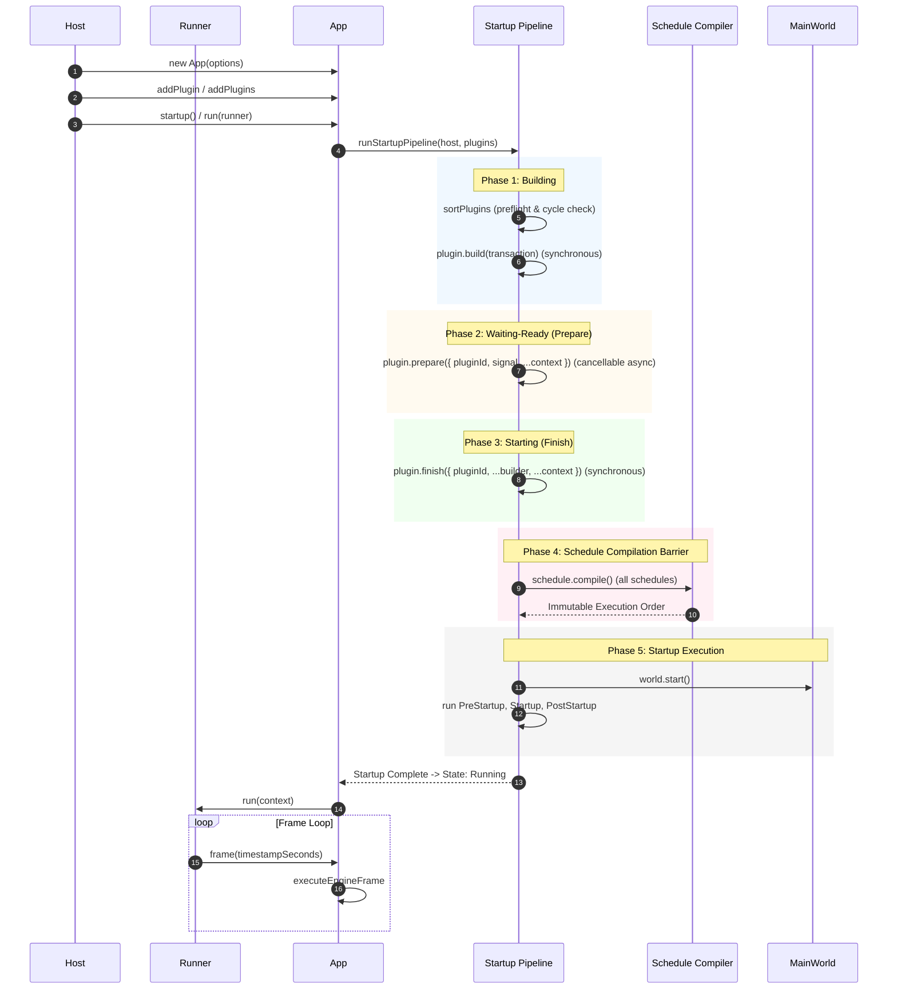

# App Runtime Subsystem

## 1. Architecture Overview and Design Philosophy

The `src/app` subsystem provides the composition root, execution loop, plugin lifecycle management, and schedule execution for AetherEngine.

Key design principles:

- **Design Intent Authority**: Governed by `engine/design/v2/02-runtime/01-app-plugin.md` and `05-plugin-composition-hardening.md`.
- **Composition Root, Not God Object**: `App` owns registries (`MainWorld`, `Schedules`, `Services`, `Extensions`), while subsystems register structures through typed contracts.
- **Fail-Fast & Explicit Transactions**: All structural mutations occur inside transactional boundaries (`RegistrationTransaction`). Asynchronous registration after build/finish is forbidden.
- **Cooperative Preparation & Cancellation**: Supports cooperative cancellation via `AbortSignal` during asynchronous `prepare`.
- **Eager Schedule Preflight**: Schedules are eagerly compiled before startup execution, uncovering cycles and missing ordering targets before the `MainWorld` starts.
- **Schedule-Local System Sets**: Systems can be organized into flat, schedule-local `SystemSet`s with virtual boundary lowering and single-evaluation synchronous run conditions.
- **Zero-Overhead Observability**: Bounded, optional telemetry with isolated listener error boundaries.

---

## 2. Module Responsibility Table

| Module                 | Responsibility                                                                                                                                                                                         |
| ---------------------- | ------------------------------------------------------------------------------------------------------------------------------------------------------------------------------------------------------ |
| `app.ts`               | Public composition root (`App`), manages high-level state transitions, delegates to startup and frame executors.                                                                                       |
| `startup.ts`           | Cancellable startup pipeline (`runStartupPipeline`): dependency preflight, synchronous `build`, cancellable `prepare`, synchronous `finish`, schedule compile barrier, and startup schedule execution. |
| `frame.ts`             | Frame and fixed-step loop execution (`executeEngineFrame`): before-fixed, fixed substep accumulator, after-fixed, and `FrameCleanup`.                                                                  |
| `schedule.ts`          | Schedule stage coordinator (`Schedule`), SystemSet registration, run condition caching, and synchronous frame execution.                                                                               |
| `schedule-compiler.ts` | Pure topological sorting with virtual entry/exit node lowering for SystemSet and lowest-registration-index tie-breaking.                                                                               |
| `plugin-group.ts`      | Immutable `PluginGroupBuilder` supporting `set`, `enable`, `disable`, and `.plugins()`.                                                                                                                |
| `telemetry.ts`         | Optional runtime observability (`AppTelemetry`), ring-buffered events, monotonic clock, and isolated listener dispatch.                                                                                |
| `transaction.ts`       | Structural registration transaction (`RegistrationTransaction`) with reverse rollback and `deferCleanup`.                                                                                              |
| `plugin-graph.ts`      | Pure plugin dependency preflight and topological sort (`sortPlugins`).                                                                                                                                 |
| `registry.ts`          | Scoped service and extension contribution storage (`ServiceRegistry`, `ExtensionRegistry`).                                                                                                            |
| `runner.ts`            | Headless and browser frame runners (`Runner`, `HeadlessRunner`, `BrowserRunner`).                                                                                                                      |
| `time.ts`              | Time resources, policies, controllers, and runtime stepping.                                                                                                                                           |
| `constants.ts`         | Stage schedule lists (`DEFAULT_SCHEDULES`, `STARTUP_SCHEDULES`, `FIXED_SCHEDULES`, etc.) and `CoreSchedule`.                                                                                           |
| `utils.ts`             | Helpers (`definePlugin`, `createServiceToken`, `createExtensionPoint`, `serviceValue`, `serviceFactory`).                                                                                              |
| `types/`               | Pure TypeScript interfaces and contracts.                                                                                                                                                              |

---

## 3. Lifecycle Sequence & Data Flow

---

## 4. Core Fail-Fast Invariants and Error Boundaries

1. **Synchronous Build and Finish**: `plugin.build()` and `plugin.finish()` returning a Promise is an immediate contract error.
2. **Cooperative Cancellation Settlement**: `App.destroy()` during startup requests cancellation through `AbortSignal` and awaits active `prepare` promises settling before tearing down resources.
3. **Pre-Startup Schedule Barrier**: Any cycle, missing dependency target, or undeclared `inSet` reference throws eagerly during `startup()`, even if that schedule would never be executed.
4. **Deterministic Tie-Breaking**: When multiple systems have zero incoming edges in a schedule DAG, the node with the lowest registration index is executed first.
5. **Set Condition Gating**: A `SystemSet` condition (`runIf`) is evaluated exactly once per schedule invocation (including each fixed substep); if false, member system conditions are not evaluated and all members are skipped.
6. **Isolated Telemetry Subscribers**: Subscriber errors never throw into runtime execution or alter engine control flow.
7. **Exactly-Once Reverse Cleanup**: Plugins shutdown in reverse dependency order; `deferCleanup` and services dispose reliably upon failure or destruction.
