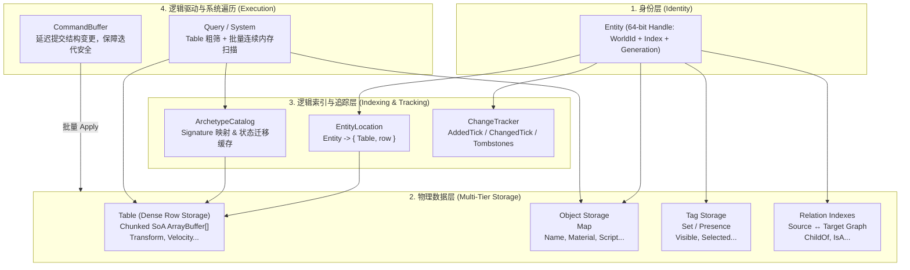
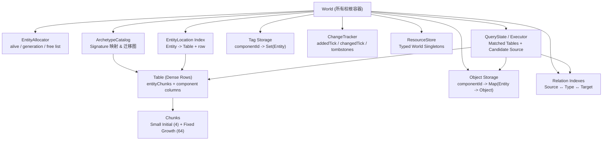
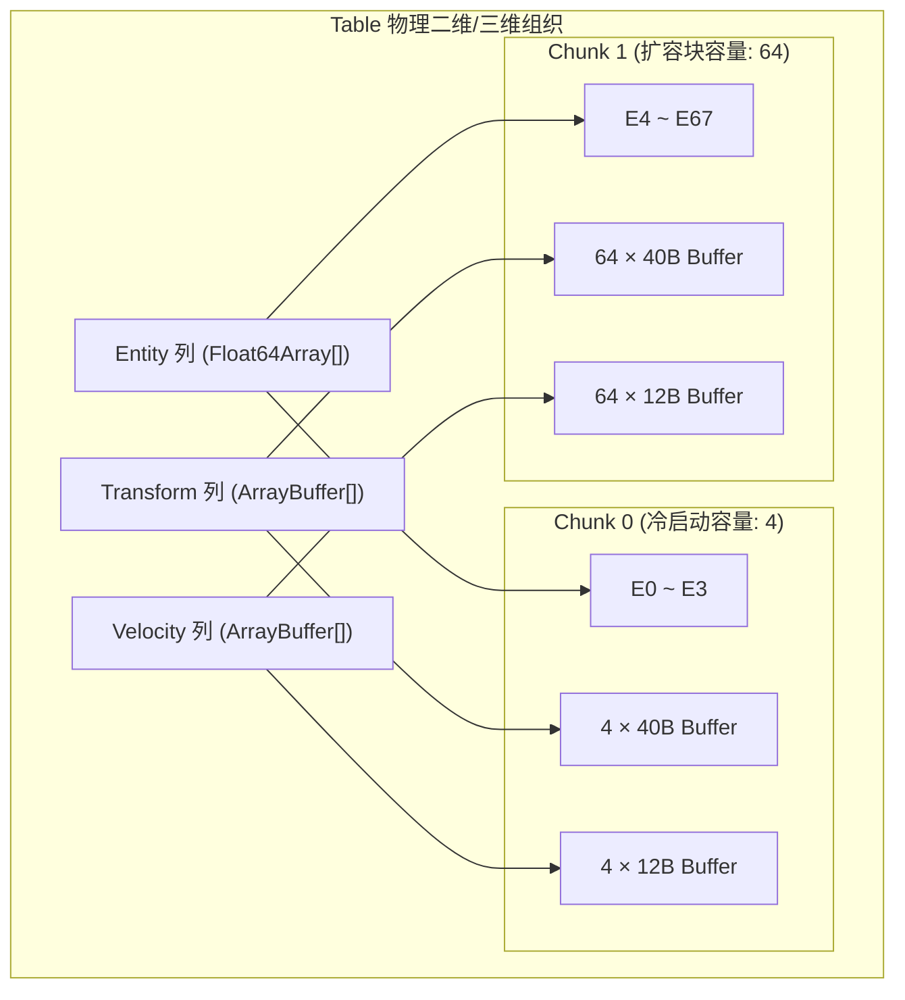
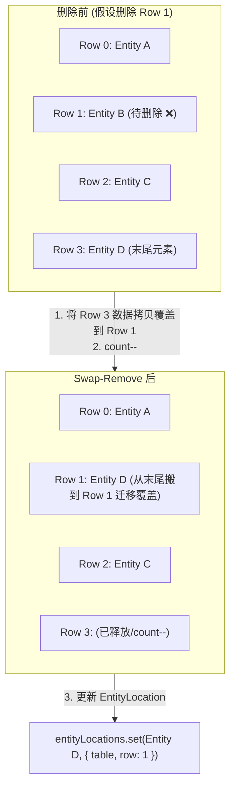
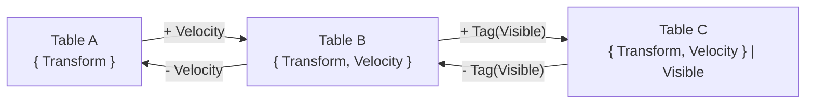
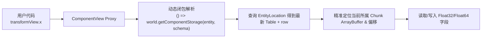
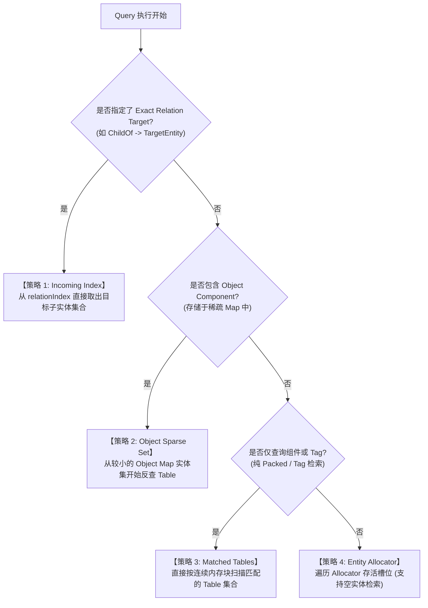
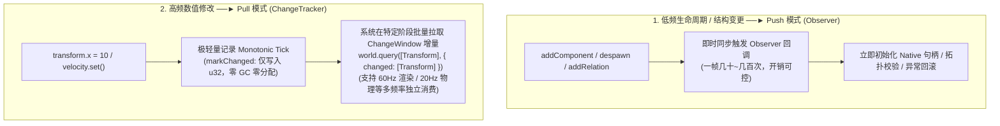

# AetherEngine ECS (Entity Component System) 子系统全景指南

本文档全面梳理了 AetherEngine `src/ecs` 模块的架构设计、内存模型（Chunked SoA 二进制行存储）、原型迁移图（Archetype Graph）、查询执行器与表级剪枝、关系索引以及响应式事件与变更追踪机制。

---

## 目录

1. [系统全景架构与设计哲学](#1-系统全景架构与设计哲学)
   - [1.1 身份、数据与索引分离](#11-身份数据与索引分离)
   - [1.2 核心概念与职责划分](#12-核心概念与职责划分)
   - [1.3 整体存储拓扑架构](#13-整体存储拓扑架构)
2. [组件分类体系与内存布局](#2-组件分类体系与内存布局)
   - [2.1 三类组件形态对比](#21-三类组件形态对比)
   - [2.2 Packed Component: 字段对齐与紧凑二进制流](#22-packed-component-字段对齐与紧凑二进制流)
   - [2.3 Object Component: 稀疏存储与 Presence 标记](#23-object-component-稀疏存储与-presence-标记)
   - [2.4 Tag Component: 零字节成员资格](#24-tag-component-零字节成员资格)
   - [2.5 组件内存序列化机制（component-serializer.ts）](#25-组件内存序列化机制component-serializerts)
3. [原型（Archetype）与分块行存储（Chunked Table）](#3-原型archetype与分块行存储chunked-table)
   - [3.1 Archetype 签名生成机制](#31-archetype-签名生成机制)
   - [3.2 Table 物理内存模型（Chunked ArrayBuffer[]）](#32-table-物理内存模型chunked-arraybuffer)
   - [3.3 二维/三维单元格寻址算法（locateRow）](#33-二维三维单元格寻址算法locaterow)
   - [3.4 内存冷启动与追加扩容策略](#34-内存冷启动与追加扩容策略)
4. [实体生命周期与核心操作](#4-实体生命周期与核心操作)
   - [4.1 实体句柄编码（64-bit Handle）](#41-实体句柄编码64-bit-handle)
   - [4.2 插入与写入（insert & writeComponent）](#42-插入与写入insert--writecomponent)
   - [4.3 $O(1)$ 尾部交换删除（Swap-Remove）与坐标重映射](#43-o1-尾部交换删除swap-remove与坐标重映射)
   - [4.4 原型迁移图（Archetype Graph Transition & Migration）](#44-原型迁移图archetype-graph-transition--migration)
   - [4.5 内存修剪归还（shrinkToFit）](#45-内存修剪归还shrinktofit)
   - [4.6 链式构建器（EntityBuilder）与虚拟句柄（SpawnTicket）](#46-链式构建器entitybuilder与虚拟句柄spawnticket)
5. [视图解耦与动态寻址机制（ComponentView）](#5-视图解耦与动态寻址机制componentview)
   - [5.1 为什么不能直接持久化 ArrayBuffer 引用？](#51-为什么不能直接持久化-arraybuffer-引用)
   - [5.2 闭包动态寻址与 Proxy 访问器](#52-闭包动态寻址与-proxy-访问器)
6. [查询引擎与表级剪枝（Query Planner & Execution）](#6-查询引擎与表级剪枝query-planner--execution)
   - [6.1 Query 编译与 Archetype 增量匹配（QueryState）](#61-query-编译与-archetype-增量匹配querystate)
   - [6.2 候选源选择策略（Candidate Source Selection）](#62-候选源选择策略candidate-source-selection)
   - [6.3 过滤剪枝机制（Table-level Pruning vs Row-level Filtering）](#63-过滤剪枝机制table-level-pruning-vs-row-level-filtering)
7. [关系系统（Relations）与层级拓扑](#7-关系系统relations与层级拓扑)
   - [7.1 关系三元组与类型签名](#71-关系三元组与类型签名)
   - [7.2 双向索引结构（RelationIndex & ChildOfIndex）](#72-双向索引结构relationindex--childofindex)
   - [7.3 拓扑环检测与生命周期联动（Acyclic & Despawn Cleanup）](#73-拓扑环检测与生命周期联动acyclic--despawn-cleanup)
8. [变更追踪（Change Detection）与响应式系统（Observer）](#8-变更追踪change-detection与响应式系统observer)
   - [8.1 单调 Tick 机制与 ChangeWindow 过滤](#81-单调-tick-机制与-changewindow-过滤)
   - [8.2 ChangeReader 游标与 Tombstone 垃圾回收](#82-changereader-游标与-tombstone-垃圾回收)
   - [8.3 响应式 Observer 与 DeferredWorld 事务安全](#83-响应式-observer-与-deferredworld-事务安全)
   - [8.4 架构设计抉择：为什么 Observer 没有 component-changed？（Push vs Pull）](#84-架构设计抉择为什么-observer-没有-component-changedpush-vs-pull)
9. [命令缓冲（CommandBuffer）与资源系统（ResourceStore）](#9-命令缓冲commandbuffer与资源系统resourcestore)
   - [9.1 迭代安全与延迟结构变更（CommandBuffer）](#91-迭代安全与延迟结构变更commandbuffer)
   - [9.2 类型化单例资源（ResourceToken）](#92-类型化单例资源resourcetoken)
10. [文件结构与核心 API 速查表](#10-文件结构与核心-api-速查表)

---

## 1. 系统全景架构与设计哲学

### 1.1 身份、数据与索引分离

传统面向对象（OOP）模型倾向于将游戏实体的所有属性和行为封装在单一对象内：

```text
// 传统 OOP 模式：内存离散，堆碎片化，Cache 命中率低
class Player {
  transform: { x: number, y: number, z: number };
  velocity: { x: number, y: number, z: number };
  name: string;
  visible: boolean;
  parent: Player | null;
}
```

AetherEngine ECS 采用**数据导向设计（Data-Oriented Design, DOD）**，彻底拆解“身份（Identity）”、“数据（Data）”与“索引（Index）”：

```text
Entity Handle (64-bit 纯数字句柄)
  ├── EntityLocation ───► Table (密集行索引与物理块)
  │                         └── Packed Component 二进制字节流 (连续 TypedArray 内存)
  ├── Object Storage  ───► Map<Entity, Object> (稀疏对象哈希表)
  ├── Tag Storage     ───► Set<Entity> (成员资格集合)
  ├── Relation Index  ───► Source / Target 双向拓扑边
  └── ChangeTracker   ───► Added / Changed / Removed 单调 Tick 事实
```



### 1.2 核心概念与职责划分

| 核心概念              | 它是什么                                       | 关键职责                                                                                            |
| :-------------------- | :--------------------------------------------- | :-------------------------------------------------------------------------------------------------- |
| **`World`**           | ECS 唯一的所有权与生命周期边界                 | 统一管理实体分配、存储容器、查询缓存、单例资源与系统调度。                                          |
| **`Entity`**          | 64 位数字句柄 (`worldId + index + generation`) | 仅作为全局唯一身份标识，不拥有任何内联属性对象。                                                    |
| **`ComponentSchema`** | 组件的类型元数据定义                           | 声明组件的存储类型（`packed` / `object` / `tag`）、字段偏移与尺寸。                                 |
| **`Archetype`**       | 实体的逻辑构型签名                             | 由 Packed 组件集合与 Presence 标记组合生成的字符串签名（如 `Transform,Velocity\|component:Name`）。 |
| **`Table`**           | 某一特定 Archetype 的物理数据容器              | 维护行连续（Dense Rows）与列分块（Chunked SoA）的二进制内存表。                                     |
| **`Chunk`**           | Table 内部的内存分配与增长单元                 | 固定容量的连续内存块（默认首块 4 行，后续 64 行），避免整表扩容拷贝。                               |
| **`EntityLocation`**  | 实体坐标定位缓存 (`Entity -> { table, row }`)  | 提供 $O(1)$ 实体到 Table 和具体行号的寻址，Swap-Remove 时动态修正。                                 |
| **`QueryState`**      | 已编译的查询执行器缓存                         | 缓存匹配的 Table 列表，监听新 Archetype 增量使失效，选择最优扫描路径。                              |
| **`ChangeTracker`**   | 全局组件变更时序记录器                         | 记录组件添加、修改与删除的单调递增 Tick 事实，支持基于版本窗口的高效差量过滤。                      |

### 1.3 整体存储拓扑架构



---

## 2. 组件分类体系与内存布局

### 2.1 三类组件形态对比

在 AetherEngine 中，组件根据其数据特性、内存排布与使用场景严格划分为 3 类（参见 [`src/ecs/types/ecs-types.ts`](types/ecs-types.ts)）：

| 维度                     | **Packed Component**                                         | **Object Component**                                           | **Tag Component**                                    |
| :----------------------- | :----------------------------------------------------------- | :------------------------------------------------------------- | :--------------------------------------------------- |
| **存储方式 (`storage`)** | `'packed'`                                                   | `'object'`                                                     | `'tag'`                                              |
| **数据形态**             | **固定字节大小**，纯基础数值字段                             | 动态长度对象、字符串、函数、复杂引用                           | **0 字节**，无字段无 Payload                         |
| **物理存储位置**         | **`Table` 内部的分块连续 `ArrayBuffer`**                     | `World.objectComponents`（两级 Map）                           | Archetype 签名 Presence 标记 + `World.tagComponents` |
| **垃圾回收 (GC)**        | **零 GC 压力**，纯二进制 TypedArray 读写                     | 由 JavaScript 引擎正常管理引用                                 | **零 GC 压力**                                       |
| **典型应用场景**         | 高频迭代、数学/物理计算（`Transform`, `Velocity`, `Bounds`） | 复杂业务状态、资源句柄（`Name`, `MaterialRef`, `ScriptState`） | 状态标记、类型分类（`Player`, `Visible`, `Static`）  |

### 2.2 Packed Component: 字段对齐与紧凑二进制流

Packed Component 在定义时必须通过 Schema 指定所有字段及其类型（参见 [`src/ecs/constants.ts:FIELD_TYPE_SIZES`](constants.ts)）：

```ts
export const FIELD_TYPE_SIZES = {
  f32: 4,
  i32: 4,
  u32: 4,
  vec2: 8,
  vec3: 12,
  vec4: 16,
  ivec3: 12,
  mat3: 36,
  mat4: 64,
  entity: 8 // 64 位 Float64 句柄
} as const;
```

#### 内存对齐示例：

假设定义一个 `Transform` 组件：

- `translation: 'vec3'`（12 字节，偏移 0）
- `rotation: 'vec4'`（16 字节，偏移 12）
- `scale: 'vec3'`（12 字节，偏移 28）
- **单实例总尺寸 (`size`)** = 40 字节。

所有实体的 `Transform` 数据在 Table 的 `Transform` 列中按行紧密平铺，内部不存在任何 JavaScript 对象包装头，可以直接无损上传给 WebGPU / WebGL 缓冲。

### 2.3 Object Component: 稀疏存储与 Presence 标记

对于动态长度数据或复杂引用（如包含字符串、材质资产对象），AetherEngine 采用独立稀疏哈希表存储：

```ts
// World 内部存储定义 (src/ecs/world.ts)
private readonly objectComponents = new Map<string, Map<Entity, object>>();
```

#### 关键机制：Presence Marker（存在性标记）

虽然 Object Component 的真实数据保存在 Map 中，但其实体的 **存在事实（Presence）** 会被编码为一个 0 字节标记（如 `component:game.name`）合并入实体的 **Archetype 签名**：

1. **享受表级粗筛**：查询 `query([Transform, Name])` 时，无需遍历 Map，直接通过 Table 签名即可在表级快速过滤掉不包含 `Name` 的整个 Table。
2. **原地更新零开销**：修改 `name.value = "New"` 时，实体的 Archetype 签名不变，不需要触发昂贵的 Table 迁移。

### 2.4 Tag Component: 零字节成员资格

Tag Component 仅用于逻辑标记（如 `Visible`, `Selected`）。它在底层不占用任何 Table 连续内存，仅作为：

1. Archetype 签名中的 Presence 标记项（用于 Query 表级快速跳过）；
2. 可选的 `World.tagComponents: Map<string, Set<Entity>>` 索引（用于极速单实体成员资格判断）。

### 2.5 组件内存序列化机制（component-serializer.ts）

[`component-serializer.ts`](component/component-serializer.ts) 是专门用于 **Packed Component** 的高性能底层内存二进制打包工具。

```ts
export function serializeComponent(
  schema: PackedComponentSchema<object>,
  data: ComponentInput = {}
): ArrayBuffer;
```

#### ① 为什么要做二进制序列化？

1. **DOD 缓存友好**：将外部传入的 JS 纯对象参数（如 `{ position: [1, 2, 3] }`）按 Schema 偏移量编码为紧凑的定长二进制块（`ArrayBuffer`），便于在 Table 中按列分块连续存储（Chunked SoA），极大提升 CPU 缓存命中率。
2. **极速内存迁移**：实体增删组件（Archetype 迁移）或删除实体（Swap-Remove）时，底层只需执行定长内存块的底层拷贝（`copyWithin` / TypedArray `set`），避免了反复的对象解构与重建。
3. **消除 GC 压力**：数据存储在二进制缓冲区后，系统与视图层（[`ComponentView`](component/component-view.ts)）通过 `DataView` 和 `Float32Array` 就地读写，不会在帧循环中产生短期垃圾对象。
4. **隔绝外部所有权（Trust Boundary）**：外部传入的 `data` 对象通过 Schema 校验并序列化为内部持有的字节流，彻底切断外部引用，防止外部修改污染内部状态。

#### ② 三种组件序列化策略对比

| 组件类型     | 是否走 `serializeComponent`？ | 实际存储与序列化机制                                                                                 |
| :----------- | :---------------------------- | :--------------------------------------------------------------------------------------------------- |
| **`packed`** | **是**                        | 调用 `serializeComponent`，按 Schema 字段偏移紧凑写入定长 `ArrayBuffer` 列。                         |
| **`object`** | **否**                        | 不走二进制序列化。通过 `cloneUnknown` 深拷贝后以原生 JS 对象存入 `World.objectComponents` 稀疏 Map。 |
| **`tag`**    | **否**                        | 完全无数据（`fields: []`）。仅在 Archetype 签名与 `World.tagComponents` 集合中记录成员资格。         |

---

## 3. 原型（Archetype）与分块行存储（Chunked Table）

### 3.1 Archetype 签名生成机制

Archetype 是实体组件构型的唯一逻辑标识。在 AetherEngine 中，签名由**已排序的 Packed 组件 ID 列表**与**已排序的 Tags 标记列表**拼接而成（参见 [`src/ecs/storage/table.ts:createArchetypeId`](storage/table.ts)）：

```ts
export function createArchetypeId(
  componentTypes: readonly PackedComponentSchema<object>[],
  tags: Iterable<string> = []
): string {
  const componentPart = [...componentTypes]
    .map((c) => c.id)
    .sort()
    .join(',');
  const tagPart = [...tags].sort().join(',');
  return `${componentPart}|${tagPart}`;
}
```

- **示例 1**：拥有 `Transform` 和 `Velocity` 的实体：`engine.transform,engine.velocity|`
- **示例 2**：额外拥有 `Name`（Object）和 `Visible`（Tag）的实体：`engine.transform,engine.velocity|component:engine.visible,component:game.name`

### 3.2 Table 物理内存模型（Chunked ArrayBuffer[]）

为了避免单一超大 `ArrayBuffer` 扩容时频繁触发整块内存申请与全量数据拷贝（Memcpy），AetherEngine 的 `Table` 采用了 **分块 SoA（Chunked Structure-of-Arrays）** 机制：

```text
Table (Archetype: Transform + Velocity)
│
├── entityChunks: EntityChunk[]
│   ├── Chunk 0 (capacity: 4)  -> Float64Array [Entity0, Entity1, Entity2, Entity3]
│   └── Chunk 1 (capacity: 64) -> Float64Array [Entity4, Entity5, ...]
│
└── columns: Map<string, TableColumn>
    ├── "Transform" Column (size: 40B) -> chunks: ArrayBuffer[]
    │   ├── Chunk 0 -> ArrayBuffer(40B * 4  = 160B)
    │   └── Chunk 1 -> ArrayBuffer(40B * 64 = 2560B)
    └── "Velocity" Column  (size: 12B) -> chunks: ArrayBuffer[]
        ├── Chunk 0 -> ArrayBuffer(12B * 4  = 48B)
        └── Chunk 1 -> ArrayBuffer(12B * 64 = 768B)
```



### 3.3 二维/三维单元格寻址算法（locateRow）

给定实体的全局一维行号 `row`，通过 [`locateRow`](storage/table.ts) 可在 $O(1)$ 时间内换算出其位于哪个 Chunk 以及块内的相对行号：

```ts
private locateRow(row: number): RowLocation {
  const firstChunk = this.entityChunks[0];
  if (firstChunk && row < firstChunk.capacity) {
    return { chunkIndex: 0, rowInChunk: row };
  }
  const rowAfterInitialChunk = row - (firstChunk?.capacity ?? this.initialChunkCapacity);
  return {
    chunkIndex: 1 + Math.floor(rowAfterInitialChunk / this.chunkCapacity),
    rowInChunk: rowAfterInitialChunk % this.chunkCapacity
  };
}
```

#### 寻址写入组件（`writeComponent`）：

1. 计算定位：`row -> { chunkIndex, rowInChunk }`；
2. 取出缓冲：`buffer = columns.get(schema.id).chunks[chunkIndex]`；
3. 计算字节偏移：`byteOffset = rowInChunk * schema.size`；
4. 内存拷贝：`new Uint8Array(buffer, byteOffset, schema.size).set(sourceBytes)`。

### 3.4 内存冷启动与追加扩容策略

- **冷启动防浪费**：首个 Chunk 采用极小容量（[`DEFAULT_TABLE_INITIAL_CHUNK_CAPACITY = 4`](constants.ts)），防止冷门或实体数量极少的 Archetype 占用过多闲置内存。
- **平滑追加扩容**：当现有 Chunks 写满时，直接为每列 push 一个新的固定大容量 Chunk（[`DEFAULT_TABLE_CHUNK_CAPACITY = 64`](constants.ts)）。**旧 Chunk 的内存指针与内部数据完全不动，扩容开销为 0 拷贝！**

---

## 4. 实体生命周期与核心操作

### 4.1 实体句柄编码（64-bit Handle）

实体句柄采用 64 位双精度浮点数（`Float64`）安全承载，位域划分如下（参见 [`src/ecs/constants.ts`](constants.ts) 与 [`src/ecs/entity/entity.ts`](entity/entity.ts)）：

| 位段 (Bit Range) | 位宽    | 含义                  | 作用                                                        |
| :--------------- | :------ | :-------------------- | :---------------------------------------------------------- |
| **Bits 0 ~ 11**  | 12 bits | **Generation (代数)** | 槽位复用计数器，防止野指针/悬垂句柄（Stale Handle）误访问。 |
| **Bits 12 ~ 31** | 20 bits | **Index (本地索引)**  | 实体的槽位索引（支持单 World 最多 1,048,576 个活跃槽位）。  |
| **Bits 32 ~ 52** | 21 bits | **WorldId (世界 ID)** | 所属 World 唯一标识，防止跨 World 混用实体。                |

### 4.2 插入与写入（insert & writeComponent）

当向 Table 插入实体时：

1. 若 `count == allocatedRows`，调用 `allocateChunk()` 为每列追加新的 `ArrayBuffer`；
2. 在当前行 `row = this.count` 写入实体 Handle，并将各组件二进制切片写入对应列的 Chunk 字节偏移中；
3. 更新 `count++` 并返回分配的行号。

### 4.3 $O(1)$ 尾部交换删除（Swap-Remove）与坐标重映射

当实体被删除或移除组件时，为了维持 Table 内部数据的密集连续性，采用 **Swap-Remove（尾部元素覆盖删除）**：



#### 代码联动实现（[`src/ecs/storage/entity-migrator.ts:removeFromTable`](storage/entity-migrator.ts)）：

```ts
export function removeFromTable(
  entityLocations: Map<Entity, EntityLocation>,
  entity: Entity,
  location: EntityLocation
): void {
  const removal = location.table.remove(location.row);
  entityLocations.delete(entity);

  if (removal?.moved !== undefined) {
    // 末尾实体继承了被删除实体的行号，立即更新索引映射
    entityLocations.set(removal.moved, { table: location.table, row: location.row });
  }
}
```

### 4.4 原型迁移图（Archetype Graph Transition & Migration）

当实体添加或删除组件时，其实体构型发生变更，需要从源 Table 迁移到目标 Table。为了避免重复计算和排序 Archetype 字符串签名，[`ArchetypeCatalog`](storage/archetype-catalog.ts) 维护了状态转移图（Transition Edges）：



#### 迁移执行步骤（[`src/ecs/storage/entity-migrator.ts:migrateEntity`](storage/entity-migrator.ts)）：

1. 查找/创建目标 Table（优先命中迁移边缓存）；
2. 在目标 Table 调用 `insert()` 分配新行，并拷贝两表共有的 Packed 组件二进制数据；
3. 将新增组件的数据写入目标 Table 对应列；
4. 在源 Table 对旧行执行 `remove()`（Swap-Remove），并同步修复可能被移动的末尾实体的 `EntityLocation`；
5. 更新当前迁移实体的 `EntityLocation` 为目标 Table 的新行。

### 4.5 内存修剪归还（shrinkToFit）

在场景切换、关卡卸载或显式维护时，调用 [`table.shrinkToFit()`](storage/table.ts)。该操作会释放末尾完全未使用的 Chunks，归还 `ArrayBuffer` 内存，同时绝对不会移动或破坏存活实体的行索引。

### 4.6 链式构建器（EntityBuilder）与虚拟句柄（SpawnTicket）

#### ① 实体链式构建器（[`EntityBuilder`](entity/entity-builder.ts)）

`world.spawn()` 会返回一个临时的 Fluent API 构建器 [`EntityBuilder`](entity/entity-builder.ts)：

```ts
const player: Entity = world
  .spawn()
  .insert(Transform, { position: [0, 10, 0] })
  .insert(Velocity, { value: [0, 0, 5] })
  .insert(VisibleTag)
  .addRelation(ChildOf, sceneRoot)
  .build(); // <- 原子写入 World 并返回实体数字句柄
```

- **职责边界**：`EntityBuilder` 是轻量临时辅助类，不长期维护实体状态；实体由 `World`（Allocator、Table、RelationIndex）统一维护。
- **`.build()` 的作用**：在链式调用期间，组件和关系先缓存在构建器数组中；调用 `.build()` 时，集中触发 Schema 校验、内存序列化和关系建索，并返回生成的 `Entity` 句柄。

#### ② 延迟生成虚拟句柄（[`SpawnTicket`](entity/spawn-ticket.ts)）

在 Query 迭代或 System 运行期间，直接修改 World 结构会导致迭代器失效或内存错乱，因此必须使用 [`CommandBuffer`](command/command-buffer.ts) 录制延迟命令。

当需要在同一批命令中“先创建实体，随后为该实体挂载组件或建立父子关系”时，由于真实 `Entity` 尚未生成，`commands.spawn()` 会返回一个 **[`SpawnTicket`](entity/spawn-ticket.ts)** 作为虚拟占位句柄：

```ts
const commands = new CommandBuffer();
// 1. 录制生成命令，返回虚拟凭证 SpawnTicket
const childTicket = commands.spawn();
// 2. 后续命令直接以 ticket 作为目标
commands.insert(childTicket, Transform, { position: [0, 0, 0] });
commands.setRelation(childTicket, ChildOf, parentEntity);

// --- Apply Point 批量提交 ---
const result = commands.apply(world);
// 3. 自动将 ticket 映射替换为真实的 Entity 句柄
const realChild: Entity = result.resolve(childTicket);
```

- **为什么使用 `class` 而非 `interface`？**
  1. **运行时类型保留**：`Entity` 运行时为 `number`，`CommandEntity = Entity | SpawnTicket`。通过 `target instanceof SpawnTicket` 可用单条 V8 原生指令极速分发，避免了低效且易误判的鸭子类型属性检查（`'owner' in target`）。
  2. **所有权隔离（`owner: symbol`）**：防止将 A 缓冲区的 Ticket 错传给 B 缓冲区。
  3. **唯一引用身份（Reference Identity）**：在 `Map<SpawnTicket, Entity>` 中以内存引用作为键，保证映射安全。

---

## 5. 视图解耦与动态寻址机制（ComponentView）

### 5.1 为什么不能直接持久化 ArrayBuffer 引用？

在很多传统实现中，用户获取组件后会缓存其底层的引用或偏移。然而在高性能 ECS 中：

1. **Swap-Remove** 会导致实体的 `row` 发生改变；
2. **分块扩容** 会为实体分配新的 Chunk `ArrayBuffer`；
3. **Archetype 迁移** 会将实体搬移到另一张 Table。

若组件视图直接捕获了固定的 `ArrayBuffer` 或内存指针，一旦发生上述操作就会立即读写错误内存，引发灾难性 Bug。

### 5.2 闭包动态寻址与 Proxy 访问器

AetherEngine 采用**延迟解析/动态寻址视图（Dynamic ComponentView）**（参见 [`src/ecs/component/component-view.ts`](component/component-view.ts)）：



- **视图长久有效**：无论实体经历多少次 Swap-Remove 或原型搬迁，用户持有的 `ComponentView` 永远能动态寻址到其最新的内存位置。
- **自动变动标记**：当通过 View 的 Setter 写入字段时，View 内部会自动触发 `world.changeTracker.markChanged(entity, schema.id)`，实现无缝的变更追踪。

---

## 6. 查询引擎与表级剪枝（Query Planner & Execution）

### 6.1 Query 编译与 Archetype 增量匹配（QueryState）

`world.query(...)` 支持对多组件组合、Tag 标记、变更窗口和关系约束的高性能批量检索：

```ts
const movingQuery = world.query([Transform, Velocity], {
  without: [Static],
  changed: [Transform]
});
```

- [`QueryState`](query/query-state.ts) 会将查询条件编译为匹配规则。
- 当系统中创建新的 Archetype/Table 时，`ArchetypeCatalog` 会增量通知所有活跃的 `QueryState` 进行快速位运算/集合匹配，并将匹配成功的 Table ID 缓存起来。

### 6.2 候选源选择策略（Candidate Source Selection）

为了达到极致性能，[`selectQueryCandidateSource`](query/query-executor.ts) 在执行前会根据查询模式选择最优的遍历起点：



### 6.3 过滤剪枝机制（Table-level Pruning vs Row-level Filtering）

查询过滤分为两个层级，最大限度消除无效计算：

1. **表级粗筛（Table-level Pruning）**：
   - 基于 `table.hasComponent()` 与 `table.hasTag()` 瞬间跳过不匹配的整个 Table（数千个不相关的实体在 1 次比对中被整表排除）。
2. **行级细筛（Row-level Filtering）**：
   - 针对命中的 Table，仅对包含 `changed` 约束或特定关系 Target 的实体进行行级 Tick / 索引验证。

---

## 7. 关系系统（Relations）与层级拓扑

### 7.1 关系三元组与类型签名

在 AetherEngine 中，实体关系由 `(Source Entity, RelationType, Target Entity)` 三元组构成（参见 [`src/ecs/relation/relation.ts`](relation/relation.ts) 与 [`src/ecs/relation/constants.ts`](relation/constants.ts)）：

- **`defineRelation(name, options)`**：声明关系类型（如 `ChildOf`, `IsA`）。
- **Exclusive 独占关系**：每个 Source 实体针对某种关系类型至多拥有 1 个 Target（如一个子实体只能有 1 个直接父级）。

### 7.2 双向索引结构（RelationIndex & ChildOfIndex）

为了支持快速的父查子（Children）、子查父（Parent）以及关系反向查询，[`RelationIndex`](relation/relation-index.ts) 和 [`ChildOfIndex`](relation/child-of-index.ts) 维护了多维索引：

```text
RelationIndex 内部拓扑：
├── outgoingBySource: Map<Entity, Map<symbol, Relation>>    // Source -> 拥有的所有关系
├── sourcesByType: Map<symbol, Set<Entity>>                 // RelationType -> 拥有该关系的所有实体
└── incomingByTarget: Map<Entity, Map<symbol, Set<Entity>>> // Target -> 指向该目标的所有 Source 实体
```

### 7.3 拓扑环检测与生命周期联动（Acyclic & Despawn Cleanup）

1. **无环约束（Acyclic Guard）**：
   当添加带 `acyclic: true` 的关系（如 `ChildOf`）时，系统会在提交前执行 [`wouldCreateRelationCycle`](relation/utils.ts) 深度追溯，若发现循环依赖（如 $A \to B \to C \to A$）立即抛出异常拒绝操作。
2. **生命周期自动解绑（Cascade Cleanup）**：
   当一个父实体被 `despawn` 时，`incomingByTarget` 索引能瞬间定位其所有子实体，自动清除对应的关系边，防止野指针残留。

---

## 8. 变更追踪（Change Detection）与响应式系统（Observer）

### 8.1 单调 Tick 机制与 ChangeWindow 过滤

AetherEngine 拥有纳秒级的组件修改追踪机制（参见 [`src/ecs/reactive/change-tracker.ts`](reactive/change-tracker.ts)）：

- **单调递增 Tick**：World 内部维护全局单调递增的无符号 32 位整型（`u32`）版本计数器。
- **添加与修改戳**：每个实体的每个组件实例分别记录 `addedTick` 与 `changedTick`。
- **增量查询**：Query 传入 `ChangeWindow { sinceExclusive, untilInclusive }`，直接比对 Tick 即可过滤出自上一帧/上一 Tick 以来被修改过的实体。

### 8.2 ChangeReader 游标与 Tombstone 垃圾回收

为了支持跨帧、跨系统的组件删除感知（Removed Components）：

- 当组件被移除或实体销毁时，系统会记录一条 `RemovedComponent` 墓碑条目（Tombstone）。
- 各系统可以注册独立的 [`ChangeReader`](reactive/change-tracker.ts) 追踪自己的读取游标（Cursor）。
- **基于所有活跃 Reader 的最小游标水位线（Retention Floor）** 安全回收历史 Tombstones，彻底杜绝内存泄漏，同时防止慢消费者丢失删除事件。

### 8.3 响应式 Observer 与 DeferredWorld 事务安全

针对拓扑变更和低频关键生命周期事件，ECS 提供了推送模型（Push Model）的 [`Observer`](reactive/observer.ts)：

```ts
world.addObserver({
  id: 'on-transform-added',
  event: 'component-added',
  component: LocalTransform,
  priority: 10,
  run: (event, deferredWorld) => {
    // 1. 安全只读访问当前实体数据
    const transform = deferredWorld.getComponent(event.entity, LocalTransform);
    // 2. 产生的副作用通过延迟命令排队，禁止直接修改世界结构
    deferredWorld.commands.spawn([{ component: MeshRenderer, data: { ... } }]);
  }
});
```

#### ① 支持的事件类型（[`ObserverEventKind`](reactive/observer.ts)）

- `'component-added'`：实体新增组件（在数据写入并可通过 View 访问后触发）；
- `'component-removed'`：实体移除组件（在组件数据与索引实际销毁前触发）；
- `'relation-added'`：实体建立关系边（如绑定父级）；
- `'relation-removed'`：实体断开关系边；
- `'entity-despawned'`：实体被销毁。

#### ② `DeferredWorld` 的核心使命与防重入机制

1. **防止结构重入破坏（Reentrancy Corruption）**：当实体增删组件时，底层的 Table 正在执行内存拷贝或 Archetype 迁移。如果 Observer 回调中允许直接调用 `world.spawn()` 或 `world.despawn()`，会导致底层行索引损坏。`DeferredWorld` 故意**不暴露**结构修改方法，直接调用会被引擎的 `assertStructuralMutationAllowed` 拦截。
2. **只读安全查询**：提供 `getComponent`、`hasComponent`、`getRelation`，供观察者快速读取当前实体的新状态。
3. **副作用收集**：内置 `deferred.commands: CommandBuffer`，Observer 产生的衍生实体或组件挂载操作统一在帧安全的提交点批量生效。
4. **异常事务回滚**：若 Observer 回调抛出异常（例如因业务规则拒绝添加某组件），当前正在进行的 mutation 会被完全回滚，且已排队的 `deferred.commands` 自动废弃。

### 8.4 架构设计抉择：为什么 Observer 没有 component-changed？（Push vs Pull）

在 AetherEngine 中，`ObserverEventKind` **刻意不包含 `component-changed`**，这是现代高性能数据驱动引擎的核心设计准则：



#### ① 性能与 GC 考量（高频数值写入 vs 低频结构事件）

在一帧主循环中，物理、动画、粒子系统可能对 `Transform` / `Velocity` 进行**数十万次**的连续数值写入。若每次写入都触发同步 Observer 回调与事件对象实例化，JavaScript 的调用栈和垃圾回收（GC）将严重卡顿。

#### ② Push vs Pull 分工对比表

| 维度         | **Observer (Push 模式)**                 | **ChangeTracker (Pull 模式)**                   |
| :----------- | :--------------------------------------- | :---------------------------------------------- |
| **触发方式** | 事件发生时**即时同步分发回调**           | 字段写入时**仅记录 Tick 时间戳**，系统批量拉取  |
| **适用场景** | 离散生命周期、拓扑结构变更、级联安全校验 | 每帧高频数值更新（位置、速度、颜色、矩阵）      |
| **性能开销** | 每次分发遍历观察者列表（适合低频）       | 纯数字哈希写入，**零 GC、极高吞吐**（适合高频） |
| **消费入口** | `world.addObserver({ event, run })`      | `world.query(..., { changed: [...] })`          |

---

## 9. 命令缓冲（CommandBuffer）与资源系统（ResourceStore）

### 9.1 迭代安全与延迟结构变更（CommandBuffer）

在遍历 Query 时直接调用 `world.despawn(entity)` 或 `world.insertComponent(...)` 会破坏正在遍历的 Table 结构与行索引。

AetherEngine 采用 [`CommandBuffer`](command/command-buffer.ts) 记录所有的结构操作命令：

```ts
for (const [entity, transform] of query) {
  if (transform.y < -100) {
    // 安全记录延迟销毁命令
    cmd.despawn(entity);
  }
}
// 在帧阶段末尾或特定 Apply Point 统一原子提交
cmd.apply(world);
```

### 9.2 类型化单例资源（ResourceToken）

对于引擎全局唯一的上下文与单例服务（如 `SchemaRegistry`, `Time`, `Diagnostics`），使用强类型化资源令牌 [`ResourceToken<T>`](types/ecs-types.ts)（参见 [`src/ecs/resource.ts`](resource.ts)）：

```ts
export const TimeResource: ResourceToken<Time> = createResourceToken('Time');

// 写入与读取强类型资源
world.insertResource(TimeResource, new Time());
const time = world.getResource(TimeResource);
```

- **类型安全**：彻底避免字符串硬编码与类型断言。
- **隔离性**：资源依附于具体的 `World` 实例，天然支持多世界、服务端模拟与单元测试隔离。

---

## 10. 文件结构与核心 API 速查表

### 核心目录组织

```text
src/ecs/
├── storage/              # 底层物理存储与原型管理
│   ├── table.ts          # Table 密集行存储、Chunked ArrayBuffer[] 管理、locateRow 寻址
│   ├── archetype-catalog.ts # Archetype 签名映射、状态迁移图与增量无效化
│   ├── entity-migrator.ts   # 实体跨表迁移、Swap-Remove 坐标同步、Archetype 同步
│   └── table-query.ts    # findMatchingTables 表级粗筛算法
├── component/            # 组件元数据、序列化与视图
│   ├── component-schema.ts  # defineComponent / defineObjectComponent / defineTagComponent
│   ├── component-view.ts    # createComponentView 动态寻址与 Proxy 访问器
│   └── component-serializer.ts # 二进制字段序列化与反序列化
├── entity/               # 实体句柄与构建器
│   ├── entity.ts         # 64 位实体句柄编解码、EntityAllocator 代数分配器
│   ├── entity-builder.ts # Fluent 链式实体构建器
│   └── spawn-ticket.ts   # 延迟生成 Ticket
├── query/                # 查询规划与执行
│   ├── query.ts          # QueryBuilder 链式构建器 (with, without, changed, added)
│   ├── query-state.ts    # QueryState 缓存与 Archetype 匹配
│   └── query-executor.ts # 候选源选择策略 (selectQueryCandidateSource) 与遍历执行
├── relation/             # 实体关系与层级拓扑
│   ├── types.ts          # IncomingRelation 与关系相关类型
│   ├── constants.ts      # 内置 ChildOf, IsA 关系常量
│   ├── utils.ts          # 关系 Tag 构造、Set/Map 集合操作、环检测与递归遍历纯函数
│   ├── relation.ts       # defineRelation 强类型关系工厂函数
│   ├── child-of-index.ts # ChildOfIndex 专用快速父子索引
│   ├── relation-index.ts # RelationIndex 多维双向关系拓扑索引
│   └── index.ts          # 统一公共导出
├── reactive/             # 变更追踪与响应式钩子
│   ├── change-tracker.ts # Monotonic Tick, ChangeReader 游标, Removed Tombstones
│   ├── observer.ts       # ObserverRegistry 响应式事件注册与派发
│   └── index.ts          # 统一响应式子系统导出
├── command/              # 结构操作命令缓冲
│   └── command-buffer.ts # CommandBuffer 延迟录制与批量提交
├── types/                # TypeScript 强类型定义导出
│   ├── ecs-types.ts      # 组件、实体句柄、关系与变更追踪类型
│   ├── command-types.ts  # 命令缓冲与延迟实体类型
│   ├── query-types.ts    # 查询候选源与调试执行计划类型
│   ├── world-types.ts    # World 配置、生命周期状态与诊断指标类型
│   └── index.ts          # 统一类型公共导出
├── resource.ts           # ResourceStore 类型化单例资源容器
├── world.ts              # World 门面根容器与生命周期中枢
├── constants.ts          # 掩码、位宽、Chunk 默认容量与类型尺寸常量
└── index.ts              # 统一公共导出出口
```

### 核心 API 速查

| 模块 / 类           | 核心 API / 方法                               | 核心功能与使用说明                                     |
| :------------------ | :-------------------------------------------- | :----------------------------------------------------- |
| **`World`**         | `spawn()` / `despawn(entity)`                 | 分配或销毁实体（自动触发代数递增与关系清理）。         |
|                     | `insertComponent(entity, schema, data)`       | 挂载组件（自动触发 Archetype 迁移与 Observer 派发）。  |
|                     | `removeComponent(entity, schema)`             | 移除组件（迁往更窄的 Archetype 并记录 Tombstone）。    |
|                     | `getComponent(entity, schema)`                | 获取组件的动态寻址视图（`ComponentView`）。            |
|                     | `addRelation(entity, relation, target)`       | 建立实体关系（支持独占检查与无环校验）。               |
|                     | `query([...components], filters)`             | 构建并执行查询（自动执行表级粗筛与连续内存扫描）。     |
|                     | `addObserver(descriptor)`                     | 注册响应式生命周期/组件变动监听器。                    |
|                     | `insertResource(token, value)`                | 注册或更新 World 级别强类型单例资源。                  |
| **`Table`**         | `insert(entity, components)`                  | 插入实体并写入组件二进制数据，容量不足自动追加 Chunk。 |
|                     | `remove(row)`                                 | 执行 $O(1)$ Swap-Remove 并返回移动的实体信息。         |
|                     | `writeComponent(schema, row, data)`           | 根据行号计算 Chunk 与字节偏移，直接写入二进制切片。    |
|                     | `shrinkToFit()`                               | 截断末尾未使用的空 Chunk，归还 `ArrayBuffer` 内存。    |
| **`CommandBuffer`** | `spawn()` / `despawn()` / `insertComponent()` | 录制延迟结构操作命令。                                 |
|                     | `apply(world)`                                | 在安全时机批量原子提交所有录制的命令。                 |
| **`QueryBuilder`**  | `with(...)` / `without(...)`                  | 约束必须包含或排除的组件/Tag/关系类型。                |
|                     | `changed(...)` / `added(...)`                 | 基于 Tick 窗口过滤变动或新增的实体。                   |
|                     | `exactRelation(rel, target)`                  | 指定精确目标实体的关系过滤。                           |
