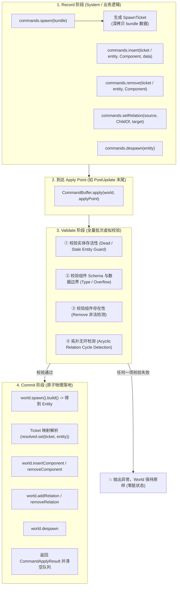
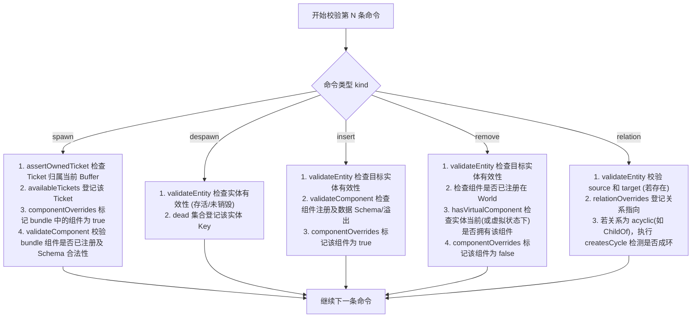

# AetherEngine ECS 命令缓冲系统（Command Buffer System）

`src/ecs/command` 提供了 AetherEngine 的 **ECS 延迟命令缓冲与批量原子提交机制（Command Buffer）**。

在高性能数据导向（DOD）的 ECS 架构中，World 的核心数据结构（如 Table 行内存、Archetype 构型、关系索引图）要求高度的内存连续性与结构稳定性。该模块作为**事务记录仪与延迟执行器**，解决了迭代过程中的结构破坏风险，并提供了具备全量预检（Validation）能力的确定性批量提交基础设施。

---

## 目录

1. [系统定位与核心解决痛点](#一系统定位与核心解决痛点)
   - [1.1 迭代安全与防重入破坏（Iteration Safety）](#11-迭代安全与防重入破坏iteration-safety)
   - [1.2 跨系统执行确定性（Determinism & Scheduling）](#12-跨系统执行确定性determinism--scheduling)
   - [1.3 全批次原子校验与零脏状态（All-or-Nothing Validation）](#13-全批次原子校验与零脏状态all-or-nothing-validation)
   - [1.4 虚拟实体占位句柄（SpawnTicket）](#14-虚拟实体占位句柄spawnticket)
   - [1.5 核心设计初衷剖析：为什么需要 Command？为什么还要 Validate？](#15-核心设计初衷剖析为什么需要-command为什么还要-validate)
2. [生命周期模型与流水线架构](#二生命周期模型与流水线架构)
   - [2.1 开发者心智模型与执行流水线](#21-开发者心智模型与执行流水线)
   - [2.2 Record $\to$ Validate $\to$ Commit 三阶段流程](#22-record--validate--commit-三阶段流程)
   - [2.3 架构流程图](#23-架构流程图)
3. [批量预检流程与虚拟状态仿真机制（Deep Dive: Validate Process）](#三批量预检流程与虚拟状态仿真机制deep-dive-validate-process)
   - [3.1 四大虚拟追踪沙盒（Virtual Sandboxes）](#31-四大虚拟追踪沙盒virtual-sandboxes)
   - [3.2 分命令类型的校验判定流](#32-分命令类型的校验判定流)
   - [3.3 虚拟组件推演（VirtualComponent & hasVirtualComponent）](#33-虚拟组件推演virtualcomponent--hasvirtualcomponent)
   - [3.4 四大底层校验守卫子程序（Helper Invariants）](#34-四大底层校验守卫子程序helper-invariants)
   - [3.5 综合推演与拦截示例](#35-综合推演与拦截示例)
   - [3.6 预检四大安全防线与典型拦截清单对照表](#36-预检四大安全防线与典型拦截清单对照表)
4. [其他核心机制详解](#四其他核心机制详解)
   - [4.1 虚拟占位句柄与引用解析（SpawnTicket & Resolution）](#41-虚拟占位句柄与引用解析spawnticket--resolution)
   - [4.2 信任边界与防御性深拷贝（Trust Boundary Defense）](#42-信任边界与防御性深拷贝trust-boundary-defense)
   - [4.3 多缓冲区分支合并与重映射（CommandBuffer.append）](#43-多缓冲区分支合并与重映射commandbufferappend)
   - [4.4 确定性应用检查点（Apply Points & Scheduling）](#44-确定性应用检查点apply-points--scheduling)
5. [目录结构与核心 API 速查](#五目录结构与核心-api-速查)
   - [5.1 文件职责](#51-文件职责)
   - [5.2 核心方法列表](#52-核心方法列表)
6. [典型使用场景与代码示例](#六典型使用场景与代码示例)
   - [6.1 场景 1：在 Query 循环中安全生成与销毁实体](#61-场景-1在-query-循环中安全生成与销毁实体)
   - [6.2 场景 2：基于 SpawnTicket 组装复杂层级与组件](#62-场景-2基于-spawnticket-组装复杂层级与组件)
   - [6.3 场景 3：自定义 Apply Point 与调度器事务集成](#63-场景-3自定义-apply-point-与调度器事务集成)

---

## 一、系统定位与核心解决痛点

### 1.1 迭代安全与防重入破坏（Iteration Safety）

当系统遍历查询（例如 `for (const [entity, pos] of world.query([Position]))`）时，底层直接访问紧凑连续的 Table 内存和行索引。若在循环体内直接调用 `world.despawn()`、`world.insertComponent()` 或 `world.spawn()`：

- 会触发实体的 Archetype 迁移或 Swap-Remove 尾部覆盖删除；
- 导致正在迭代的行索引失效、游标跳变或内存污染。

`World` 在 Query 活跃时内置了运行时守卫（Guard），会主动拦截直接结构修改。通过 `CommandBuffer`，系统只需将结构变更意图作为“命令”推入队列，在安全时间点批量应用。

### 1.2 跨系统执行确定性（Determinism & Scheduling）

避免多个独立系统随时随地穿插修改 `World` 产生不可预测的竞态与执行顺序差异。所有命令严格按照**系统调度执行顺序（System Execution Order）**与**系统内记录顺序（Record Order）**保存在 Buffer 中，在明确的生命周期检查点（Apply Point）确定性回放。

### 1.3 全批次原子校验与零脏状态（All-or-Nothing Validation）

当批量生成预制体（Prefab）、场景树或复杂复合实体时，如果在中间某一步失败（如传入非法组件数据导致 f32 溢出、试图绑定造成循环父子关系的 `ChildOf`、或是操作了已销毁的陈旧实体），若直接修改 World 会导致 World 处于“半创建、半修改”的脏状态。

`CommandBuffer` 在真正向 `World` 写入任何数据前，会先在内存中构建**虚拟状态视图（Virtual State）**对整个批次进行全量静态校验：

- **校验失败**：抛出异常，`World` 保持 100% 纯净，绝不残留半个实体；
- **校验成功**：进入 Commit 阶段，原子执行所有物理操作。

### 1.4 虚拟实体占位句柄（SpawnTicket）

当你在逻辑中调用 `commands.spawn()` 录制生成命令时，底层的真实 `Entity ID`（64-bit Handle）尚未生成。但后续逻辑往往需要立即为这个新实体挂载组件或建立父子关系。

`CommandBuffer` 引入了 **`SpawnTicket`** 作为强类型占位凭证，允许后续命令无缝引用该 Ticket，最终在 `apply` 提交时自动解析映射为真实生成的 `Entity`。

### 1.5 核心设计初衷剖析：为什么需要 Command？为什么还要 Validate？

很多开发者会产生疑问：_“设计 CommandBuffer 的目的是为了做校验吗？”_

```text
┌────────────────────────────────────────────────────────────────────────┐
│                        两个不同维度的核心设计目的                      │
├──────────────────────────────────┬─────────────────────────────────────┤
│ 1. 为什么要有 CommandBuffer？    │ 🎯 第一目的:【时序解耦与内存安全】   │
│    (所有现代 ECS 都有的基础能力) │ 防止 Query 遍历物理内存时发生游标错乱│
├──────────────────────────────────┼─────────────────────────────────────┤
│ 2. 为什么还要引入 Validate 预检？│ 🛡️ 进阶目的:【消除半成品脏状态断裂】 │
│    (AetherEngine 事务级进化)     │ 杜绝传统“盲目回放”引发的局部失败残损│
└──────────────────────────────────┴─────────────────────────────────────┘
```

#### ① 第一目的：时序解耦与内存迭代安全（Temporal Decoupling & Iteration Safety）

- 实体的 Packed 组件数据在底层内存（Table ArrayBuffer）中是紧凑连续存放的，`world.query()` 本质是一个高速跑过内存的游标；
- 逻辑必然需要在遍历怪物时“生成子弹”、“击杀怪物”、“挂载 Buff”，直接在循环中动内存会打乱游标造成死锁或跳跃；
- 因此必须使用 `CommandBuffer` 先行排队，等安全退出迭代后再提交。

#### ② 进阶目的：从“盲目回放”到“事务级原子预检（All-or-Nothing）”

- **传统 ECS 的“盲目回放”缺陷**：
  很多传统 ECS 对排队的命令直接按顺序逐条执行。如果录制了一个包含 10 个子部件的复合 Prefab，执行到第 8 个时因数值溢出报错，前面 7 个实体已经真实写入了 World —— **在 World 中留下了缺胳膊少腿的“半成品脏实体”**，导致后续系统报空指针或内存泄漏。
- **AetherEngine 的“原子预检”**：
  在真正动物理内存前，先在内存沙盒中预演整批命令。一旦发现任何潜在错误，**立即整批回滚，World 保持 100% 纯净，零垃圾残留**！

---

## 二、生命周期模型与流水线架构

### 2.1 开发者心智模型与执行流水线

```text
开发者代码 ──► 1. 动数值 / 纯读取 ──────► 【即时直接调用】直接读写 World 内存
           │
           └──► 2. 动结构 (增删实体/组件) ──► 【加入 Command 队列】先排队，拿 SpawnTicket
                                                         │
                                               到达 Apply Point 检查点
                                                         │
                                                         ▼
                                             【全批次静态仿真预检 (Validate)】
                                                         │ (通过后)
                                                         ▼
                                             【最终物理落地】依旧是逐条调用底层 World API！
```

### 2.2 Record $\to$ Validate $\to$ Commit 三阶段流程

```text
[ 1. Record 阶段 ] ──► [ 2. Validate 阶段 ] ──► [ 3. Commit 阶段 ]
 录制操作意图           构建虚拟状态预检            批量原子提交并清空
 生成 SpawnTicket      全批次规则/环/Schema校验     映射 Ticket -> 真实 Entity
```

### 2.3 架构流程图



---

## 三、批量预检流程与虚拟状态仿真机制（Deep Dive: Validate Process）

`validate` 过程（位于 [`src/ecs/command/command-validator.ts`](command-validator.ts)）是整个系统的安全基石。它在提交前对整批命令进行沙盒仿真预演。

### 3.1 四大虚拟追踪沙盒（Virtual Sandboxes）

在开始校验命令流之前，校验器在内存中开辟 4 个轻量状态集合：

```typescript
const availableTickets = new Set<SpawnTicket>(); // ① 追踪已声明可用的 Ticket
const dead = new Set<string>(); // ② 追踪批次内已被销毁的实体
const relationOverrides = new Map<symbol, Map<string, Target | null>>(); // ③ 追踪关系拓扑虚拟指向
const componentOverrides = new Map<string, Map<string, boolean>>(); // ④ 追踪组件存在性虚拟状态
```

| 沙盒变量                 | 作用                                                               | 拦截的典型错误                                                          |
| :----------------------- | :----------------------------------------------------------------- | :---------------------------------------------------------------------- |
| **`availableTickets`**   | 记录本批次中已执行 `spawn()` 的 Ticket 集合                        | 拦截在 `spawn` 之前就提前引用某个未出生 Ticket 的错误（未声明先引用）   |
| **`dead`**               | 记录被标记为 `despawn` 的实体 Key（含 `ticket:0` 或 `entity:123`） | 拦截在实体被销毁后，后续命令继续对其 `insert/remove/setRelation` 的错误 |
| **`componentOverrides`** | 记录实体上各个组件的最新虚拟存在状态（`true` 挂载 / `false` 卸载） | 拦截重复 `remove` 或删除未挂载组件的错误                                |
| **`relationOverrides`**  | 记录实体间关系的虚拟指向（`Target` 实体或 `null` 解绑）            | 拦截在同批次操作中形成父子循环层级（如 $A \to B \to A$）的错误          |

---

### 3.2 分命令类型的校验判定流



---

### 3.3 虚拟组件推演（VirtualComponent & hasVirtualComponent）

在预检阶段，命令尚未落地到 `World`。`hasVirtualComponent` 通过**双层叠加视图（Overlay View）**准确判断组件存在性：

```
                    ┌──────────────────────────────┐
                    │ hasVirtualComponent(target)  │
                    └──────────────┬───────────────┘
                                   │
                                   ▼
        ┌─────────────────────────────────────────────────────┐
        │ 1. 优先查虚拟重写表 (componentOverrides / 模拟执行层) │
        │    (本次批次中前面的 spawn/insert/remove 是否动过该组件?) │
        └──────────────┬──────────────────────┬───────────────┘
                       │                      │
                  已记录(true/false)        未记录(undefined)
                       │                      │
                       ▼                      ▼
                 直接返回该虚拟值     ┌─────────────────────────────┐
                                    │ 2. 降级查 World 真实底座     │
                                    └──────────────┬──────────────┘
                                                   │
                                     ┌─────────────┴─────────────┐
                                     ▼                           ▼
                             若是 SpawnTicket               若是真实 Entity
                             (之前没加过, 为 false)          world.hasComponent(target)
```

```typescript
function hasVirtualComponent(overrides, world, target, component) {
  const value = overrides.get(entityKey(target))?.get(component.id);
  if (value !== undefined) {
    return value; // 优先使用本批次的虚拟变动
  }
  // 未操作过：若是未出生的 Ticket 则为 false，若是真实实体则查 World
  return target instanceof SpawnTicket ? false : world.hasComponent(target, component);
}
```

---

### 3.4 四大底层校验守卫子程序（Helper Invariants）

#### ① 实体有效性守卫：`validateEntity(target, ...)`

- **Ticket 校验**：检查所有权 `target.owner === owner`，并检查 `availableTickets.has(target)`（防止在 spawn 之前提前使用）；
- **真实 Entity 校验**：调用 `world.isAlive(target)` 拦截已销毁的陈旧句柄（Stale Entity）；
- **死亡名单检测**：检查 `dead.has(entityKey(target))`，拦截同一批次内“先 despawn 后对其增删组件”的矛盾操作。

#### ② 组件与 Schema 边界守卫：`validateComponent(world, component, data)`

- 检查 `world.isComponentRegistered(component)`；
- 检查传入的 `data` 是否符合字段类型规范（例如 JavaScript 的大数 `1e300` 存入 `f32` 字段会被立即拦截）。

#### ③ 拓扑环深度追溯算法：`createsCycle(...)`

```typescript
function createsCycle(world, relation, source, target, overrides) {
  const sourceKey = entityKey(source);
  const visited = new Set<string>();
  let current = target;

  while (current !== null) {
    const key = entityKey(current);
    if (key === sourceKey) return true; // 追溯回了源实体，构成死循环！
    if (visited.has(key)) return true; // 发现路径闭环
    visited.add(key);

    // 优先沿虚拟重写表向上溯源，其次沿 World 现有层级向上溯源
    if (overrides.has(key)) {
      current = overrides.get(key) ?? null;
    } else if (current instanceof SpawnTicket) {
      current = null; // 新创建但未设更高父级的 Ticket，链路终止
    } else {
      current = world.getRelation(current, relation)?.target ?? null;
    }
  }
  return false;
}
```

---

### 3.5 综合推演与拦截示例

```typescript
const commands = new CommandBuffer();

// 1. spawn 返回 ticket:0，带 Position
const ticket = commands.spawn([{ component: Position, data: { x: 1 } }]);
// 2. 移除 ticket:0 的 Position
commands.remove(ticket, Position);
// 3. 再次移除 ticket:0 的 Position (错误操作)
commands.remove(ticket, Position);
```

**推演执行过程：**

1. 校验第 1 句 `spawn`：
   - `availableTickets.add(ticket:0)`；
   - `componentOverrides.set('ticket:0', 'Position', true)`；
   - Schema 校验通过。
2. 校验第 2 句 `remove`：
   - `validateEntity(ticket:0)`：检查 `availableTickets` 发现已存在，合法；
   - `hasVirtualComponent(ticket:0, Position)`：查 `componentOverrides` 返回 `true`，存在该组件，合法；
   - `componentOverrides.set('ticket:0', 'Position', false)`（将虚拟状态置为 `false`）。
3. 校验第 3 句 `remove`：
   - `validateEntity(ticket:0)`：合法；
   - `hasVirtualComponent(ticket:0, Position)`：查 `componentOverrides` 返回 **`false`**；
   - **💥 立即抛错**：`Entity "ticket:0" does not have component "Position" to remove.`
   - **结果**：整个 `apply` 终止，World 状态保持绝对纯净，未发生任何写入。

---

### 3.6 预检四大安全防线与典型拦截清单对照表

| 校验防线                         | 具体校验内容                                                                                                                                              | 拦截的典型致命 Bug                                                  |
| :------------------------------- | :-------------------------------------------------------------------------------------------------------------------------------------------------------- | :------------------------------------------------------------------ |
| **1. 实体生命周期有效性**        | - 检查 Ticket 是否未声明就提前使用；<br>- 检查实体是否在同批次前面被 `despawn` 了；<br>- 检查传入的已有 `Entity` 是否为已过期的陈旧句柄（Stale Entity）。 | 拦截“向已被销毁的怪物身上挂载 Buff”或“向空气发子弹”。               |
| **2. 组件 Schema 与数据边界**    | - 检查组件是否已注册到当前 World；<br>- 检查传入的数据字段类型是否合法；<br>- **数值边界溢出检查**（例如 JS 传入大数 `1e300` 存入定长 `f32` 内存）。      | 拦截由于数据溢出导致的二进制内存污染（Memory Corruption）。         |
| **3. 状态自洽性（虚拟推演）**    | - 检查 `removeComponent` 时，该实体是否真实拥有（或在虚拟推演中挂载了）该组件；<br>- 检查是否在同批次中重复删除了同一个组件。                             | 拦截重复卸载组件导致的 Archetype 迁移指针混乱。                     |
| **4. 层级拓扑无环性（Acyclic）** | - 针对 `ChildOf` 等层级关系，沿着虚拟推演图与现有 World 深度向上溯源。                                                                                    | 拦截 $A \to B \to C \to A$ 的父子死循环依赖（防止场景树死锁崩溃）。 |

---

## 四、其他核心机制详解

### 4.1 虚拟占位句柄与引用解析（SpawnTicket & Resolution）

```typescript
export class SpawnTicket {
  constructor(
    public readonly owner: symbol,
    public readonly index: number
  ) {}
}
```

- **所有权隔离（Owner Identity）**：每个 `CommandBuffer` 拥有独立的私有 `owner = Symbol('CommandBuffer')`。`SpawnTicket` 带有该所有权标记，防止将 Buffer A 中的 Ticket 误传给 Buffer B。
- **引用身份（Reference Identity）**：作为对象实例存在，可直接作为 `Map<SpawnTicket, Entity>` 的键，避免了数字 ID 混淆。
- **结果解析（`result.resolve(ticket)`）**：`apply()` 执行完毕后返回 `CommandApplyResult`，通过 `result.resolve(ticket)` 可以即时检索到该 Ticket 所对应的真实 `Entity`。

### 4.2 信任边界与防御性深拷贝（Trust Boundary Defense）

根据引擎架构准则，外部传入的数据在进入存储系统前必须进行所有权切断：

- `commands.spawn(bundle)` 与 `commands.insert(..., data)` 会对传入的组件数据调用 `cloneUnknown(data)` 执行深拷贝；
- 即使调用方在录制命令后立刻修改原始 `data` 对象，也不会污染已排队的待提交数据。

### 4.3 多缓冲区分支合并与重映射（CommandBuffer.append）

在多 Worker 并行作业或嵌套子调度场景下，每个子任务可以拥有独立的 `CommandBuffer`。

主线程通过调用 `mainBuffer.append(subBuffer)` 进行合并：

- `append` 内部会遍历源 Buffer 的命令；
- 自动为源 Buffer 中的所有 `SpawnTicket` 在主 Buffer 中重新生成映射（Remap Tickets）；
- 保持子批次命令内部的引用关系绝对一致，合并后自动清空源 Buffer。

### 4.4 确定性应用检查点（Apply Points & Scheduling）

默认内置的 Apply Points 分布在：

- `Startup` stage 执行结束时；
- `FixedPostUpdate` 末尾；
- `PostUpdate` 末尾（常规主逻辑命令提交）；
- `FrameCleanup` 之前。

插件与业务也可以在 Schedule 构建期注册命名 Apply Point（如 `builder.addCommandApplyPoint('Update', { id: 'editor-transaction', after: ['my-system'] })`）。

---

## 五、目录结构与核心 API 速查

### 5.1 文件职责

```text
src/ecs/command/
├── command-buffer.ts     # CommandBuffer 核心类与 CommandBufferResource 令牌
├── command-validator.ts  # 全批次静态预检算法与虚拟沙盒仿真
├── spawn-ticket.ts       # 延迟命令批次中的虚拟实体占位凭证 (SpawnTicket)
├── utils.ts              # 防御性深拷贝、Ticket 句柄重映射与 ApplyResult 构造
├── index.ts              # 统一模块公共导出
└── README.md             # 详细架构与技术设计文档
```

### 5.2 核心方法列表

| 方法 / 属性                      | 参数                                    | 返回值                         | 核心职责与设计说明                                                 |
| :------------------------------- | :-------------------------------------- | :----------------------------- | :----------------------------------------------------------------- |
| `spawn(bundle?)`                 | `bundle?: ComponentBundle`              | `SpawnTicket`                  | 录制实体生成命令，深拷贝 bundle 数据，返回虚拟凭据 `SpawnTicket`。 |
| `despawn(entity)`                | `entity: CommandEntity`                 | `this`                         | 录制销毁实体命令（支持已有 `Entity` 或未决 `SpawnTicket`）。       |
| `insert(entity, comp, data?)`    | `entity, ComponentType, ComponentInput` | `this`                         | 录制挂载组件命令，深拷贝 `data`，支持链式调用。                    |
| `remove(entity, comp)`           | `entity, ComponentType`                 | `this`                         | 录制移除组件命令（会在校验阶段检查该组件是否存在）。               |
| `setRelation(src, rel, target?)` | `source, RelationType, target?`         | `this`                         | 设置或清除（当 target 为空时）实体间的有向关系。                   |
| `append(source)`                 | `source: CommandBuffer`                 | `void`                         | 合并另一个 CommandBuffer 的所有命令并重新映射 Ticket。             |
| `apply(world, applyPoint?)`      | `world: World, applyPoint?: string`     | `CommandApplyResult`           | 预检并原子提交全部命令，清空队列，返回结果解析器。                 |
| `clear()`                        | 无                                      | `void`                         | 清空所有排队的待执行命令。                                         |
| `resolve(ticket)`                | `ticket: SpawnTicket`                   | `Entity`                       | 查询最近一次 `apply` 批次中某个 Ticket 对应的真实 `Entity`。       |
| `length`                         | 无 (getter)                             | `number`                       | 当前排队的命令总数。                                               |
| `CommandBufferResource`          | 资源令牌常量                            | `ResourceToken<CommandBuffer>` | 注册在 World 资源池中的全局单例 CommandBuffer 令牌。               |

---

## 六、典型使用场景与代码示例

### 6.1 场景 1：在 Query 循环中安全生成与销毁实体

```typescript
import { definePlugin, CommandBufferResource } from 'aether-engine';

export const WeaponSystemPlugin = definePlugin({
  id: 'game.weapon-system',
  build(builder) {
    builder.addSystem('Update', {
      id: 'fire-weapons',
      run(world) {
        // 从 World 资源中获取当前帧的全局 CommandBuffer
        const commands = world.getResource(CommandBufferResource)!;

        // 遍历所有具备射击意图的武器实体
        for (const [entity, weapon, transform] of world.query([Weapon, Transform])) {
          if (weapon.wantsFire && weapon.ammo > 0) {
            // 1. 安全生成子弹（延迟执行，不破坏当前迭代）
            commands.spawn([
              { component: Transform, data: { x: transform.x, y: transform.y, z: transform.z } },
              { component: Velocity, data: { vx: weapon.muzzleVelocity, vy: 0, vz: 0 } },
              { component: BulletTag }
            ]);

            // 2. 消耗弹药完毕后销毁武器实体
            if (weapon.ammo === 1) {
              commands.despawn(entity);
            }
          }
        }
      }
    });
  }
});
```

### 6.2 场景 2：基于 SpawnTicket 组装复杂层级与组件

```typescript
const commands = new CommandBuffer();

// 1. 录制父实体
const parentTicket = commands.spawn([{ component: Transform, data: { x: 0, y: 0, z: 0 } }]);

// 2. 录制子实体，并直接建立 ChildOf 关系指向尚未生成的 parentTicket
const childTicket = commands.spawn([{ component: Transform, data: { x: 10, y: 0, z: 0 } }]);
commands.setRelation(childTicket, ChildOf, parentTicket);

// 3. 提交到 World
const result = commands.apply(world, 'spawn-hierarchy');

// 4. 解析得到真实的 Entity 句柄
const parentEntity = result.resolve(parentTicket);
const childEntity = result.resolve(childTicket);

console.log(world.getParent(childEntity) === parentEntity); // true
```

### 6.3 场景 3：自定义 Apply Point 与调度器事务集成

```typescript
import { App, HeadlessRunner, definePlugin, CommandBufferResource } from 'aether-engine';

const app = new App().addPlugin(
  definePlugin({
    id: 'custom-transaction-plugin',
    build(builder) {
      // 注册业务系统：向 buffer 写入大量修改
      builder.addSystem('Update', {
        id: 'stage-world-mutations',
        run(world) {
          const commands = world.getResource(CommandBufferResource)!;
          commands.spawn([{ component: Transform, data: { x: 100 } }]);
        }
      });

      // 在 Update 阶段内声明一个具名的 Apply Point，立即提交前面系统产生的修改
      builder.addCommandApplyPoint('Update', {
        id: 'mid-update-commit',
        after: ['stage-world-mutations']
      });

      // 后续系统在同一帧的 PostUpdate 中即可立即观测到新实体
      builder.addSystem('PostUpdate', {
        id: 'observe-new-entities',
        run(world) {
          const entities = [...world.query([Transform])];
          console.log(`已观察到 ${entities.length} 个实体`);
        }
      });
    }
  })
);
```
