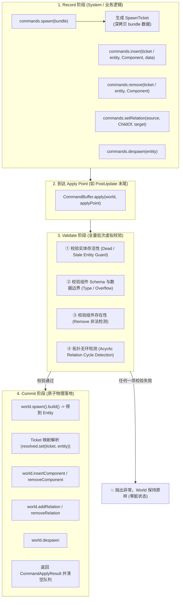

# AetherEngine ECS 命令缓冲系统（Command Buffer System）

`src/ecs/command` 提供了 AetherEngine 的 **ECS 延迟命令缓冲与批量原子提交机制（Command Buffer）**。

在高性能数据导向（DOD）的 ECS 架构中，World 的核心数据结构（如 Table 行内存、Archetype 构型、关系索引图）要求高度的内存连续性与结构稳定性。该模块作为**事务记录仪与延迟执行器**，解决了迭代过程中的结构破坏风险，并提供了具备全量预检（Validation）能力的确定性批量提交基础设施。

---

## 目录

1. [系统定位与核心解决痛点](#一系统定位与核心解决痛点)
   - [1.1 迭代安全与防重入破坏（Iteration Safety）](#11-迭代安全与防重入破坏iteration-safety)
   - [1.2 跨系统执行确定性（Determinism & Scheduling）](#12-跨系统执行确定性determinism--scheduling)
   - [1.3 全批次原子校验与零脏状态（All-or-Nothing Validation）](#13-全批次原子校验与零脏状态all-or-nothing-validation)
   - [1.4 虚拟实体占位句柄（SpawnTicket）](#14-虚拟实体占位句柄spawnticket)
2. [生命周期模型与流水线架构](#二生命周期模型与流水线架构)
   - [2.1 Record $\to$ Validate $\to$ Commit 三阶段流程](#21-record--validate--commit-三阶段流程)
   - [2.2 架构流程图](#22-架构流程图)
3. [核心机制详解](#三核心机制详解)
   - [3.1 虚拟占位句柄与引用解析（SpawnTicket & Resolution）](#31-虚拟占位句柄与引用解析spawnticket--resolution)
   - [3.2 虚拟状态仿真预检（Batch Virtual Validation）](#32-虚拟状态仿真预检batch-virtual-validation)
   - [3.3 信任边界与防御性深拷贝（Trust Boundary Defense）](#33-信任边界与防御性深拷贝trust-boundary-defense)
   - [3.4 多缓冲区分支合并与重映射（CommandBuffer.append）](#34-多缓冲区分支合并与重映射commandbufferappend)
   - [3.5 确定性应用检查点（Apply Points & Scheduling）](#35-确定性应用检查点apply-points--scheduling)
4. [目录结构与核心 API 速查](#四目录结构与核心-api-速查)
   - [4.1 文件职责](#41-文件职责)
   - [4.2 核心方法列表](#42-核心方法列表)
5. [典型使用场景与代码示例](#五典型使用场景与代码示例)
   - [5.1 场景 1：在 Query 循环中安全生成与销毁实体](#51-场景-1在-query-循环中安全生成与销毁实体)
   - [5.2 场景 2：基于 SpawnTicket 组装复杂层级与组件](#52-场景-2基于-spawnticket-组装复杂层级与组件)
   - [5.3 场景 3：自定义 Apply Point 与调度器事务集成](#53-场景-3自定义-apply-point-与调度器事务集成)

---

## 一、系统定位与核心解决痛点

### 1.1 迭代安全与防重入破坏（Iteration Safety）

当系统遍历查询（例如 `for (const [entity, pos] of world.query([Position]))`）时，底层直接访问紧凑连续的 Table 内存和行索引。若在循环体内直接调用 `world.despawn()`、`world.insertComponent()` 或 `world.spawn()`：

- 会触发实体的 Archetype 迁移或 Swap-Remove 尾部覆盖删除；
- 导致正在迭代的行索引失效、游标跳变或内存污染。

`World` 在 Query 活跃时内置了运行时守卫（Guard），会主动拦截直接结构修改。通过 `CommandBuffer`，系统只需将结构变更意图作为“命令”推入队列，在安全时间点批量应用。

### 1.2 跨系统执行确定性（Determinism & Scheduling）

避免多个独立系统随时随地穿插修改 `World` 产生不可预测的竞态与执行顺序差异。所有命令严格按照**系统调度执行顺序（System Execution Order）**与**系统内记录顺序（Record Order）**保存在 Buffer 中，在明确的生命周期检查点（Apply Point）确定性回放。

### 1.3 全批次原子校验与零脏状态（All-or-Nothing Validation）

当批量生成预制体（Prefab）、场景树或复杂复合实体时，如果在中间某一步失败（如传入非法组件数据导致 f32 溢出、试图绑定造成循环父子关系的 `ChildOf`、或是操作了已销毁的陈旧实体），若直接修改 World 会导致 World 处于“半创建、半修改”的脏状态。

`CommandBuffer` 在真正向 `World` 写入任何数据前，会先在内存中构建**虚拟状态视图（Virtual State）**对整个批次进行全量静态校验：

- **校验失败**：抛出异常，`World` 保持 100% 纯净，绝不残留半个实体；
- **校验成功**：进入 Commit 阶段，原子执行所有物理操作。

### 1.4 虚拟实体占位句柄（SpawnTicket）

当你在逻辑中调用 `commands.spawn()` 录制生成命令时，底层的真实 `Entity ID`（64-bit Handle）尚未生成。但后续逻辑往往需要立即为这个新实体挂载组件或建立父子关系。

`CommandBuffer` 引入了 **`SpawnTicket`** 作为强类型占位凭证，允许后续命令无缝引用该 Ticket，最终在 `apply` 提交时自动解析映射为真实生成的 `Entity`。

---

## 二、生命周期模型与流水线架构

### 2.1 Record $\to$ Validate $\to$ Commit 三阶段流程

```text
[ 1. Record 阶段 ] ──► [ 2. Validate 阶段 ] ──► [ 3. Commit 阶段 ]
 录制操作意图           构建虚拟状态预检            批量原子提交并清空
 生成 SpawnTicket      全批次规则/环/Schema校验     映射 Ticket -> 真实 Entity
```

### 2.2 架构流程图



---

## 三、核心机制详解

### 3.1 虚拟占位句柄与引用解析（SpawnTicket & Resolution）

```typescript
export class SpawnTicket {
  constructor(
    public readonly owner: symbol,
    public readonly index: number
  ) {}
}
```

- **所有权隔离（Owner Identity）**：每个 `CommandBuffer` 拥有独立的私有 `owner = Symbol('CommandBuffer')`。`SpawnTicket` 带有该所有权标记，防止将 Buffer A 中的 Ticket 误传给 Buffer B。
- **引用身份（Reference Identity）**：作为对象实例存在，可直接作为 `Map<SpawnTicket, Entity>` 的键，避免了数字 ID 混淆。
- **结果解析（`result.resolve(ticket)`）**：`apply()` 执行完毕后返回 `CommandApplyResult`，通过 `result.resolve(ticket)` 可以即时检索到该 Ticket 所对应的真实 `Entity`。

### 3.2 虚拟状态仿真预检（Batch Virtual Validation）

在执行 `this.validate(world)` 时，`CommandBuffer` 会在本地建立 4 个虚拟追踪集合：

1. `availableTickets: Set<SpawnTicket>`：追踪当前已被 spawn 的 ticket，防止“先引用未创建的 ticket”；
2. `dead: Set<string>`：追踪已被 despawn 的实体，防止对已死亡实体进行后续操作；
3. `componentOverrides: Map<string, Map<string, boolean>>`：模拟实体上各组件的存在性状态（Present / Removed），确保连续的 `insert` 与 `remove` 逻辑自洽；
4. `relationOverrides: Map<symbol, Map<string, VirtualTarget | null>>`：模拟关系拓扑图，并结合 World 现有拓扑调用 `createsCycle` 进行**深层拓扑环检测**。

### 3.3 信任边界与防御性深拷贝（Trust Boundary Defense）

根据引擎架构准则，外部传入的数据在进入存储系统前必须进行所有权切断：

- `commands.spawn(bundle)` 与 `commands.insert(..., data)` 会对传入的组件数据调用 `cloneUnknown(data)` 执行深拷贝；
- 即使调用方在录制命令后立刻修改原始 `data` 对象，也不会污染已排队的待提交数据。

### 3.4 多缓冲区分支合并与重映射（CommandBuffer.append）

在多 Worker 并行作业或嵌套子调度场景下，每个子任务可以拥有独立的 `CommandBuffer`。

主线程通过调用 `mainBuffer.append(subBuffer)` 进行合并：

- `append` 内部会遍历源 Buffer 的命令；
- 自动为源 Buffer 中的所有 `SpawnTicket` 在主 Buffer 中重新生成映射（Remap Tickets）；
- 保持子批次命令内部的引用关系绝对一致，合并后自动清空源 Buffer。

### 3.5 确定性应用检查点（Apply Points & Scheduling）

默认内置的 Apply Points 分布在：

- `Startup` stage 执行结束时；
- `FixedPostUpdate` 末尾；
- `PostUpdate` 末尾（常规主逻辑命令提交）；
- `FrameCleanup` 之前。

插件与业务也可以在 Schedule 构建期注册命名 Apply Point（如 `builder.addCommandApplyPoint('Update', { id: 'editor-transaction', after: ['my-system'] })`）。

---

## 四、目录结构与核心 API 速查

### 4.1 文件职责

```text
src/ecs/command/
├── command-buffer.ts  # CommandBuffer 核心实现与 CommandBufferResource 令牌
├── index.ts           # 统一模块公共导出
```

### 4.2 核心方法列表

| 方法 / 属性                      | 参数                                    | 返回值                         | 核心职责与设计说明                                                 |
| :------------------------------- | :-------------------------------------- | :----------------------------- | :----------------------------------------------------------------- |
| `spawn(bundle?)`                 | `bundle?: ComponentBundle`              | `SpawnTicket`                  | 录制实体生成命令，深拷贝 bundle 数据，返回虚拟凭据 `SpawnTicket`。 |
| `despawn(entity)`                | `entity: CommandEntity`                 | `this`                         | 录制销毁实体命令（支持已有 `Entity` 或未决 `SpawnTicket`）。       |
| `insert(entity, comp, data?)`    | `entity, ComponentType, ComponentInput` | `this`                         | 录制挂载组件命令，深拷贝 `data`，支持链式调用。                    |
| `remove(entity, comp)`           | `entity, ComponentType`                 | `this`                         | 录制移除组件命令（会在校验阶段检查该组件是否存在）。               |
| `setRelation(src, rel, target?)` | `source, RelationType, target?`         | `this`                         | 设置或清除（当 target 为空时）实体间的有向关系。                   |
| `append(source)`                 | `source: CommandBuffer`                 | `void`                         | 合并另一个 CommandBuffer 的所有命令并重新映射 Ticket。             |
| `apply(world, applyPoint?)`      | `world: World, applyPoint?: string`     | `CommandApplyResult`           | 预检并原子提交全部命令，清空队列，返回结果解析器。                 |
| `clear()`                        | 无                                      | `void`                         | 清空所有排队的待执行命令。                                         |
| `resolve(ticket)`                | `ticket: SpawnTicket`                   | `Entity`                       | 查询最近一次 `apply` 批次中某个 Ticket 对应的真实 `Entity`。       |
| `length`                         | 无 (getter)                             | `number`                       | 当前排队的命令总数。                                               |
| `CommandBufferResource`          | 资源令牌常量                            | `ResourceToken<CommandBuffer>` | 注册在 World 资源池中的全局单例 CommandBuffer 令牌。               |

---

## 五、典型使用场景与代码示例

### 5.1 场景 1：在 Query 循环中安全生成与销毁实体

```typescript
import { definePlugin, CommandBufferResource } from 'aether-engine';

export const WeaponSystemPlugin = definePlugin({
  id: 'game.weapon-system',
  build(builder) {
    builder.addSystem('Update', {
      id: 'fire-weapons',
      run(world) {
        // 从 World 资源中获取当前帧的全局 CommandBuffer
        const commands = world.getResource(CommandBufferResource)!;

        // 遍历所有具备射击意图的武器实体
        for (const [entity, weapon, transform] of world.query([Weapon, Transform])) {
          if (weapon.wantsFire && weapon.ammo > 0) {
            // 1. 安全生成子弹（延迟执行，不破坏当前迭代）
            commands.spawn([
              { component: Transform, data: { x: transform.x, y: transform.y, z: transform.z } },
              { component: Velocity, data: { vx: weapon.muzzleVelocity, vy: 0, vz: 0 } },
              { component: BulletTag }
            ]);

            // 2. 消耗弹药完毕后销毁武器实体
            if (weapon.ammo === 1) {
              commands.despawn(entity);
            }
          }
        }
      }
    });
  }
});
```

### 5.2 场景 2：基于 SpawnTicket 组装复杂层级与组件

```typescript
const commands = new CommandBuffer();

// 1. 录制父实体
const parentTicket = commands.spawn([{ component: Transform, data: { x: 0, y: 0, z: 0 } }]);

// 2. 录制子实体，并直接建立 ChildOf 关系指向尚未生成的 parentTicket
const childTicket = commands.spawn([{ component: Transform, data: { x: 10, y: 0, z: 0 } }]);
commands.setRelation(childTicket, ChildOf, parentTicket);

// 3. 提交到 World
const result = commands.apply(world, 'spawn-hierarchy');

// 4. 解析得到真实的 Entity 句柄
const parentEntity = result.resolve(parentTicket);
const childEntity = result.resolve(childTicket);

console.log(world.getParent(childEntity) === parentEntity); // true
```

### 5.3 场景 3：自定义 Apply Point 与调度器事务集成

```typescript
import { App, HeadlessRunner, definePlugin, CommandBufferResource } from 'aether-engine';

const app = new App().addPlugin(
  definePlugin({
    id: 'custom-transaction-plugin',
    build(builder) {
      // 注册业务系统：向 buffer 写入大量修改
      builder.addSystem('Update', {
        id: 'stage-world-mutations',
        run(world) {
          const commands = world.getResource(CommandBufferResource)!;
          commands.spawn([{ component: Transform, data: { x: 100 } }]);
        }
      });

      // 在 Update 阶段内声明一个具名的 Apply Point，立即提交前面系统产生的修改
      builder.addCommandApplyPoint('Update', {
        id: 'mid-update-commit',
        after: ['stage-world-mutations']
      });

      // 后续系统在同一帧的 PostUpdate 中即可立即观测到新实体
      builder.addSystem('PostUpdate', {
        id: 'observe-new-entities',
        run(world) {
          const entities = [...world.query([Transform])];
          console.log(`已观察到 ${entities.length} 个实体`);
        }
      });
    }
  })
);
```
