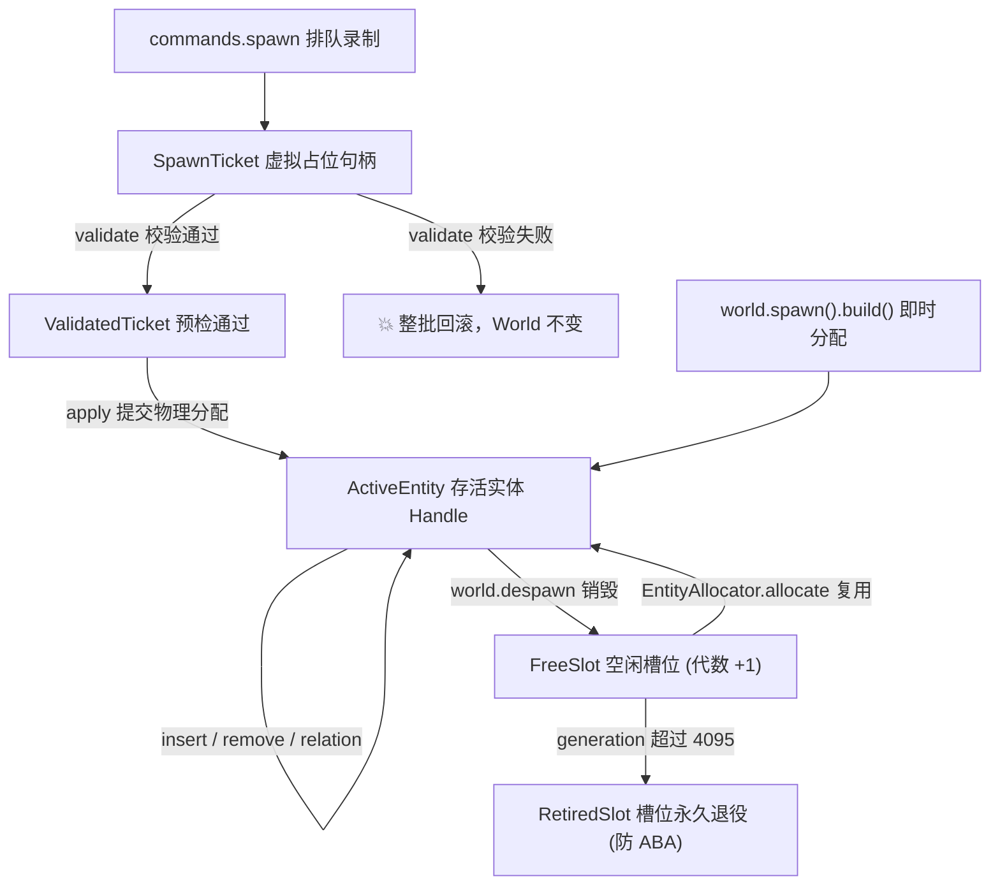

# AetherEngine ECS 实体标识与生命周期系统（Entity Identity & Lifecycle）

`src/ecs/entity` 提供了 AetherEngine 中关于 **实体身份标识（Entity Identity）、槽位代数分配器（Entity Allocator）、链式构建器（Entity Builder）以及延迟虚拟占位凭证（Spawn Ticket）** 的核心实现。

在数据导向（DOD）架构中，实体没有任何内嵌属性对象，它纯粹作为一个 **全局唯一的身份标识符（64-bit Handle）**，用于在各个 Table、稀疏 Map 和关系索引中建立数据关联。

---

## 目录

1. [目录结构与文件职责](#一目录结构与文件职责)
2. [实体句柄模型与 64 位编码体系](#二实体句柄模型与-64-位编码体系)
   - [2.1 位域划分（WorldId + Index + Generation）](#21-位域划分worldid--index--generation)
   - [2.2 代数递增与防 ABA 槽位退役机制](#22-代数递增与防-aba-槽位退役机制)
3. [两种实体生成形态对比（即时 vs 延迟）](#三两种实体生成形态对比即时-vs-延迟)
   - [3.1 生成形态流水线对比](#31-生成形态流水线对比)
   - [3.2 核心维度对比表](#32-核心维度对比表)
   - [3.3 为什么两者同时存在？Query 迭代视角下的底层差异](#33-为什么两者同时存在query-迭代视角下的底层差异)
   - [3.4 一帧生命周期内的阶段协同](#34-一帧生命周期内的阶段协同)
4. [SpawnTicket 专题深度解析（Virtual Entity Placeholder）](#四spawnticket-专题深度解析virtual-entity-placeholder)
   - [4.1 核心本质：它是实体（Entity），不是组件（Component）](#41-核心本质它是实体entity不是组件component)
   - [4.2 深度设计抉择：为什么不用 commands 数组下标代替 Ticket？](#42-深度设计抉择为什么不用-commands-数组下标代替-ticket)
   - [4.3 所有权隔离（owner: symbol）与 FIFO 确定性](#43-所有权隔离owner-symbol与-fifo-确定性)
5. [实体生命周期状态流转图](#五实体生命周期状态流转图)

---

## 一、目录结构与文件职责

```text
src/ecs/entity/
├── entity.ts          # 64 位实体句柄编解码 (encode/decodeEntity) 与代数分配器 (EntityAllocator)
├── entity-builder.ts  # Fluent API 即时实体链式装配构建器 (EntityBuilder)
├── index.ts           # 统一模块公共导出
└── README.md          # 本设计与架构文档
```

---

## 二、实体句柄模型与 64 位编码体系

### 2.1 位域划分（WorldId + Index + Generation）

在 AetherEngine 中，实体句柄在运行时以双精度浮点数（`Float64 / number`）安全承载，其底层在数学上等价于一个紧凑的 64 位整数，位域结构如下：

```text
 63          53 52                 32 31               12 11            0
┌──────────────┬─────────────────────┬───────────────────┬──────────────┐
│  (Reserved)  │ WorldId (21 bits)   │ Index (20 bits)   │ Gen (12 bits)│
└──────────────┴─────────────────────┴───────────────────┴──────────────┘
```

| 位段 (Field)            | 位宽    | 取值范围 / 容量    | 核心职责                                                                                           |
| :---------------------- | :------ | :----------------- | :------------------------------------------------------------------------------------------------- |
| **`Generation` (代数)** | 12 bits | $0 \sim 4,095$     | **槽位复用代数**。实体销毁后槽位复用时递增，防止已销毁实体的陈旧句柄（Stale Handle）误访问新实体。 |
| **`Index` (本地槽位)**  | 20 bits | $0 \sim 1,048,575$ | **World 内实体槽位号**。单 World 最多支持 104 万个并发存活实体。                                   |
| **`WorldId` (世界 ID)** | 21 bits | $1 \sim 2,097,151$ | **所属 World 唯一标识**。防止在多 World 架构中将 A 引擎的实体错传给 B 引擎。                       |

### 2.2 代数递增与防 ABA 槽位退役机制

[`EntityAllocator`](entity.ts) 内部维护空闲列表（`freeList`）与槽位元数据（`EntityMeta`）：

1. **分配实体**：优先从 `freeList` 复用槽位，若无可用槽位则向后追加新槽位（`generation` 初始为 0）；
2. **释放实体**：将 `alive` 标记为 `false`，并将 `generation++` 后将槽位索引推入 `freeList`；
3. **防 ABA 槽位退役（Retired Slot）**：当槽位复用达到最大代数（`generation >= 4095`）时，该槽位被标记为 `retired: true`，永久从池中剔除不再分配，彻底杜绝超长运行周期下的 ABA 句柄碰撞。

---

## 三、两种实体生成形态对比（即时 vs 延迟）

### 3.1 生成形态流水线对比

```mermaid
flowchart TD
    subgraph Direct["1. 即时同步生成 (Direct World API)"]
        D1["world.spawn()"] --> D2["创建 EntityBuilder 临时构建器"]
        D2 --> D3["链式装配: .insert() / .addRelation()"]
        D3 --> D4[".build() 提交"]
        D4 --> D5["立即分配 64 位真实 Entity 句柄并在 Table 分配内存"]
    end

    subgraph Deferred["2. 延迟批次录制 (Deferred CommandBuffer API)"]
        C1["commands.spawn()"] --> C2["生成 SpawnTicket 虚拟占位凭证"]
        C2 --> C3["排队录制: commands.insert(ticket, ...)"]
        C3 --> C4["到达 Apply Point: commands.apply(world)"]
        C4 --> C5["全批次静态预检 (Validation)"]
        C5 --> C6["预检通过: Commit 原子物理分配 & 兑换真实 Entity"]
    end
```



### 3.2 核心维度对比表

| 维度         | **`EntityBuilder`（即时同步）**                           | **`SpawnTicket`（延迟提交）**                                              |
| :----------- | :-------------------------------------------------------- | :------------------------------------------------------------------------- |
| **使用入口** | `world.spawn()`                                           | `commands.spawn()`                                                         |
| **执行时机** | **立即执行**，调用 `.build()` 时立即在 World 分配物理内存 | **延迟执行**，推入 `CommandBuffer`，在 Apply Point 批量执行                |
| **安全性**   | **在 Query 迭代中禁止调用**（会被 World Guard 拦截报错）  | **Query 迭代中安全**，不破坏当前 Table 遍历内存                            |
| **句柄类型** | 立即返回 `Entity`（`number` 64 位句柄）                   | 先返回 `SpawnTicket`（对象），提交后通过 `resolve(ticket)` 兑换为 `Entity` |
| **适用阶段** | 启动初始化（`Startup`）、场景/关卡加载、单点事件          | 每帧主循环（`Update` / `FixedUpdate`）、高频 Query 遍历中                  |

---

### 3.3 为什么两者同时存在？Query 迭代视角下的底层差异

在 AetherEngine 中，实体的 Packed 组件数据是**按 Table 紧凑连续排列**存储在 `ArrayBuffer`（Chunked SoA）中的：

```text
Table (Transform + Velocity) 物理行内存：
Row 0: [Entity A 数据] [Transform A] [Velocity A]
Row 1: [Entity B 数据] [Transform B] [Velocity B]
Row 2: [Entity C 数据] [Transform C] [Velocity C]
Row 3: [Entity D 数据] [Transform D] [Velocity D]  <-- 末尾行 (count = 4)
```

Query 迭代（`world.query([Transform, Velocity])`）的底层本质是一个**高速递增的连续内存游标**（`row = 0 -> 1 -> 2 -> 3`）。

#### ① 在 Query 循环中调用【即时修改】的灾难：

- **灾难 1（Swap-Remove 漏逻辑）**：如果在遍历到 `Row 1`（Entity B）时调用 `world.despawn(B)`，底层为了维持密集连续，会把末尾的 `Row 3`（Entity D）搬移覆盖到 `Row 1`。紧接着游标递增到 `Row 2`，导致**被搬过来的 Entity D 被彻底漏掉，从未被迭代到**！
- **灾难 2（Archetype 迁移导致内存破坏）**：如果在遍历中调用 `world.insertComponent`，实体的构型发生改变，必须迁入新 Table，导致旧 Table 发生行数据移动与 `count--`，当前迭代器的游标发生混乱越界。

#### ② 引擎的运行时防御锁（World Guard）：

`World` 内部维护了 `activeQueries` 计数器。当有 Query 正在迭代时，调用任何直接结构变更都会立即抛错：

```text
Error: Cannot perform direct structural mutations during query iteration. Use CommandBuffer.
```

#### ③ 在 Query 循环中调用【延迟修改】的安全保障：

调用 `commands.spawn()` 或 `commands.despawn()` 时，**仅仅向普通 JS 数组追加一条操作意图，物理内存、行号和 Table 结构完全不动**。Query 迭代能够以最高效率跑完，随后在 Apply Point 集中安全提交。

---

### 3.4 一帧生命周期内的阶段协同与执行流水线

```text
开发者代码 ──► 1. 动数值 / 纯读取 ──────► 【即时直接调用】直接读写 World 内存
           │
           └──► 2. 动结构 (增删实体/组件) ──► 【加入 Command 队列】先排队，拿 SpawnTicket
                                                         │
                                               到达 Apply Point 检查点
                                                         │
                                                         ▼
                                             【全批次静态仿真预检 (Validate)】
                                                         │ (通过后)
                                                         ▼
                                             【最终物理落地】依旧是逐条调用底层 World API！
```

```text
[ 1. 启动与场景加载阶段 (无 Query 活跃) ]
      │
      └──► 使用【即时模式】: world.spawn().build() 瞬间铺设成千上万个初始实体
      │
[ 2. 帧主循环 Update 阶段 (大量 System 正在高频 Query 遍历) ]
      │
      ├── System A (移动系统): 正在 query([Position, Velocity])
      ├── System B (射击系统): 正在 query([Shooter])
      │      └──► 使用【延迟模式】: commands.spawn(子弹), commands.despawn(击中目标)
      └── System C (碰撞系统): query 结束
      │
[ 3. 到达 Apply Point 检查点 (所有 Query 均已安全退出) ]
      │
      └──► commands.apply(world): 批量全量预检 ──► 原子调用底层【即时接口】落地物理内存
```

---

## 四、SpawnTicket 专题深度解析（Virtual Entity Placeholder）

### 4.1 核心本质：它是实体（Entity），不是组件（Component）

在类型系统设计中，`SpawnTicket` 与 `Entity` 联合构成了代表实体的抽象类型：

```typescript
// src/ecs/types/command-types.ts
export type CommandEntity = Entity | SpawnTicket;
```

- **`Transform` / `Velocity` 是组件（Component）**：贴在实体身上的数据。
- **`SpawnTicket` 是实体凭据（Virtual Entity Handle）**：尚未落地的虚拟实体占位符。

在所有接受“实体目标”的命令方法（`insert`、`remove`、`setRelation`、`despawn`）中，`SpawnTicket` 与 `Entity` 均可作为合法参数传入。

---

### 4.2 深度设计抉择：为什么不用 commands 数组下标代替 Ticket？

既然 `CommandBuffer` 内部维护了 `commands: WorldCommand[]` 队列，为什么不直接返回数组下标（`index: number`），而要专门封装一个 `SpawnTicket` 对象？

#### ① 原因 1：`commands` 数组下标 $\neq$ 实体生成序号（命令混杂性）

`commands` 数组中混杂了所有类型的命令（`spawn`、`despawn`、`insert`、`remove`、`relation`）。

```typescript
commands.despawn(oldEntity);                // commands[0]: despawn
const ticketA = commands.spawn();            // commands[1]: spawn (ticket.index = 0)
commands.insert(ticketA, Transform, { ... }); // commands[2]: insert
const ticketB = commands.spawn();            // commands[3]: spawn (ticket.index = 1)
```

- 如果用数组下标，第 1 个实体的 ID 是 `1`，第 2 个是 `3`；
- 如果中间穿插 100 条 `insert`，数组下标会飞涨，但实体可能只创建了 2 个；
- `SpawnTicket.index` 是专门独立自增的实体计数器（`this.nextTicket++`）。

#### ② 原因 2：彻底消除数字歧义（区分“真实实体 0”与“虚拟实体 0”）

真实实体的句柄是数字（`number`），且合法的真实实体句柄完全可能等于 `0`。
若将虚拟实体也表示为数字（如 `0`），调用 `commands.insert(0, Transform, data)` 时底层将**无法区分**：

- 这个 `0` 到底是指“当前 World 中真实存在的 0 号实体”？
- 还是指“刚才排队的第 0 号虚拟实体”？

封装为 `class SpawnTicket` 后，运行时通过单条指令 `target instanceof SpawnTicket` 即可**零歧义、极速分发**。

#### ③ 原因 3：基于引用的哈希映射安全（Reference Identity）

在 `apply()` 阶段，系统使用 `Map<SpawnTicket, Entity>` 将虚拟凭据映射为真实实体句柄。
JavaScript 对象的**内存引用身份（Object Reference Identity）**天然具备全局唯一性，彻底杜绝了不同批次间纯数字 Key 的覆盖污染。

#### ④ 原因 4：多 Buffer 并行合并（`append`）时的安全重映射

在多线程或 Worker 并行作业时，Worker A 和 Worker B 内部都会产生 `ticket.index = 0`。
通过对象引用，`mainBuffer.append(workerBuffer)` 可以在 `Map<SpawnTicket, SpawnTicket>` 中为每个子 Ticket 安全生成主 Buffer 上的新 Ticket，平滑完成重映射，绝不发生数字冲突。

---

### 4.3 所有权隔离（owner: symbol）与 FIFO 确定性

```typescript
export class SpawnTicket {
  constructor(
    public readonly owner: symbol, // 归属标记
    public readonly index: number // 自增序列号
  ) {}
}
```

1. **所有权隔离（Owner Identity）**：
   每个 `CommandBuffer` 拥有独立的私有 `owner = Symbol('CommandBuffer')`。在 `validate` 与 `resolve` 时强制检查 `ticket.owner === this.owner`，防止跨 Buffer 错传。
2. **无优先级 FIFO 确定性**：
   `SpawnTicket` 内部不包含优先级（Priority）。命令严格按照系统调度顺序与录制顺序先入先出执行，保证游戏逻辑与层级挂载的绝对确定性。

---

## 五、实体生命周期状态流转图


