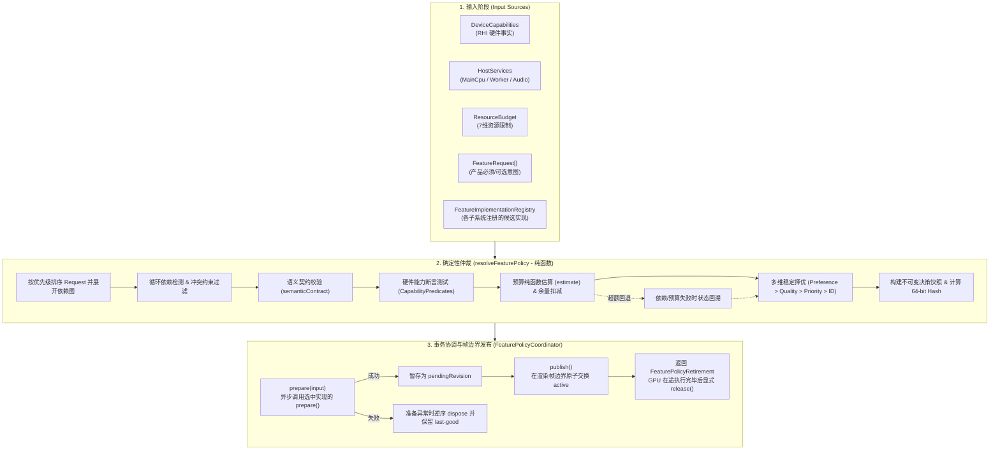
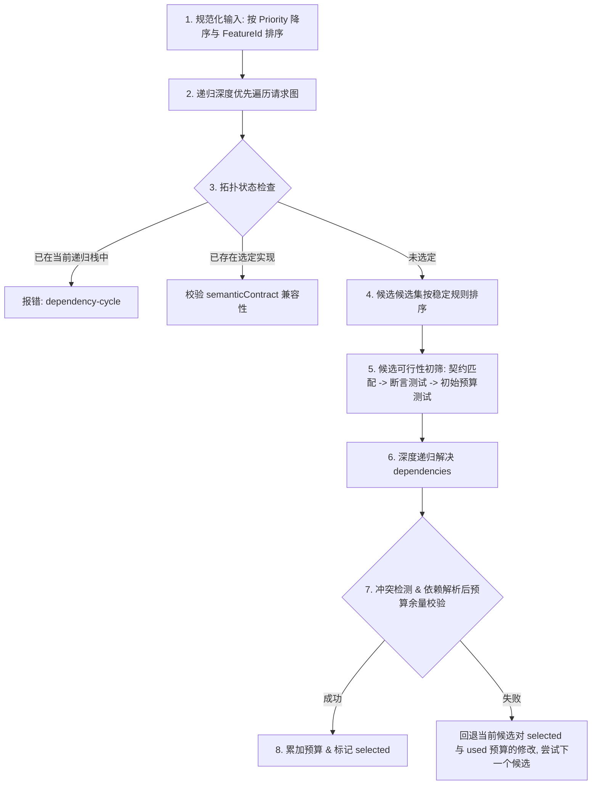
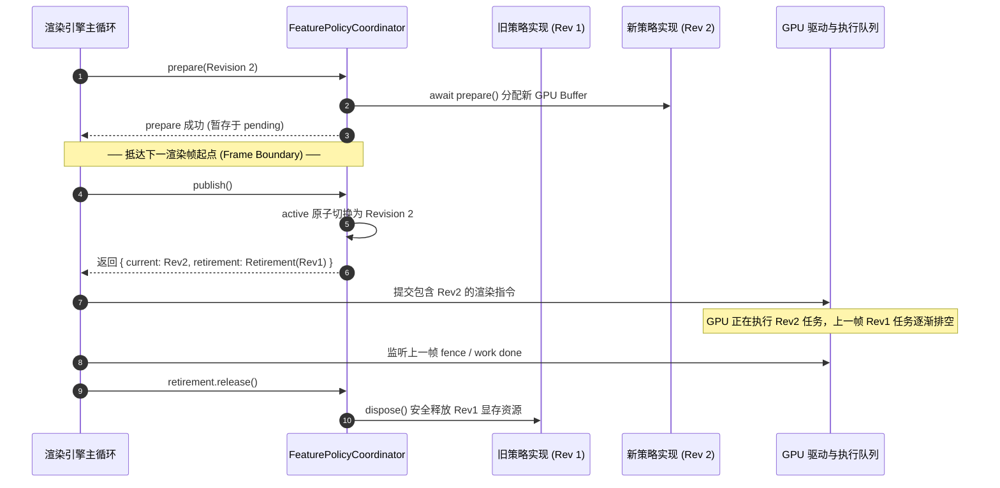

# AetherEngine FeaturePolicy Subsystem: 架构设计、确定性仲裁与帧边界生命周期指南

本文档全面梳理了 AetherEngine `src/feature-policy` 模块的架构设计、数据模型、确定性仲裁算法（`resolver`）、事务协调与帧边界发布机制（`coordinator`）以及在渲染与运行时中的集成实战。

---

## 目录

1. [系统全景与设计哲学](#1-系统全景与设计哲学)
   - [1.1 核心定位与解决的痛点](#11-核心定位与解决的痛点)
   - [1.2 核心四权分立](#12-核心四权分立)
   - [1.3 系统全局数据流与架构拓扑](#13-系统全局数据流与架构拓扑)
2. [核心概念与类型系统](#2-核心概念与类型系统)
   - [2.1 强类型 Branded IDs](#21-强类型-branded-ids)
   - [2.2 四级支持等级（FeatureSupportLevel）](#22-四级支持等级featuresupportlevel)
   - [2.3 7 维资源预算模型（ResourceBudget）](#23-7-维资源预算模型resourcebudget)
   - [2.4 封闭式强类型能力谓词（CapabilityPredicate）](#24-封闭式强类型能力谓词capabilitypredicate)
   - [2.5 实现合同：Runtime 与 Render Feature](#25-实现合同runtime-与-render-feature)
   - [2.6 不可变决策快照与 64-bit FNV-1a Hash](#26-不可变决策快照与-64-bit-fnv-1a-hash)
3. [确定性仲裁与解析机制（Resolver）](#3-确定性仲裁与解析机制resolver)
   - [3.1 解析器纯函数原则](#31-解析器纯函数原则)
   - [3.2 8 步确定性决策与回溯算法](#32-8-步确定性决策与回溯算法)
   - [3.3 循环依赖与冲突检测](#33-循环依赖与冲突检测)
   - [3.4 全量解释性留存（Explainable Decisions）](#34-全量解释性留存explainable-decisions)
4. [事务协调与帧边界发布（Coordinator & Lifecycle）](#4-事务协调与帧边界发布coordinator--lifecycle)
   - [4.1 动态变化与三阶段事务](#41-动态变化与三阶段事务)
   - [4.2 并发互斥与异常回滚（Rollback）](#42-并发互斥与异常回滚rollback)
   - [4.3 帧边界原子发布与延迟退役（Retirement）](#43-帧边界原子发布与延迟退役retirement)
   - [4.4 幂等销毁与错误聚合（AggregateError）](#44-幂等销毁与错误聚合aggregateerror)
5. [实战范例：多后端特性接入与消费](#5-实战范例多后端特性接入与消费)
   - [5.1 案例剖析：LightListBuild 特性](#51-案例剖析lightlistbuild-特性)
   - [5.2 注册新特性的多后端实现](#52-注册新特性的多后端实现)
   - [5.3 在渲染管线中安全消费 PreparedPolicy](#53-在渲染管线中安全消费-preparedpolicy)
6. [文件结构与核心 API 速查表](#6-文件结构与核心-api-速查表)

---

## 1. 系统全景与设计哲学

### 1.1 核心定位与解决的痛点

在现代跨平台图形引擎中，硬件与运行环境呈现极度碎片化特征（WebGPU 拥有计算管线与存储缓冲区，WebGL2 仅支持光栅化与 Transform Feedback，极低端或 Headless 环境则依赖 CPU/Worker）。

传统引擎处理多后端降级时常陷入以下反模式：

1. **散落的分支代码**：在 Shader、Pass 或 System 内部到处充斥 `if (backend === 'webgpu')` 或 UA 字符串嗅探；
2. **运行时偷换算法**：在渲染主循环中某帧调用 `createComputePipeline` 失败后，静默临时切换到 CPU 循环，导致掉帧和不可预测的状态畸变；
3. **不可解释与不可复现**：无法得知某个功能为何不可用、因为哪项硬件限制超标、或因为哪项资源预算超支；
4. **显存释放竞态**：降级切换时直接销毁旧资源，引发 GPU 正在读取在途缓冲区的崩溃。

`src/feature-policy` 的设计初衷是：**在 Prepare/Planning 边界，将设备硬件事实、业务产品意图和插件注册实现进行确定性仲裁，输出不可变快照，并通过双缓冲事务在帧边界安全切换。**

### 1.2 核心四权分立

FeaturePolicy 严格区分四个维度的概念，禁止混淆：

```text
┌───────────────────────────┐      ┌───────────────────────────┐
│ DeviceCapabilities (事实) │      │   FeatureRequest (意图)   │
│  - RHI Features / Limits  │      │  - 是否必须 (required)    │
│  - 纹理格式能力 / 队列角色 │      │  - 语义契约版本要求       │
│  - Host Services 宿主服务 │      │  - 优先级与画质支持偏好   │
└─────────────┬─────────────┘      └─────────────┬─────────────┘
              │                                  │
              └─────────────────┬────────────────┘
                                ▼
              ┌──────────────────────────────────┐
              │ resolveFeaturePolicy (纯函数仲裁)│
              │  ◄── FeatureImplementation[]     │
              │      (已注册的多后端候选实现库)  │
              └─────────────────┬────────────────┘
                                ▼
              ┌──────────────────────────────────┐
              │  FeaturePolicySnapshot (不可变)  │
              │  - 决策结果与 64-bit 确定性 Hash │
              │  - 全量评估与淘汰原因记录        │
              └─────────────────┬────────────────┘
                                ▼
              ┌──────────────────────────────────┐
              │ FeaturePolicyCoordinator (事务)  │
              │  - 异步 prepare 资源             │
              │  - 渲染帧边界原子 publish        │
              │  - GPU 在途任务后 release 旧资源 │
              └──────────────────────────────────┘
```

- **Capability（设备事实）**：由 RHI 硬件探测层提供，描述底层能做什么（不可由上层业务篡改）；
- **FeatureRequest（产品意图）**：由业务逻辑或画质预设声明，描述想要什么、是否必须、优先级高低；
- **FeatureImplementation（候选实现）**：由各渲染/模拟子系统注册，声明其能力断言、语义版本与预算开销；
- **FeaturePolicy（仲裁与发布）**：纯函数决策并输出稳定的实现计划，由 Coordinator 负责安全的生命周期流转。

### 1.3 系统全局数据流与架构拓扑



---

## 2. 核心概念与类型系统

### 2.1 强类型 Branded IDs

在 [`ids.ts`](ids.ts) 与 [`types/feature-policy-types.ts`](types/feature-policy-types.ts) 中，所有标识符均采用 TypeScript **Branded Types**，并在工厂函数中实施非空校验，杜绝空字符串与裸 `string` 混淆：

```ts
export type FeatureId = string & { readonly [featureIdBrand]: true };
export type ImplementationId = string & { readonly [implementationIdBrand]: true };
export type HostServiceId = string & { readonly [hostServiceIdBrand]: true };

export function featureId(value: string): FeatureId {
  /* 非空校验 */
}
export function implementationId(value: string): ImplementationId {
  /* 非空校验 */
}
export function hostServiceId(value: string): HostServiceId {
  /* 非空校验 */
}
```

### 2.2 四级支持等级（FeatureSupportLevel）

| 支持等级          | 含义                                                               | 典型案例                                  | 降级容忍度                          |
| :---------------- | :----------------------------------------------------------------- | :---------------------------------------- | :---------------------------------- |
| **`native`**      | 硬件直接原生支持所需语义，无模拟开销                               | WebGPU Compute Shader 粒子计算 / 光源裁剪 | 首选方案                            |
| **`emulated`**    | 保持对外语义完全一致，但底层通过替代机制实现，存在已批准的额外开销 | WebGL2 使用 Transform Feedback 模拟粒子   | 语义等价                            |
| **`fallback`**    | 明确降低质量、容量或精度以换取可用性                               | CPU 端裁剪光源列表（降低最大光源数）      | 明确降级                            |
| **`unsupported`** | 当前设备与预算下无任何可用实现                                     | 无合适后端可用                            | 若为 `required` 则构建/启动直接报错 |

> **关键原则**：不能仅凭性能好坏主观判定级别。`emulated` 必须保证与 `native` 具有集合等价的输出语义；任何降低容量或精度的行为必须明确标记为 `fallback`。

### 2.3 7 维资源预算模型（ResourceBudget）

在 [`budget.ts`](budget.ts) 中，资源预算使用规范化的非负实数度量，涵盖计算、显存、带宽与编译四维开销：

```ts
export interface ResourceBudget {
  readonly cpuTimeMs: number; // CPU 每帧预估耗时
  readonly gpuTimeMs: number; // GPU 每帧预估耗时
  readonly cpuMemoryBytes: number; // 占用 CPU 内存字节数
  readonly gpuMemoryBytes: number; // 占用 GPU 显存字节数
  readonly uploadBytesPerFrame: number; // 逐帧 CPU->GPU 上传带宽
  readonly readbackBytesPerFrame: number; // 逐帧 GPU->CPU 回读带宽
  readonly compileTimeMs: number; // 预编译/管线创建耗时
}
```

- **`validateResourceBudget`**：严格断言所有数值为有限且非负；
- **`resourceBudgetFits(used, estimate, limit)`**：严格按 7 个维度分别检验 $used + estimate \le limit$；
- **`ZERO_RESOURCE_BUDGET`**：规范化的不可变零预算单例。

### 2.4 封闭式强类型能力谓词（CapabilityPredicate）

在 [`predicates.ts`](predicates.ts) 中，能力断言被定义为封闭的可辨识联合（Discriminated Union），拒绝动态自由字符串：

```ts
export type CapabilityPredicate =
  | {
      readonly kind: 'feature';
      readonly feature: RHIFeature;
      readonly statuses: readonly SupportStatus[];
    }
  | { readonly kind: 'limit'; readonly limit: string; readonly minimum: number }
  | {
      readonly kind: 'format';
      readonly format: GPUTextureFormat;
      readonly capability: FormatCapabilityName;
    }
  | {
      readonly kind: 'queue';
      readonly role: RHIQueueRole;
      readonly statuses: readonly SupportStatus[];
    }
  | { readonly kind: 'service'; readonly service: HostServiceId };
```

- **`feature`**：检验 RHI 特性支持状态（如 `compute-shader`, `texture-compression-bc`）；
- **`limit`**：检验硬件限制（如 `maxStorageBuffersPerShaderStage >= 8`）；
- **`format`**：检验特定纹理格式的能力（如 `rgba16float` 是否支持 `filterable` / `renderable`）；
- **`queue`**：检验图形/计算/传输队列的可用状态；
- **`service`**：检验宿主环境服务（如 `main-cpu`, `web-worker`）。

### 2.5 实现合同：Runtime 与 Render Feature

实现分为两类：

1. **`RuntimeFeatureImplementation<Prepared, FrameInput, FrameOutput>`**：
   - 包含 `execute(prepared, frame)` 方法；
   - 适用于独立 CPU/Worker 计算任务（如 CPU 光源剔除、物理碰撞求交）。
2. **`RenderFeatureImplementation<Prepared>`**：
   - 包含 `contribute(prepared, context)` 方法；
   - 适用于向 RenderGraph 贡献 Pass、Resource Access 与渲染管线模板，禁止任意调用底层队列提交。

三阶段生命周期：

- `estimate(input)`：纯函数计算预估资源开销；
- `prepare(input)`：异步分配底层资源（如创建 GPU Buffer、Worker 线程或管线）；
- `dispose(prepared)`：销毁释放该实现占用的资源。

### 2.6 不可变决策快照与 64-bit FNV-1a Hash

在 [`hash.ts`](hash.ts) 中，实现了跨平台完全一致的 **64-bit FNV-1a 规范化哈希算法**：

- 对象键按字典序排序序列化；
- 最终 Hash 字符串作为 Shader 变体、管线布局、材质缓存和 Composition Plan 的失效与重建键。

---

## 3. 确定性仲裁与解析机制（Resolver）

### 3.1 解析器纯函数原则

[`resolveFeaturePolicy`](resolver.ts) 是一个严格的**纯函数**：

- 输入完全相同时，输出的快照和 Hash 100% 恒定；
- 不依赖系统当前墙上时钟、不依赖内存指针地址、不依赖对象插入顺序；
- 在输入边界深度拷贝（Defensive Copy）调用方对象，发布面使用私有只读 Facade（`ReadonlyMapSnapshot`）。

### 3.2 8 步确定性决策与回溯算法



#### 候选比较规则（`compareCandidates`）：

1. **`supportPreference` 偏好顺序**（默认为 `['native', 'emulated', 'fallback']`，支持产品显式自定义重排）；
2. **`quality.rank` 降序**（画质等级高者优先）；
3. **`priority` 降序**（实现声明优先级高者优先）；
4. **`id` 字典序**（稳定 Tie-breaker）；
5. **`version` 降序**（高版本优先）。

### 3.3 循环依赖与冲突检测

- **依赖环检测（Cycle Detection）**：维护 `path: readonly FeatureId[]` 栈，当发现请求已存在于栈中时，立即判定 `dependency-cycle`；
- **冲突过滤（Conflict Constraint）**：候选实现可声明 `conflicts: [{ feature, implementations? }]`，双向校验互斥关系，阻止不兼容的实现组合共存。

### 3.4 全量解释性留存（Explainable Decisions）

`FeaturePolicy` 不仅输出胜出者，更完整记录每个被拒绝候选的详细评估证据：

```ts
export type CandidateDisposition =
  | 'eligible' // 合格
  | 'rejected-capability' // 硬件能力/断言不满足
  | 'rejected-semantic' // 语义契约不匹配
  | 'rejected-budget' // 资源预算超额
  | 'rejected-conflict'; // 依赖冲突
```

所有评估明细沉淀于 `snapshot.evaluations`，供开发者工具（Inspector）、烘焙器（Cook）以及诊断系统直观展示为何降级或为何不可用。

---

## 4. 事务协调与帧边界发布（Coordinator & Lifecycle）

### 4.1 动态变化与三阶段事务

系统运行时常因以下事件需要重构策略：

- 渲染表面（Surface）尺寸或格式变化；
- 发生 GPU 设备丢失（Device Loss）并完成重置恢复；
- 收到系统内存压力告警（Memory Pressure）；
- 用户主动调整全局画质档位（Quality Preset）。

[`FeaturePolicyCoordinator`](coordinator.ts) 采用三阶段事务确保切换过程零黑屏、零闪烁、零竞态：

```text
阶段 1: resolve (纯函数决策，生成 snapshot)
阶段 2: prepare (异步准备选中实现的底层资源，生成 pendingRevision)
阶段 3: publish (在主循环渲染帧边界，原子交换 activeRevision 并退役旧策略)
```

### 4.2 并发互斥与异常回滚（Rollback）

1. **互斥锁保护**：同一时刻禁止并发调用 `prepare()`，若上一个 prepare 尚未完成或已有 pending 策略未发布，立即抛错拦截；
2. **版本单调递增**：新输入 `revision` 必须严格大于当前已发布的 `revision`；
3. **异常逆序回滚**：若某个实现的 `prepare()` 抛出异常，Coordinator 会**按照逆序依次调用已成功项的 `dispose()`**，并保持当前 `current`（last-good）策略不受任何影响；
4. **首次失败保护**：引擎首次启动准备失败时，Coordinator 保持 `unavailable` 状态。

### 4.3 帧边界原子发布与延迟退役（Retirement）



- **`publish()` 极速切换**：仅做引用赋值，耗时为微秒级；
- **`FeaturePolicyRetirement`**：由 Coordinator 包装旧策略，调用方持有它直到确认上一帧提交的 GPU 指令已经执行完成，再显式调用 `release()`，彻底消除“在途显存被误删”的 Crash。

### 4.4 幂等销毁与错误聚合（AggregateError）

在引擎关闭或销毁时调用 `coordinator.destroy()`：

- 幂等执行（重复调用无副作用）；
- 同时清理 `pending` 与 `active` 策略拥有的资源；
- 使用 `AggregateError` 聚合所有清理异常，确保某一组件报错不会阻断其他组件的释放。

---

## 5. 实战范例：多后端特性接入与消费

### 5.1 案例剖析：LightListBuild 特性

以 [`src/rendering/lighting/light-list-feature.ts`](../rendering/lighting/light-list-feature.ts) 为例，演示如何声明一个 CPU 边界受限的降级实现：

```ts
import {
  featureId,
  hostServiceId,
  implementationId,
  type RuntimeFeatureImplementation
} from '../../feature-policy';

export const BuiltInFeature = Object.freeze({
  LightListBuild: featureId('aether.rendering.light-list-build')
} as const);

export const BuiltInFeatureImplementation = Object.freeze({
  CpuBoundedLightList: implementationId('cpu-bounded')
} as const);

export function createCpuBoundedLightListImplementation(
  options: CpuBoundedLightListImplementationOptions
): RuntimeFeatureImplementation<CpuLightListCapacity, FrameInput, FrameOutput> {
  return {
    kind: 'runtime',
    feature: BuiltInFeature.LightListBuild,
    id: BuiltInFeatureImplementation.CpuBoundedLightList,
    version: 1,
    support: 'fallback', // 声明为 fallback 级别
    semanticContract: 'aether.light-list-build@1',
    requirements: [
      { kind: 'queue', role: 'graphics', statuses: ['native', 'emulated'] },
      { kind: 'service', service: hostServiceId('main-cpu') }
    ],
    dependencies: [],
    conflicts: [],
    priority: 0,
    quality: {
      tier: 'cpu-bounded',
      rank: 0,
      notes: ['Capacity and deterministic truncation are explicit.']
    },
    estimate: () => options.estimatedBudget,
    prepare: async () => options.capacity,
    dispose: () => {
      /* 清理临时结构 */
    },
    execute: (preparedCapacity, frame) => {
      // 执行 CPU 裁剪逻辑
      return buildCpuLightLists({ ...frame, capacity: preparedCapacity });
    }
  };
}
```

### 5.2 注册新特性的多后端实现

业务系统或插件在启动阶段向注册表注入候选：

```ts
const registry = new FeatureImplementationRegistry();

// 1. 注册 WebGPU 高性能 Compute 实现 (native)
registry.register(createWebGpuComputeLightListImplementation());

// 2. 注册 WebGL2 Transform Feedback 实现 (emulated)
registry.register(createWebGL2TransformFeedbackLightListImplementation());

// 3. 注册 CPU 兜底实现 (fallback)
registry.register(createCpuBoundedLightListImplementation({ ... }));
```

### 5.3 在渲染管线中安全消费 PreparedPolicy

渲染管线或主循环中仅读取 `coordinator.current`，直接通过 FeatureId 索引预备好的资源与执行通道：

```ts
const currentPolicy = coordinator.current;
if (!currentPolicy) return;

// 1. 获取决策元数据
const decision = currentPolicy.snapshot.decisions.get(BuiltInFeature.LightListBuild);
console.log(`Using implementation: ${decision.implementation} (${decision.support})`);

// 2. 获取在 prepare 阶段生成的资源/上下文 (例如 buffer、worker 或 capacity)
const preparedContext = currentPolicy.prepared.get(BuiltInFeature.LightListBuild);

// 3. 执行计算 (Runtime 特性直接 execute，Render 特性参与 RenderGraph contribute)
const result = implementation.execute(preparedContext, frameInput);
```

---

## 6. 文件结构与核心 API 速查表

| 文件                                                             | 核心类 / 函数 / 常量                                                                                                         | 核心职责                                                             |
| :--------------------------------------------------------------- | :--------------------------------------------------------------------------------------------------------------------------- | :------------------------------------------------------------------- |
| [`types/feature-policy-types.ts`](types/feature-policy-types.ts) | `FeatureId`, `SupportLevel`, `ResourceBudget`, `CapabilityPredicate`, `FeaturePolicySnapshot` 等                             | 定义子系统核心数据接口与 Branded 强类型                              |
| [`ids.ts`](ids.ts)                                               | `featureId()`, `implementationId()`, `hostServiceId()`                                                                       | 强类型 ID 创建与非空校验工厂                                         |
| [`budget.ts`](budget.ts)                                         | `RESOURCE_BUDGET_FIELDS`, `ZERO_RESOURCE_BUDGET`, `validateResourceBudget()`, `addResourceBudgets()`, `resourceBudgetFits()` | 7 维资源预算校验、累加与超额裁定                                     |
| [`predicates.ts`](predicates.ts)                                 | `evaluateCapabilityPredicate()`, `snapshotPredicate()`                                                                       | 硬件特性、限制、格式、队列及宿主服务断言求值                         |
| [`hash.ts`](hash.ts)                                             | `stablePolicyHash()`                                                                                                         | 64-bit FNV-1a 确定性规范化哈希计算                                   |
| [`registry.ts`](registry.ts)                                     | `FeatureImplementationRegistry`                                                                                              | 候选实现注册、防重校验与规范化排序快照                               |
| [`resolver.ts`](resolver.ts)                                     | `resolveFeaturePolicy()`                                                                                                     | 纯函数仲裁引擎（拓扑分析、断言校验、预算扣减、回溯、不可变快照生成） |
| [`coordinator.ts`](coordinator.ts)                               | `FeaturePolicyCoordinator`, `FeaturePolicyRetirement`                                                                        | 事务协调器（异步 prepare、帧边界原子 publish、延迟销毁、错误聚合）   |
| [`index.ts`](index.ts)                                           | `export *`                                                                                                                   | 模块公共 API 统一导出入口                                            |
