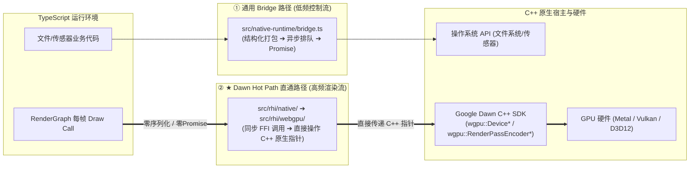
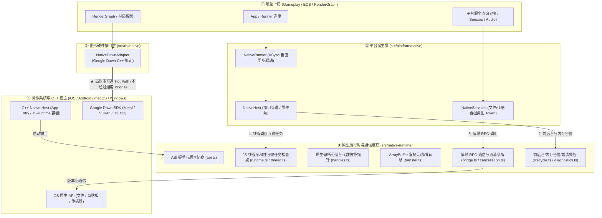
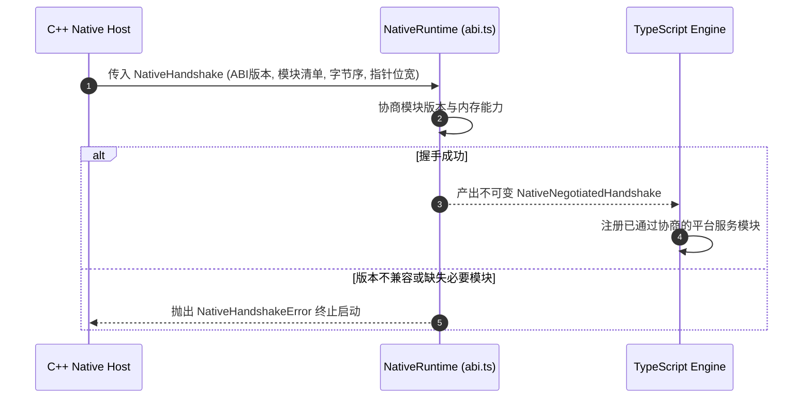
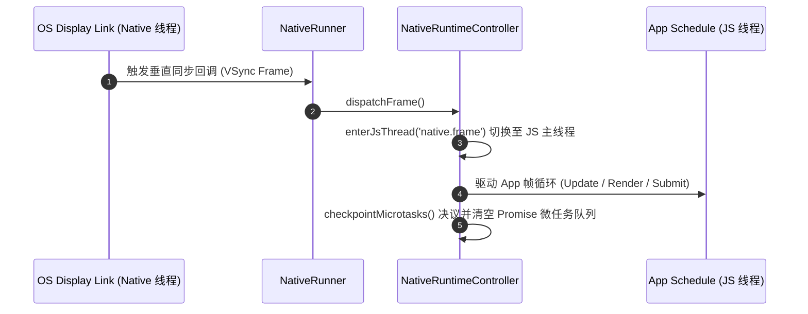

# Native Runtime 模块架构设计

## 1. 架构定位与设计哲学

`src/native-runtime` 是 AetherEngine 的**跨语言 FFI 通信协议与嵌入式 JS 虚拟机生命周期控制器**。

它专注于解决 **“TypeScript 引擎代码如何与 C++ 宿主环境（iOS、Android、macOS、Windows）进行安全、高效、有版本控制的跨语言调用”**，是连接 TypeScript 运行时与原生宿主底座的核心桥梁。

---

## 2. 什么是跨语言 FFI (Foreign Function Interface)？

### 2.1 FFI 的定义与核心机制

**FFI（Foreign Function Interface，外部函数接口）** 是一种跨语言调用技术机制，允许一种编程语言（如 TypeScript / JavaScript）直接调用另一种编程语言（如 C/C++、Rust、Swift）编写的函数和内存数据，反之亦然。

在 Native 原生客户端环境下：

- **上层 TypeScript 逻辑**运行在嵌入式 JavaScript 虚拟机（如 iOS 的 JavaScriptCore、Android 的 V8/Hermes）中，受垃圾回收（GC）管理并依托动态对象堆；
- **底层操作系统与驱动**（窗口、文件系统、传感器、Metal/Vulkan 图形驱动）由 C/C++ 原生编写，依赖连续二进制内存与原生指针。

**跨语言 FFI 就是连接这两套完全不同的内存模型与运行时环境的通信协议与类型绑定层**（如 Node.js N-API、React Native JSI、WebAssembly FFI 等）。

### 2.2 原生运行时的“双通道”架构设计

在 AetherEngine 中，FFI 被明确划分为两条职责与性能截然不同的通道：

| 通道                   | 实现模块                       | 传输机制                                           | 适用场景                                        | 性能量级                  |
| :--------------------- | :----------------------------- | :------------------------------------------------- | :---------------------------------------------- | :------------------------ |
| **通用 Bridge 桥**     | `src/native-runtime/bridge.ts` | 结构化打包 ➔ 异步排队 ➔ Promise 决议 ➔ JS 线程切回 | 读本地文件、查陀螺仪、读取剪贴板                | 微秒级（每秒几十~几百次） |
| **Dawn Hot Path 直通** | `src/rhi/native/`              | C++ 裸指针直接绑定 ➔ 同步 FFI 方法调用             | 每帧成千上万次 `draw`、`setBindGroup`、`submit` | 纳秒级（每秒数十万次）    |

---

## 3. Native 体系三维三角关系

在原生环境下，AetherEngine 将 Native 体系严格划分为三个正交子系统：

### 职责边界对比矩阵

| 模块                                             | 核心职责                                  | 解决的核心问题                                                                                                  | 典型对象/符号                                                                                                    |
| :----------------------------------------------- | :---------------------------------------- | :-------------------------------------------------------------------------------------------------------------- | :--------------------------------------------------------------------------------------------------------------- |
| **`src/native-runtime/`** _(原生运行时底座)_ | **跨语言 FFI 基础设施与 JS 虚拟机控制器** | **“TS 如何安全、正确地与 C++ 交互？”** 管理 JS 线程调度、C++ ABI 协商、内存转移、原生句柄生命周期。         | `NativeRuntimeController` `NativeHandleRegistry` `NativeBridgeDispatcher` `negotiateNativeHandshake` |
| **`src/platform/native/`** _(平台宿主层)_    | **OS 窗口度量、事件泵与平台服务**         | **“如何把操作系统窗口和事件封装给引擎？”** 监听 OS 窗口 Resize/DPI、驱动 VSync 帧循环、提供 FS/剪贴板服务。 | `NativeHost` `NativeRunner` `NativeFilesystemService` `PlatformWindow`                               |
| **`src/rhi/native/`** _(渲染硬件接口层)_     | **底层 GPU 设备与 Shader 执行**           | **“如何把 Draw 指令交给 GPU 硬件？”** 通过 Google Dawn 调用 Metal/Vulkan/D3D12，将 WGSL 编译为原生 Shader。 | `NativeDawnAdapter` `DawnDevice` `DawnCommandEncoder`                                                    |

---

## 三、为什么 `src/native-runtime` 单独作为一个核心目录？

### 1. 浏览器的“理所当然”，在 Native 下必须手工构筑

- 在浏览器环境中，JS 引擎（V8）、主线程事件循环（Event Loop）、微任务检查点（Microtask Checkpoints）、GC 终结器（Finalizers）由宿主环境天然提供。
- 在 Native 原生环境下，TypeScript 运行在嵌入式 JS 引擎（JSC / V8 / Hermes）中：
  - 需要由代码显式切入 JS 线程并执行操作（`enterJsThread` / `runOnJsThread`）；
  - 需要在每帧前后显式触发 `checkpointMicrotasks()`，确保 Promise 决议被及时处理；
  - 需要在 C++ 指针与 JS 包装对象之间维护**代数防野指针机制**（`NativeHandleRegistry`）与终结器回调。

### 2. 渲染高性能直通路 vs 低频 RPC 桥（Critical Invariant）

- **低频系统服务**（读文件、查传感器、剪贴板）：调用频率低，走 `src/native-runtime/bridge.ts` 的版本化异步 RPC 桥，安全但有编解码开销。
- **高频渲染指令**（每帧成千上万次 Draw Call、Buffer 绑定）：**严禁走通用 Bridge**。`src/rhi/native` 直接通过 Google Dawn 提供的 C++ 内存指针直通执行（Dawn Hot Path）。
- 独立的 `src/native-runtime` 避免了渲染热路径与低频 RPC 桥的职责混淆。

### 3. 架构正交性（Orthogonality）

- `src/native-runtime` 属于纯粹的 FFI 协议与机制，**不依赖任何 DOM、Window 或 GPU 概念**；
- `src/platform/native` 是平台业务与窗口策略，消费 `native-runtime` 提供的能力；
- 两者物理隔离，保证了跨平台核心的内聚与可维护性。

---

## 四、核心子模块与职责

| 文件                  | 核心职责                                                   | 关键 API / 类型                                             |
| :-------------------- | :--------------------------------------------------------- | :---------------------------------------------------------- |
| **`manifest.ts`**     | 原生目标构建配置与平台准入策略校验                         | `validateNativeBuildManifest`, `NativeBuildManifest`        |
| **`abi.ts`**          | TS 引擎与 C++ 宿主启动阶段的 ABI 与版本协商                | `negotiateNativeHandshake`, `NativeHandshake`               |
| **`runtime.ts`**      | JS 宿主线程调度、微任务检查点与全局异常管理                | `NativeRuntimeController`, `JsRuntimePort`                  |
| **`thread.ts`**       | 线程亲和性断言，防止非 JS 线程非法侵入引擎上下文           | `assertNativeJsThread`, `NativeThreadContractError`         |
| **`handles.ts`**      | 原生对象句柄租借（Lease）、Generation 代数校验与 GC 析构   | `NativeHandleRegistry`, `NativeHandle`, `NativeHandleLease` |
| **`transfer.ts`**     | `ArrayBuffer` 跨语言边界的零拷贝转移/映射/安全复制         | `createNativeTransfer`, `NativeTransferPort`                |
| **`bridge.ts`**       | 版本化异步 RPC 通信分发器（支持超时、取消与错误分类）      | `NativeBridgeDispatcher`, `NativeBridgeRequest`             |
| **`cancellation.ts`** | 原生异步操作取消令牌                                       | `NativeCancellationSource`, `NativeCancellationToken`       |
| **`event-pump.ts`**   | 原生底层事件向 JS 所有者线程的有序排队与合并派发           | `NativeEventPump`                                           |
| **`lifecycle.ts`**    | 原生生命周期协调器（前后台、音频中断、屏幕旋转、内存告警） | `NativeLifecycleCoordinator`, `NativeMemoryPressureEvent`   |
| **`diagnostics.ts`**  | 原生崩溃快照生成与脱敏诊断报告收集                         | `createNativeCrashReport`, `NativeCrashReport`              |

---

## 五、核心时序与数据流

### 1. 启动与 ABI 握手流程

### 2. 帧调度与线程切换流程

---

## 六、Fail-Fast 核心不变量

1. **线程亲和性（Thread Affinity Invariant）**：
   - 所有的 TypeScript 引擎执行流必须在 JS 所有者线程运行。非 JS 线程直接触发的方法调用必须通过 `NativeRuntimeController` 派发，否则立即抛出 `NativeThreadContractError`。
2. **句柄代数校验（Handle Generation Invariant）**：
   - 所有跨 C++/TS 引用的原生句柄均携带 `id + generation`。当底层 C++ 资源释放后，其代数失效，任何过期的 JS 悬空调用立即被 `NativeHandleRegistry` 拦截并拒绝。
3. **零容忍未协商模块调用（Handshake Strictness）**：
   - 任何未在启动握手中明确声明并达成版本协商的原生模块，禁止发起 Bridge RPC 调用。
