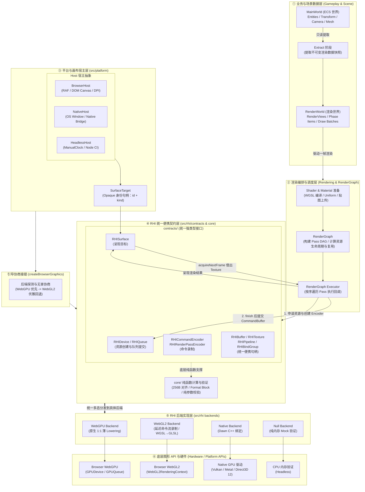
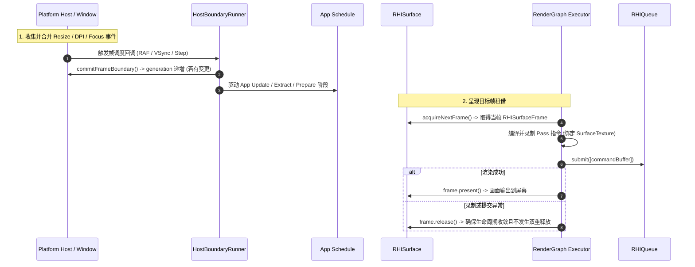

# Platform 模块架构设计

## 1. 架构定位与设计哲学

`src/platform` 是 AetherEngine 的**跨平台宿主与窗口抽象层**。它的核心职责是为游戏循环与渲染系统提供确定性、强类型且平台无关的运行底座。

### 1.1 核心设计原则

1. **绝对隐藏平台私有细节（Opaque Identity）**：
   - 平台层负责管理浏览器 DOM `HTMLCanvasElement`、`OffscreenCanvas` 或原生桌面 OS Window 句柄。
   - 向上层（ECS、RenderGraph、Gameplay）只暴露轻量不透明的 **`SurfaceTarget`** (`{ readonly id: symbol; readonly kind: 'canvas' | 'native-window' }`)。
   - **不变量**：任何原生 DOM 节点、GL context 或 OS 窗口句柄绝不泄漏到 ECS 组件、RenderGraph 或序列化状态中。

2. **关注点分离（Separation of Concerns）**：
   - **`src/platform`** 拥有：宿主环境生命周期（`Host`）、窗口与画布度量（`HostWindow`、`WindowMetrics`）、高精度单调时钟（`MonotonicClock`）、系统级服务（`PlatformServiceRegistry`）。
   - **`src/rhi`** 拥有：GPU 适配器（`RHIAdapter`）、逻辑设备与队列（`RHIDevice`、`RHIQueue`）、可呈现表面状态机（`RHISurface`）与渲染管线/指令录制。
   - **两者接缝**：通过 `createBrowserGraphics` 完成安全探测、无害后端协商与上下文绑定。

3. **零开销与无头可测性（Zero-Overhead & Headless First）**：
   - 核心逻辑完全解耦于浏览器环境，在无 GPU、无 DOM 的 CI/Node 环境中可通过 `HeadlessHost` 和 `ManualClock` 进行 100% 确定性的单元测试与行为验证。

---

## 2. 引擎分层全景架构

---

## 3. 子目录职责划分

按照 `AGENTS.md` 规范中的**子系统聚类规则**，`src/platform` 划分为以下高内聚子目录：

| 子目录          | 核心职责                                              | 主要导出符号                                                                                                              |
| :-------------- | :---------------------------------------------------- | :------------------------------------------------------------------------------------------------------------------------ |
| **`core/`**     | 平台通用基础抽象、窗口度量与调度器帧边界接缝          | `PlatformWindow`, `WindowMetrics`, `HostBoundaryRunner`, `MutablePlatformServiceRegistry`, `createPlatformServiceToken`   |
| **`browser/`**  | 浏览器环境宿主、DOM 事件/RAF 适配与图形协商引导器     | `BrowserHost`, `BrowserWindowPort`, `BrowserPlatformPort`, `createBrowserGraphics`, `BrowserGraphicsBootstrapError`       |
| **`headless/`** | 无头/CI/Node 运行宿主与手动单调时钟                   | `HeadlessHost`, `ManualClock`, `HeadlessHostOptions`                                                                      |
| **`native/`**   | 原生移动/桌面端宿主、VSync 垂直同步调度与原生系统服务 | `NativeHost`, `NativeRunner`, `NativeFilesystemServiceToken`, `NativeSensorsServiceToken`, `registerNativeServiceModules` |
| **`types/`**    | 平台层不可变强类型契约定义                            | `Host`, `HostWindow`, `SurfaceTarget`, `WindowMetrics`, `BrowserGraphicsSession`, `BrowserGraphicsLoss` 等                |

---

## 4. 一帧生命周期与数据流

---

## 5. 核心不变量与 Fail-Fast 规范

1. **画布上下文唯一绑定（Context Exclusivity）**：
   - 目标 Canvas 只能绑定一种 Context（WebGPU 或 WebGL2）。在后端探测阶段，`createBrowserGraphics` 仅对环境与独立临时 Canvas 探测能力，**严禁提前在目标 Canvas 上调用 `getContext`**。
2. **窗口度量合并（Metrics Coalescing）**：
   - 连续的 Resize 事件在帧边界前暂存为 `pendingMetrics`，仅在 `commitFrameBoundary()` 时生效并递增 `generation`，避免拖拽缩放时每像素高频重建 GPU 资源。
3. **SurfaceFrame 线性所有权**：
   - 每次 `acquire` 产生的 `RHISurfaceFrame` 具有严格的线性生命周期，最终路径必须且只能是 `present()` 或 `release()` 之一。
