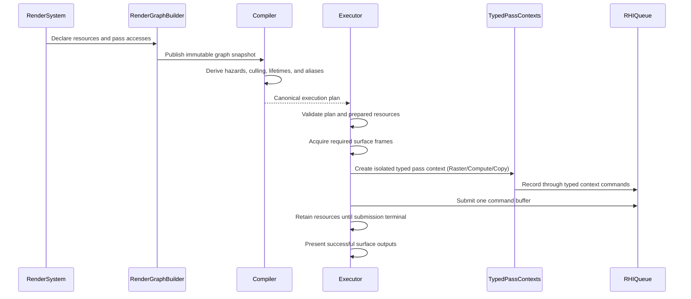

# RenderGraph Subsystem

RenderGraph separates declarative render work from physical RHI execution. Systems declare logical resources, pass accesses, and terminal outputs; the compiler derives one execution plan; the executor resolves physical resources and records the plan through restricted pass capabilities.

## Responsibilities

| Directory   | Responsibility                                                                                                                            |
| ----------- | ----------------------------------------------------------------------------------------------------------------------------------------- |
| `types/`    | Shared logical resource, restricted capability, compiler result, and execution-plan types.                                                |
| `builder/`  | Logical handles, versioned resource declarations, pass setup, and prepared-resource tokens.                                               |
| `ranges/`   | Texture and buffer range types, normalization, subresource interval intersection, subtraction, and overlap algorithms.                    |
| `history/`  | Multi-frame resource history registry, double/triple-buffering slot acquisition, view invalidation, and retirement lifecycles.            |
| `debug/`    | Read-only projection, serialization, and deterministic checksum generation of compiled and executed render graph plans.                   |
| `compiler/` | DAG validation, hazard analysis, culling, topology, lifetime/alias/transition planning, and raster pass fusion partitioning.              |
| `context/`  | Internal pass-local capability resolution, encoder proxies, descriptor lowering, and owned-resource retirement.                           |
| `executor/` | Canonical plan validation, surface-frame ownership, physical resource binding, transient pooling, encoding, submission, and presentation. |
| `index.ts`  | Stable public RenderGraph exports. Internal `context` and executor helper modules are intentionally excluded.                             |

## Lifecycle



## Ownership Boundaries

- Builder inputs are caller-owned. Published graph snapshots detach or freeze retained values according to their public contracts.
- Logical handles are scoped to one graph identity and resource version. Consumers must not reconstruct or mutate them.
- Imported resources remain externally owned. Transient resources are owned by the executor pool and may be reused only after all retaining submissions become terminal.
- A surface frame belongs to exactly one executor invocation. A successful submission ends in `present()`; a pre-submit failure ends in `release()`.
- Pass callbacks receive only their matching typed pass context (`RasterPassContext`, `ComputePassContext`, or `CopyPassContext`). They cannot acquire surfaces, submit queues, allocate arbitrary persistent resources, or access undeclared graph resources.
- Prepared pipelines and draw resources are created before surface acquisition and validated again at the submission boundary.

## Fail-Fast Invariants

1. Execution accepts only a canonical plan produced for the exact immutable graph snapshot.
2. Every pass access must reference a handle owned by the current graph and a declared compatible range and usage.
3. Pass commands can only be invoked within their active synchronous callback scope; physical pass and encoder lifecycles are owned and closed by the executor and fusion partitions.
4. Restricted capabilities expire when their pass context closes.
5. An acquired surface frame reaches one terminal state exactly once.
6. Failed or device-lost transient resources are destroyed instead of returning to the reusable pool.
7. History read and write slots remain distinct; publication occurs only after successful submission completion.
8. Raster pass fusion preserves logical pass context isolation, attachment clearing, draw validation, and error boundaries while sharing one physical render pass encoder.

## Public API Boundary

The package barrel exports authoring, compilation, execution, history, debug, and prepared-resource contracts. Pass-builder state, restricted-context implementations, encoder proxies, executor cleanup, physical binding, and lowering helpers remain internal. New public exports require an explicit contract and a public API regression test.

```
RenderGraphSnapshot (Builder 的输入)
   │
   ├── 1. 冲突分析 (hazards.ts)：RAW(读后写)/WAR(写后读)/WAW 冲突推导，建立物理依赖边
   │
   ├── 2. 拓扑规划与剔除 (schedule/)：死 Pass 剔除 (Culling) + Kahn 拓扑排序 + 成环死锁检测
   │
   ├── 3. 硬件级通道融合 (fusion/)：将多个逻辑 Raster Pass 合并为一个物理 Pass (移动端 TBDR 架构神技)
   │
   └── 4. 显存复用与状态规划 (resources/)：生命周期分析 [firstUse, lastUse] + 显存别名 (Aliasing) + 屏障规划 (Transition)
   │
   ▼
RenderGraphExecutionPlan (最终输出给 Executor 的执行计划)
```

```
上层提交的无序/半无序 Pass 声明
           │
           ▼
[ Hazard 分析模块（当前代码）]
   通过 Subresource 几何相交判定，找出所有的 RAW / WAR / WAW
   输出：有向无环图的“依赖边”（Edges）
           │
           ▼
[ 后续编译与调度优化阶段 ]
   ├─ 1. 拓扑排序 (Topological Sort): 确定 GPU 队列的合法执行顺序
   ├─ 2. 死代码消除 (Culling): 如果某个 Write 没人读且不是终端，直接剔除该 Pass
   ├─ 3. 合并决策 (Pass Merging): 判断符合条件的相交 Pass 能否就地融合（Subpass）
   └─ 4. 插入同步指令 (Barriers): 在无法合并的依赖边之间，精准插入最小粒度的 GPU 屏障
```

```
上层渲染系统 (Render Systems / Pipelines)
   │
   ▼
[ 阶段零：声明与构建 (builder/) ]
   职责：提供强类型、安全的只读声明 API，录制整帧的资源、Pass 与逻辑意图，冻结为不可变快照
   ├─ 1. 资源创建与版本化管理 (resources.ts):
   │     • 创建瞬态资源 (createTexture / createBuffer)，导入外部资源 (importTexture)
   │     • 逻辑版本推进：每次 Write 生成新 handle (如 Color_v0 -> Color_v1)，建立单调递增版本链
   │     • 归一化子资源范围 (normalizeRange)：规范化 Mip / Layer / Aspect / Offset 区间
   │
   ├─ 2. Pass 声明与沙盒 Setup (pass-builders/):
   │     • 预留并定义 Pass (addRasterPass / addComputePass / addCopyPass)
   │     • 限制性 Setup 回调：通过类型隔离的 PassBuilder 声明 read / write / attachments / sideEffects
   │     • 事务与回滚安全：Setup 过程若抛出异常，自动回滚已登记的资源版本与 Terminal，防止半污染
   │
   ├─ 3. 约束与终端声明 (builder.ts):
   │     • 声明语义依赖边 (declareAfter)：指定“Pass B 必须在 Pass A 之后跑”的逻辑控制流
   │     • 声明最终输出终端 (present / exportResource)：标记作为屏幕呈现或导出外部的资源
   │
   ├─ 4. 快照生成 (build()):
   │     • 校验所有保留的 PassToken 必须完整定义
   │     • 校验终端引用的必须是资源的“最终版本” (Final Version)
   │     • 彻底锁定并深度冻结 (Object.freeze)
   │
   ▼
RenderGraphSnapshot (不可变的初始图快照，脱离一切外部引用)
   │
   ▼
[ 阶段一：物理冲突推导 (compiler/hazards.ts) ]
   通过 Subresource (Mip/Layer/Aspect) 几何相交判定与版本依赖分析
   输出：推导出的客观物理读写依赖边集 (RAW 读后写 / WAR 写后读 / WAW 写后写)
   │
   ▼
[ 阶段二：调度验证、剔除与拓扑排序 (compiler/schedule/) ]
   入口：compileRenderGraph(snapshot)
   ├─ 1. 依赖边合并：allEdges = [...hazardEdges, ...semanticEdges]
   ├─ 2. 信任边界校验 (validatePassReferences)：确保所有边和 Terminal 两端的 passId 均合法存在
   ├─ 3. 物理反转拦截 (rejectHazardReversal)：BFS 逆向寻路，严禁语义边反转物理依赖 (逆转物理必报错)
   ├─ 4. 死代码剔除 (Culling):
   │     • collectRoots：收集屏幕呈现 (Present)、外部导出 (Export) 和副作用 (SideEffects) 节点
   │     • collectPredecessorClosure：沿反向图上溯闭包，未对 Root 做出贡献的孤立 Pass 划入 culledPasses
   └─ 5. 确定性拓扑排序 (Topological Sort):
         • stableTopologicalOrder：基于 Kahn 算法
         • 稳定决胜 (Tie-Breaking)：入度为 0 节点按注册序号排序，保证跨平台 100% 确定性
         • 死锁报错：若检测到环抛出 RenderGraphCycleError (附带最短死锁调用链)
   输出：CompiledRenderGraph (线性执行序列 order、保留的 retainedPasses、剔除的 culledPasses)
   │
   ▼
[ 阶段三：硬件级通道融合 (compiler/fusion/) ]
   入口：partitionRasterGroups(snapshot, compiled, options)
   针对移动端 Tile / Apple GPU (TBDR) 架构，将连续兼容的 Raster Pass 合并为物理 RenderPass
   ├─ 1. 过滤非 Raster Pass：Compute / Copy Pass 触发 NonRasterBoundary 立即切断
   ├─ 2. 局部硬条件校验 (Category A)：
   │     • 渲染目标一致性：Attachment 纹理、View、Mip、Format、尺寸必须完全一致
   │     • 禁止中途清屏 (IntermediateClear)：后续 Pass 含有 loadOp: 'clear' 则必须拆分
   │     • MSAA 解析边界 (ResolveBoundary)：Resolve 必须在物理 Pass 终点完成
   ├─ 3. 累积状态与显存预算 (Category B)：
   │     • 资源角色冲突 (UsageScopeConflict)：同一纹理不能在组内“既作为画布写，又作为贴图采样读”
   │     • 显存膨胀预算 (ResidencyBudget)：监控拓宽引起的 physicalLifetimeExpansionBytes，超预算则放弃合并
   └─ 4. 底层操作降级 (Attachment Lowering)：首个 Pass 执行 Clear/Load，末尾 Pass 执行 Store
   输出：GroupPartitionResult (RasterGroupPlan[]，定义最终提交的物理 RenderPass 批次)
   │
   ▼
[ 阶段四：物理显存规划与状态屏障 (compiler/resources/) ]
   入口：createRenderGraphExecutionPlan(snapshot, compiled, options)
   ├─ 1. 生命周期分析 (lifetime-analysis.ts):
   │     • 以排好序的 Pass 为时间轴，记录资源的 [firstUse, lastUse]
   │     • 生命周期拓宽 (lifetime-widening.ts)：同一 Fused Group 内部所有资源的生命周期强制
   │       拓宽至整个 Group 的 [groupStart, groupEnd]，防止组内驱动发生并发显存踩踏
   │
   ├─ 2. 显存别名与复用规划 (alias-planner.ts):
   │     • 首次适应 (First-Fit) 算法
   │     • 互斥校验 (intervalsDisjoint)：生命周期完全错开的资源才允许复用同一块物理显存
   │     • 排除非 Transient 资源 (外部导入/跨帧历史资源严禁复用)
   │     • 输出：ResourceAliasPlan (最小化实际分配块数)
   │
   └─ 3. 跨 Pass 状态屏障推导 (transition-planner.ts):
         • 历史状态机比对：追踪资源从上一个 Pass 到当前 Pass 的 Usage 变化
         • 子资源原子化差分 (Subresource Atomization)：精确到 Mip/Layer 切片生成 Barrier
         • 输出：PortableTransition[] (精确的 GPU 屏障与布局转换列表)
   │
   ▼
RenderGraphExecutionPlan (最终生成的物理执行计划，由 WeakSet 密封防伪造)
   │
   ▼
[ 阶段五：硬件执行与提交 (executor/executor.ts) ]
   职责：将执行计划翻译为具体的 WebGPU / 驱动原生指令流
   ├─ 1. 物理显存与资源池解析 (executor-bindings.ts):
   │     • 从临时显存池 (Transient Pool) 按照 AliasPlan 绑定/复用物理 GPUTexture 与 GPUBuffer
   │     • 获取交换链当前帧的 Surface 纹理
   ├─ 2. 状态转换执行：在 Pass 边界插入 GPU Pipeline Barrier (Layout Transitions)
   ├─ 3. 命令录制与调度：
   │     • 遍历 ExecutionSchedule 中的 steps：
   │         - kind: 'raster-group' -> 调用 beginRenderPass 一次性录制组内所有逻辑 Pass 的 DrawCalls
   │         - kind: 'pass' (Compute/Copy) -> 调用 beginComputePass / copyTextureToBuffer 独立录制
   ├─ 4. 提交队列 (queue.submit([commandBuffer])): 将统一录制好的大 CommandBuffer 提交 GPU
   └─ 5. 终端呈现 (present): 呈现 Surface 纹理到屏幕，将瞬态显存归还显存池以备下一帧重用
```
