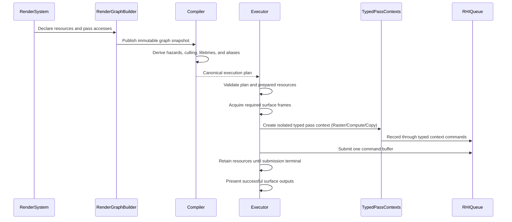

# RenderGraph Subsystem

RenderGraph separates declarative render work from physical RHI execution. Systems declare logical resources, pass accesses, and terminal outputs; the compiler derives one execution plan; the executor resolves physical resources and records the plan through restricted pass capabilities.

## Responsibilities

| Directory   | Responsibility                                                                                                                            |
| ----------- | ----------------------------------------------------------------------------------------------------------------------------------------- |
| `types/`    | Shared logical resource, restricted capability, compiler result, and execution-plan types.                                                |
| `builder/`  | Logical handles, versioned resource declarations, pass setup, prepared-resource tokens, and RenderSystem contribution.                    |
| `ranges/`   | Texture and buffer range types, normalization, subresource interval intersection, subtraction, and overlap algorithms.                    |
| `history/`  | Multi-frame resource history registry, double/triple-buffering slot acquisition, view invalidation, and retirement lifecycles.            |
| `debug/`    | Read-only projection, serialization, and deterministic checksum generation of compiled and executed render graph plans.                   |
| `compiler/` | DAG validation, hazard analysis, culling, topology, lifetime/alias/transition planning, and raster pass fusion partitioning.              |
| `context/`  | Internal pass-local capability resolution, encoder proxies, descriptor lowering, and owned-resource retirement.                           |
| `executor/` | Canonical plan validation, surface-frame ownership, physical resource binding, transient pooling, encoding, submission, and presentation. |
| `index.ts`  | Stable public RenderGraph exports. Internal `context` and executor helper modules are intentionally excluded.                             |

## Lifecycle

## Ownership Boundaries

- Builder inputs are caller-owned. Published graph snapshots detach or freeze retained values according to their public contracts.
- Logical handles are scoped to one graph identity and resource version. Consumers must not reconstruct or mutate them.
- Imported resources remain externally owned. Transient resources are owned by the executor pool and may be reused only after all retaining submissions become terminal.
- A surface frame belongs to exactly one executor invocation. A successful submission ends in `present()`; a pre-submit failure ends in `release()`.
- Pass callbacks receive only their matching typed pass context (`RasterPassContext`, `ComputePassContext`, or `CopyPassContext`). They cannot acquire surfaces, submit queues, allocate arbitrary persistent resources, or access undeclared graph resources.
- Prepared pipelines and draw resources are created before surface acquisition and validated again at the submission boundary.

## Fail-Fast Invariants

1. Execution accepts only a canonical plan produced for the exact immutable graph snapshot.
2. Every pass access must reference a handle owned by the current graph and a declared compatible range and usage.
3. Pass commands can only be invoked within their active synchronous callback scope; physical pass and encoder lifecycles are owned and closed by the executor and fusion partitions.
4. Restricted capabilities expire when their pass context closes.
5. An acquired surface frame reaches one terminal state exactly once.
6. Failed or device-lost transient resources are destroyed instead of returning to the reusable pool.
7. History read and write slots remain distinct; publication occurs only after successful submission completion.
8. Raster pass fusion preserves logical pass context isolation, attachment clearing, draw validation, and error boundaries while sharing one physical render pass encoder.

## Public API Boundary

The package barrel exports authoring, compilation, execution, history, debug, prepared-resource, and RenderSystem contracts. Pass-builder state, restricted-context implementations, encoder proxies, executor cleanup, physical binding, and lowering helpers remain internal. New public exports require an explicit contract and a public API regression test.
