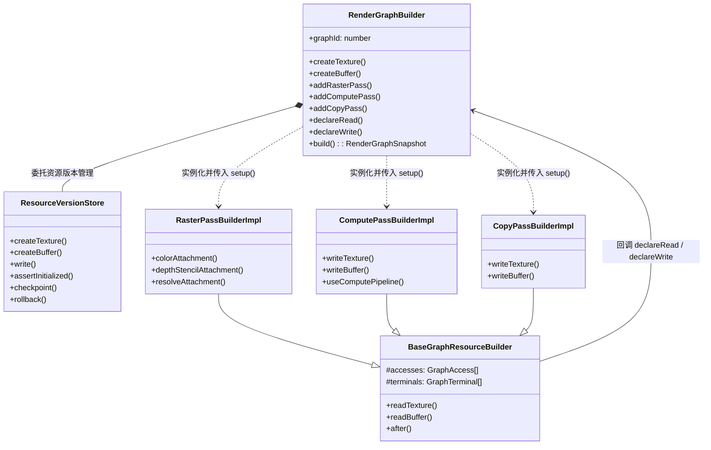
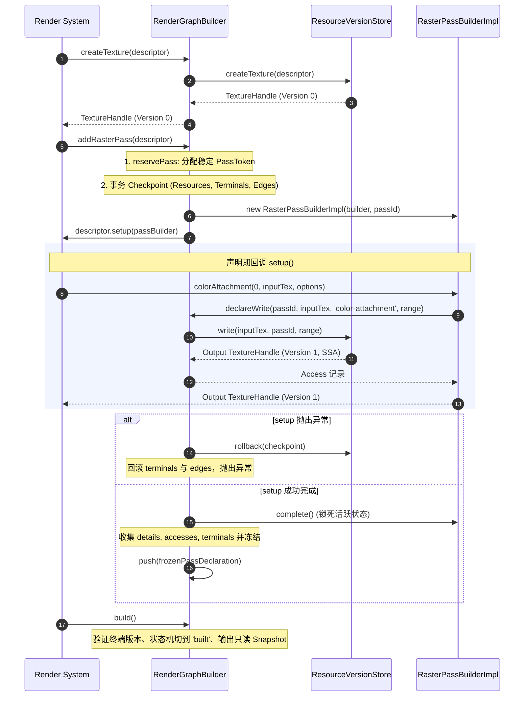

# RenderGraphBuilder 架构设计与实现解析

本文档深入解析 [`RenderGraphBuilder`](file:///Users/hgis/myproject/AetherEngine/src/render-graph/builder/builder.ts) 的设计思想、架构职责、内部状态、协作流程以及关键的不变量防御机制。

---

## 1. 架构定位与设计动机 (Why & What)

现代渲染引擎包含大量复杂的渲染通道（Pass），如 Shadow Pass、Depth Pre-pass、G-Buffer、Lighting、Post-Processing 等。直接手工调用底层图形 API（WebGPU / WebGL2）会导致三个核心痛点：

1. **显存分配失控**：临时纹理与缓冲区的生命周期难以统筹，易造成频繁分配或显存峰值膨胀。
2. **状态屏障易错**：资源读写冲突（Hazard）、布局转换（Layout Transition / Barrier）极易漏配或过度同步。
3. **无法实施全图剔除（Pass Culling）**：未激活的渲染特性对应的 Pass 往往仍然无脑执行。

[`RenderGraphBuilder`](file:///Users/hgis/myproject/AetherEngine/src/render-graph/builder/builder.ts) 充当的是 **“带事务保障的声明期前端编译器”**。

- **核心职责**：在 CPU 端收集用户/系统对资源（Texture/Buffer）的创建、对通道（Pass）的声明、以及读写访问意图（Access），最终生成一份完全冻结、不可变、包含完整因果图的快照 `RenderGraphSnapshot`。
- **非职责**：它不执行任何实际的 GPU Draw Call，不接触具体的物理显存分配，也不直接向 Queue 提交命令（这些工作交由后序的 `compiler/` 与 `executor/` 完成）。

---

## 2. 核心状态与内部模型 (State & Core Abstractions)

`RenderGraphBuilder` 内部维护了驱动整图构建的六大关键状态：

```ts
export class RenderGraphBuilder implements RenderGraphPassContextDelegate {
  readonly graphId = nextGraphId++;

  // 1. 资源版本存储中枢（SSA 语义、初始化区间追踪、版本演进）
  private readonly resources = new ResourceVersionStore(this.graphId);

  // 2. Pass 声明集合与预留索引（保证稳定顺序与前向引用）
  private readonly passes: GraphPassDeclaration[] = [];
  private readonly passTokens = new Map<number, PassToken>();
  private readonly passNamesById = new Map<number, string>();
  private readonly definedPassIds = new Set<number>();
  private readonly passNames = new Set<string>();

  // 3. 终结输出目标（如 Present 到屏幕交换链，或 Export 到图外部）
  private readonly terminals: GraphTerminal[] = [];

  // 4. 显式因果时序边（通过 after() 声明的非数据依赖）
  private readonly semanticEdges: SemanticEdge[] = [];

  // 5. 单向生命周期状态机
  private phase: 'authoring' | 'building' | 'built' = 'authoring';
}
```

---

## 3. 组件协作关系与依赖图 (Interactions)

`RenderGraphBuilder` 实现了 `RenderGraphPassContextDelegate` 接口，作为专用 Pass 构建器与资源底层之间的中介网关：



---

## 4. 端到端流程剖析 (End-to-End Lifecycle)

以一个典型的光栅化 Pass（例如 G-Buffer Pass）为例，走读完整的生命周期：



### 关键步骤解析：

1. **两阶段注册与前向引用（Two-phase Reservation）**：
   `addRasterPass` 内部首先调用 `reservePass(id)`，生成包含递增 `passId` 的 `PassToken`。
   - **价值**：允许 Pass 在尚未执行 `setup` 内容前就拥有唯一的 Token，使得后续 Pass 可以自由声明 `after(otherPassToken)`，消除作者编写声明顺序的拓扑心智负担。

2. **事务级容灾与回滚（Transaction Rollback）**：
   在执行用户的 `descriptor.setup(...)` 之前，Builder 会记录 `ResourceVersionStore.checkpoint()`。一旦用户回调中报错，Builder 会立刻无痕回滚资源版本、终端列表和依赖边，避免半初始化的脏数据污染图结构。

3. **同步性与不可变保证（Synchronous & Frozen）**：
   - `setup` 期间禁止任何异步操作（对返回值检查 `isPromiseLike`，是则 Fail-Fast 报错）。
   - `setup` 结束瞬间，PassBuilder 触发 `.complete()`，内部 `active` 标志置为 `false`，任何试图延后调用 builder 的闭包都会抛错。

---

## 5. 核心防御性设计与 Fail-Fast 不变量 (Invariants)

根据架构守卫规则（`AGENTS.md`），`builder.ts` 在关键信任边界设置了严格的断言检查：

| 机制 / 不变量                                     | 代码位置              | 防御目标                                                                                                                       |
| :------------------------------------------------ | :-------------------- | :----------------------------------------------------------------------------------------------------------------------------- |
| **单向阶段守卫 (`assertAuthoring`)**              | builder.ts L415-L420  | 禁止在 `build()` 启动或完成后继续添加 Pass、创建资源或修改拓扑。                                                               |
| **SSA 句柄合法性 (`assertGraphHandle`)**          | handles.ts L3-L42     | 严格防止未初始化的句柄、伪造对象、跨 Graph 的句柄以及版本陈旧（Stale）的句柄进入图状态。                                       |
| **描述符能力二次断言 (`assertDescriptorUsage`)**  | builder.ts L408-L413  | 防止逻辑层声明了超出 GPU 物理硬件能力的访问（例如贴图未开 `STORAGE_BINDING` 却在 Pass 中声明 `storage-write`）。               |
| **未初始化读取防御 (`assertInitialized`)**        | builder.ts L291, L321 | 确保在读取或终端输出某个 Texture/Buffer 的特定切片前，该切片已在先前的 Pass 中被完整写入。                                     |
| **终端版本有效性检验**                            | builder.ts L260-L266  | 确保 `present()` 或 `exportResource()` 引用的句柄必须是该资源的**最终逻辑版本（Final Version）**，禁止将中间临时版本送往屏幕。 |
| **呈现目标所有权守卫 (`validatePresentBinding`)** | builder.ts L377-L387  | 呈现到屏幕的纹理必须且只能是外部 Swapchain 导入的（`origin.kind === 'imported'`），且 Acquire Token 必须完全匹配。             |

---

## 6. 总结

`RenderGraphBuilder` 将**命令式**渲染逻辑转化为**纯函数式/声明式**的数据依赖图。通过 **SSA 版本推进**、**两阶段 Pass 预留**、**强事务回滚**以及**严格的生命周期状态机**，在无需接触具体 GPU 执行细节的前提下，为下游 `compiler` 和 `executor` 提供了具备完整因果不变性的执行依据。
