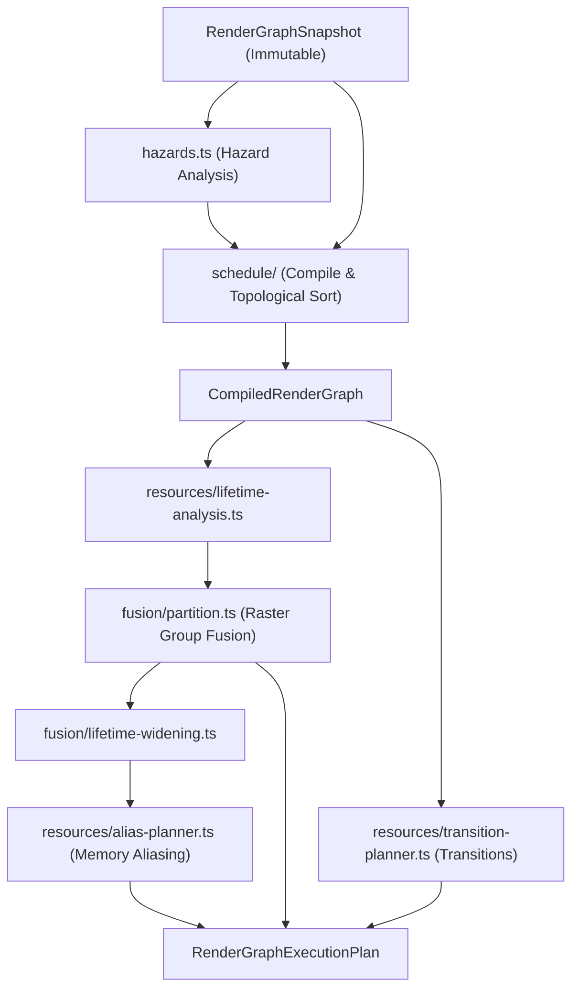

# RenderGraph Compiler Subsystem

The compiler transforms an immutable, validated `RenderGraphSnapshot` into deterministic execution artifacts, including physical schedules, topological dependencies, resource lifetime intervals, alias plans, portable state transitions, and raster pass fusion plans.

## Architecture & Subsystems

```text
src/render-graph/
  compiler/
    README.md
    index.ts

    schedule/
      compile-render-graph.ts    # Main pipeline: validation -> hazards -> culling -> topology
      topology.ts                # Root collection, predecessor closure, Kahn topological sorting, cycle detection
      validation.ts              # Pass references, hazard reversal checks, pass sorting helpers
      errors.ts                  # RenderGraphCycleError, RenderGraphSemanticHazardError
      index.ts

    resources/
      lifetime-analysis.ts       # Post-culling physical resource usage intervals [firstUse, lastUse]
      alias-planner.ts           # First-fit memory aliasing decisions and rejection diagnostic logging
      transition-planner.ts      # Backend-neutral state/layout transitions for subresources
      index.ts

    fusion/
      constants.ts               # SplitReasonCode (Category A & B), format byte estimates
      signature.ts               # Raster pass signature extraction and attachment compatibility
      usage.ts                   # GroupUsageAccumulator intra-pass resource conflict tracking
      attachment-lowering.ts     # Lower loadOp, clearValue, storeOp, and MSAA resolve operations
      residency.ts               # Transient memory footprint expansion and residency budget checks
      lifetime-widening.ts       # Widens member resource intervals across fused boundaries [groupStart, groupEnd]
      partition-types.ts         # ActiveRasterGroup and internal partition state types
      compatibility.ts           # Modular early-return evaluation pipeline for candidate pass fusion
      partition.ts               # Deterministic forward pass partitioning into RasterGroupPlans
      diagnostics.ts             # Diagnostic formatting and summary telemetry
      index.ts

    hazards.ts                   # Conservative RAW, WAR, and WAW subresource hazard edge analysis
```

## Data Flow



## Responsibilities & Invariants

1. **Schedule**:
   - Compiles topological order using deterministic tie-breaking on registration order.
   - Detects dependency cycles and outputs minimal cycle chains with involved resource versions and hazard kinds.
   - Rejects semantic ordering edges that attempt to reverse physical resource hazards.
   - Culls unreachable passes from terminal sinks and side-effect roots.

2. **Resources**:
   - Analyzes subresource-level usage intervals.
   - Plans transient memory aliasing without admitting imported, historical, or currently-pending resources.
   - Plans backend-neutral portable state transitions.

3. **Fusion (Raster Groups)**:
   - Partitions consecutive compatible raster passes into unified physical render passes to leverage on-chip TBDR memory and minimize encoder overhead.
   - Enforces strict compatibility rules: same render target signatures, no intervening clears, no unresolved hazards, safe late depth introduction proof, and memory residency budget limits.
   - Widens transient resource lifetimes to prevent aliasing hazards within the same physical pass.
