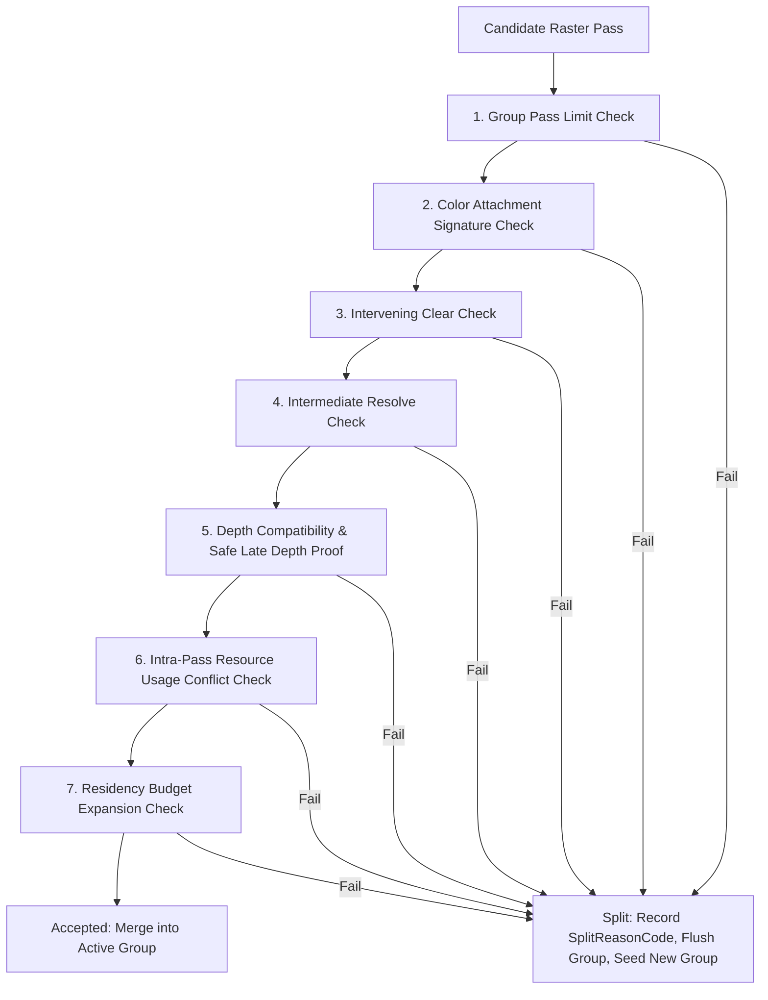

# Raster Pass Fusion Subsystem

Compiler-driven raster pass fusion merges consecutive, compatible logical raster passes into a single physical render pass (`RasterGroupPlan`). This minimizes encoder setup overhead, avoids redundant memory bandwidth, and enables mobile/tile-based GPU on-chip subpass optimization.

## Fusion Evaluation Pipeline

## Module Responsibilities

| File                     | Responsibility                                                                                                     |
| ------------------------ | ------------------------------------------------------------------------------------------------------------------ |
| `constants.ts`           | Definition of `SplitReasonCode` (Category A: stateless immediate; Category B: stateful cumulative).                |
| `signature.ts`           | Attachment descriptors, slot mapping, view ranges, and format comparison.                                          |
| `usage.ts`               | `GroupUsageAccumulator` state machine tracking attachment-vs-sampled loop hazards and buffer RAW/WAR.              |
| `compatibility.ts`       | Pure evaluation pipeline running the 7-step candidate compatibility checks.                                        |
| `residency.ts`           | Evaluates transient memory growth against `maxResidencyExpansionBytes`.                                            |
| `partition.ts`           | Deterministic forward greedy scan over topologically sorted passes.                                                |
| `attachment-lowering.ts` | Lowers group-level `loadOp` (head member), intermediate load/store, and tail `storeOp` / resolves.                 |
| `lifetime-widening.ts`   | Widens member resource intervals to `[group.start, group.end]` to prevent intermediate memory aliasing violations. |
| `diagnostics.ts`         | Formats boundary split records and telemetry counters.                                                             |

## Fail-Fast Invariants

1. **Category A Violations**: Immediately splits the physical pass if pass types, attachment layouts, or formats conflict.
2. **Intermediate Clears**: A non-initial pass requesting `load: 'clear'` always forces a group split (`SplitReasonCode.IntermediateClear`) to prevent erasing prior draws.
3. **Safe Late Depth**: Depth attachment introduced in a later pass of a group must prove that:
   - It performs a clean `depthLoad: 'clear'`.
   - The depth resource was never touched by any earlier pass in the group in any role.
4. **Lifetime Widening**: Before memory alias planning, all resources accessed within a fused group have their intervals expanded to cover the entire physical group span.
