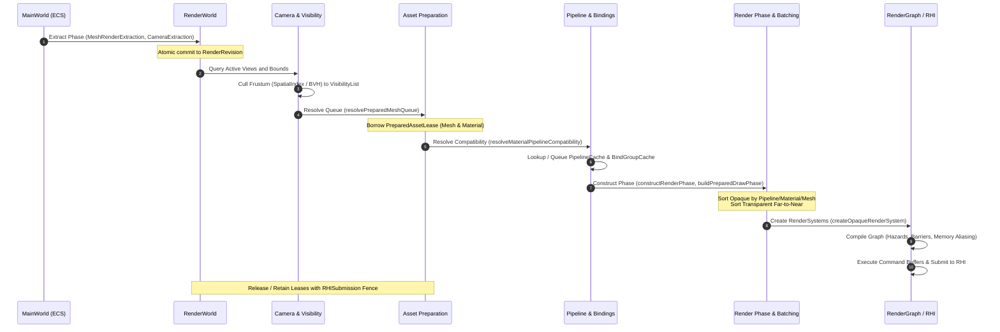

# Rendering Subsystem (`src/rendering`)

## 1. Overview & Architecture Philosophy

The `src/rendering/` subsystem provides design-driven, type-safe rendering abstractions for AetherEngine. Following `AGENTS.md` and `engine/design/v2/04-rendering/`, the architecture enforces strict separation between:

1. **Extraction**: Pulling sparse gameplay facts from `MainWorld` into the read-only, revisioned `RenderWorld`.
2. **Culling & Visibility**: Hierarchical frustum culling and spatial indexing (BVH) without GPU overhead.
3. **Asset Preparation**: Outside hot-path GPU resource uploads (meshes, materials, textures, buffers) with lease-tracked retention.
4. **Pipeline Specialization**: Canonical reflection, lowering, and caching for layout specialization across WebGPU/WebGL2 backends.
5. **Phase Sorting & Batching**: Coherent state-sorted draw call assembly preserving transparency order.
6. **Pass Compilation & Execution**: Declarative RenderGraph pass scheduling, synchronization, and RHI submission.

---

## 2. Subdirectory Responsibility Table

| Directory                      | Responsibility                                                                                                                            | Core Types & Symbols                                                                                                                 |
| :----------------------------- | :---------------------------------------------------------------------------------------------------------------------------------------- | :----------------------------------------------------------------------------------------------------------------------------------- |
| [`world/`](./world/)           | Sparse revisioned `RenderWorld`, atomic extract transactions, entity mapping, change tracking, snapshot isolation, prepared asset leases. | `RenderWorld`, `defineRenderField`, `defineExtractorToken`, `PreparedAssetRegistry`, `SubmissionRetainedValue`                       |
| [`camera/`](./camera/)         | Camera view state, projection matrices, camera extraction, frustum extraction.                                                            | `CameraProjection`, `CameraRenderSource`, `CameraViewExtraction`, `RenderView`                                                       |
| [`visibility/`](./visibility/) | Spatial indexing, bounding volume hierarchies (Static BVH), linear frustum culling.                                                       | `SpatialIndex`, `StaticBvhSpatialIndex`, `linearCullSpatialEntries`, `computeVisibility`                                             |
| [`mesh/`](./mesh/)             | Mesh extraction, GPU vertex/index buffer uploads, submesh queue resolution.                                                               | `MeshRenderSource`, `MeshRenderExtraction`, `prepareMesh`, `resolvePreparedMeshQueue`                                                |
| [`material/`](./material/)     | Material reflection compilation, binding resolution, bind group preparation and caching.                                                  | `compileMaterialBindingLayout`, `resolveMaterialBindings`, `MaterialBindGroupCache`, `SubmissionRetainedCache`                       |
| [`pipeline/`](./pipeline/)     | Canonical pipeline identities, layout compilation/lowering, layout cache, async pipeline compilation.                                     | `createPipelineKey`, `createBindingKey`, `compileBindingLayoutPlan`, `LayoutCache`, `DeviceLayoutCache`, `PipelineCache`             |
| [`lighting/`](./lighting/)     | Light extraction, clustered/forward light lists, directional shadows, Cascaded Shadow Maps (CSM), shadow atlas.                           | `PreparedLight`, `buildCpuLightLists`, `buildStableCascade`, `ShadowAtlasAllocator`, `declareShadowDepthPasses`                      |
| [`phase/`](./phase/)           | Render phase sorting, packet preparation, opaque render systems, overlay reconciler, frame runner.                                        | `buildRenderPhase`, `prepareDrawPacket`, `buildPreparedDrawPhase`, `createOpaqueRenderSystem`, `OverlayReconciler`, `runRenderFrame` |
| [`systems/`](./systems/)       | High-level RenderSystem authoring registry, query binding, per-view lowering, and pass scheduling facade.                                 | `RenderSystemRegistry`, `compileRenderSystems`, `renderSystemToken`, `RenderSystemDescriptor`                                        |

---

## 3. Data Flow & Lifecycle Sequence

---

## 4. Core Fail-Fast Invariants & Error Boundaries

1. **Generation Safety**: Every live GPU handle (`RHIBuffer`, `RHITexture`, `RHIBindGroup`, `RHIRenderPipeline`) tracks its `deviceGeneration`. Mismatches trigger immediate fail-fast errors to prevent use-after-free or cross-device corruption.
2. **Deterministic Canonical Identity**: `CanonicalKey` generates stable hashes independent of property insertion order or runtime reflection ordering.
3. **Lease Retain / Release Lifecycle**: All prepared GPU assets and bind groups implement `retain(submission)` and `release()`. Resources remain alive until hardware fences signal completion.
4. **Transparency Ordering**: Transparent items strictly sort far-to-near (painter's algorithm) and never cross batching boundaries.
5. **No Direct RHI Creation in Phase/Queue**: Queue and phase sorting are pure CPU operations; RHI allocations and compilations occur exclusively during asset preparation or inside registered compilers.
