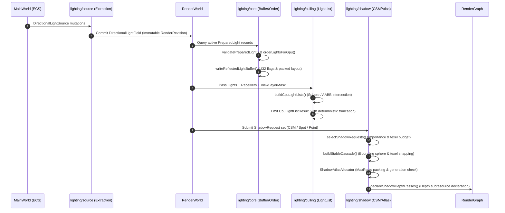

# Lighting & Shadow Subsystem (`src/rendering/lighting`)

> Status: `V2 Baseline / Conformant`
> Design Authority: [`engine/design/v2/04-rendering/06-lighting-shadow.md`](../../../engine/design/v2/04-rendering/06-lighting-shadow.md)

---

## 1. Overview & Architecture Philosophy

The `src/rendering/lighting/` subsystem provides design-driven, type-safe lighting and shadow abstractions for AetherEngine. Following `AGENTS.md` and `engine/design/v2/04-rendering/06-lighting-shadow.md`, the architecture enforces strict separation between:

1. **Extraction (`source/`)**: Incremental publication of sparse `MainWorld` ECS light sources into immutable `RenderWorld` facts with deterministic tombstone tracking.
2. **Core Light Models & Buffers (`core/`)**: Physical parameter validation (`lux` / `candela`), canonical entity ordering, and binary serialization into reflected GPU buffer layouts (`writeReflectedLightBuffer`).
3. **Culling & Fallbacks (`culling/`)**: Bounded CPU light list construction (`buildCpuLightLists`), spatial intersection tests (Sphere / AABB), and `FeaturePolicy` fallback scheduling.
4. **Shading Reference Oracles (`shading/`)**: Deterministic CPU oracle implementing Cook-Torrance GGX/Smith/Schlick direct-light BRDF evaluation (`evaluateCookTorranceDirect`) for golden test validation.
5. **Shadow Pipeline (`shadow/`)**: Shadow request arbitration and budgeting (`selectShadowRequests`), rotation-stable Cascaded Shadow Maps (CSM) calculation with texel snapping (`buildStableCascade`), generation-safe MaxRects 2D atlas packing (`ShadowAtlasAllocator`), and declarative RenderGraph pass registration (`declareShadowDepthPasses`).

---

## 2. Subdirectory Responsibility Table

| Directory                | Responsibility                                                                | Key Exports                                                                                                            |
| :----------------------- | :---------------------------------------------------------------------------- | :--------------------------------------------------------------------------------------------------------------------- |
| [`types/`](./types/)     | Domain types, interfaces, budgets, capacities, and metrics                    | `PreparedLight`, `CpuLightListResult`, `ShadowRequest`, `ShadowAtlasTileHandle`                                        |
| [`source/`](./source/)   | ECS component definition and incremental RenderWorld extraction               | `DirectionalLightSource`, `DirectionalLightField`, `DirectionalLightExtraction`, `createDirectionalLightExtractorPlan` |
| [`core/`](./core/)       | Physical parameter validation, GPU sorting, and reflected buffer packing      | `validatePreparedLight`, `orderLightsForGpu`, `writeReflectedLightBuffer`, `LIGHT_KIND`                                |
| [`culling/`](./culling/) | Light list construction, bounding intersection, and FeaturePolicy binding     | `buildCpuLightLists`, `createCpuBoundedLightListImplementation`, `BuiltInFeature`                                      |
| [`shading/`](./shading/) | CPU correctness oracle for direct PBR metallic-roughness BRDF                 | `evaluateCookTorranceDirect`, `CookTorranceDirectInput`                                                                |
| [`shadow/`](./shadow/)   | Shadow budgeting, CSM projection math, MaxRects Atlas, and RenderGraph passes | `selectShadowRequests`, `buildStableCascade`, `ShadowAtlasAllocator`, `declareShadowDepthPasses`                       |

---

## 3. Data Flow & Lifecycle Sequence

---

## 4. Core Fail-Fast Invariants & Error Boundaries

1. **Physical Units & Invariants**:
   - Directional lights require illuminance in `lux`, point/spot lights require intensity in `candela`, and `range > 0`.
   - Spot angles must strictly satisfy `0 <= inner <= outer < PI/2`.
   - Light directions must be finite, non-zero 3D vectors and are normalized prior to buffer packing.
2. **Defensive Copies & Snapshot Isolation**:
   - Extraction, list building, and shadow selection take defensive copies of caller-owned inputs and publish frozen snapshots (`Object.freeze`).
3. **CSM Sub-Texel Stability**:
   - Cascade bounding spheres are rotation-invariant and derive strictly from unjittered projection frustum slices.
   - Snapping rounds half-integers toward positive infinity (`floor(x / texel + 0.5) * texel`) to eliminate camera micro-jitter shimmering.
4. **MaxRects Atlas Hole Reclamation & Generation Safety**:
   - `ShadowAtlasAllocator` maintains maximal free rectangle partitions upon tile release.
   - Atlas resizes, full invalidations, and compactions increment `generationValue`, instantly invalidating previous `ShadowAtlasTileHandle` instances.
5. **RenderGraph Sole Scheduling Authority**:
   - `declareShadowDepthPasses` captures request facts and recorder callbacks at declaration time. Subsequent mutations to caller request objects cannot alter graph passes, layer assignments, or recording behavior.
