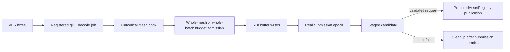

# Mesh rendering subsystem

This subsystem turns validated canonical `MeshData` into device-generation-specific prepared buffers. It does not own source glTF bytes, canonical CPU assets, materials, textures, or the scheduler's consumer leases.

| Area                                                  | Responsibility                                                                 |
| ----------------------------------------------------- | ------------------------------------------------------------------------------ |
| Root `mesh-prepare.ts` and `mesh-budgeted-prepare.ts` | Buffer creation, whole-upload admission, and rollback.                         |
| Root `mesh-upload-candidate.ts`                       | Submission-retained staged publication or terminal cleanup.                    |
| Root extraction/queue/render-source modules           | ECS-to-RenderWorld facts and prepared mesh resolution.                         |
| `gltf/`                                               | Decode-job/cook-to-renderer operation adapters for one or all mesh primitives. |
| `types/`                                              | Prepared mesh identity and layout contracts.                                   |

Invariants:

- All ranges for a selected mesh operation are admitted before the first GPU buffer is created.
- A rejected admission creates no GPU buffers; a backend failure disposes all earlier buffers and releases every reservation.
- A prepared candidate is invisible until the scheduler validates revision and surviving consumers, then commits synchronously.
- Multi-primitive publication validates all variant keys before inserting any registry entry.
- Published variants retain a submission lease; unpublished variants wait for submission terminal before physical disposal.
- The caller supplies a registered glTF decode job and an actual submission callback. The current demo still uses synchronous baseline preparation.
