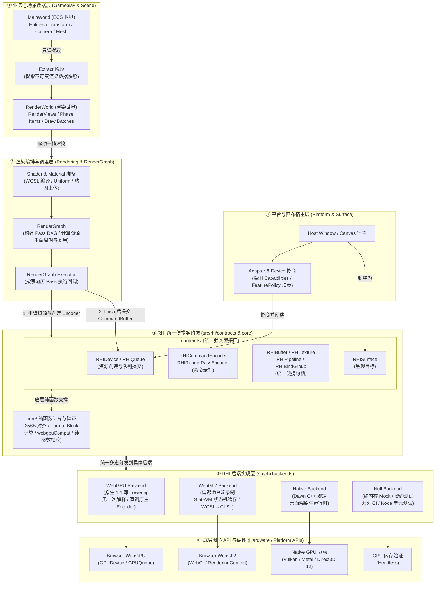
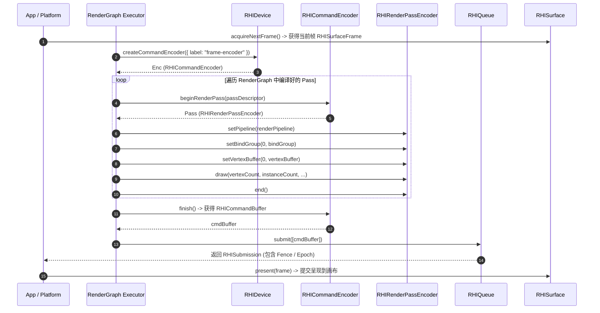

# AetherEngine RHI Subsystem: 架构全景与目录导航

本文档是 AetherEngine `src/rhi` 渲染硬件接口（Render Hardware Interface）子系统的顶层架构总览与导航索引。

---

## 目录

1. [系统全景与分层架构](#1-系统全景与分层架构)
   - [1.1 核心定位与设计哲学](#11-核心定位与设计哲学)
   - [1.2 自顶向下整体架构图](#12-自顶向下整体架构图)
   - [1.3 六层职责与核心数据流](#13-六层职责与核心数据流)
2. [一帧中的 RHI 调用生命周期](#2-一帧中的-rhi-调用生命周期)
3. [子目录专业文档索引](#3-子目录专业文档索引)
4. [源码目录结构与核心 API 速查表](#4-源码目录结构与核心-api-速查表)

---

## 1. 系统全景与分层架构

### 1.1 核心定位与设计哲学

在 AetherEngine 中，**RHI (Render Hardware Interface)** 是连接上层高层渲染系统与底层图形 API 的统一便携抽象层。

核心原则：

1. **统一的 WebGPU-like 接口**：上层系统（如 `RenderGraph`、`Material`、`Shader`）仅面向统一的类型契约编程，不通过 `if (backend === 'webgl2')` 切换公共 API；
2. **方法存在与能力可用分离**：统一的方法面（如 `createComputePipeline`）在所有后端均存在，若底层能力不支持，由 `DeviceCapabilities` 提前协商，误用时显式抛出强类型异常（`RHIUnsupportedOperationError`），绝不在底层做隐式静默偷换；
3. **世代（Generation）与生命周期安全**：所有 RHI 资源均附带 `deviceGeneration`，跨设备或已失效资源在边界即时拦截，杜绝悬空指针；
4. **纯函数验证先行**：对齐、格式尺寸、拷贝布局计算等均由纯函数在 Lowering 前完成验证，不依赖浏览器全局变量或驱动黑盒。

### 1.2 自顶向下整体架构图



### 1.3 六层职责与核心数据流

| 层级                 | 代表模块                                         | 核心职责                                                      | 一帧中的核心行为                                            |
| :------------------- | :----------------------------------------------- | :------------------------------------------------------------ | :---------------------------------------------------------- |
| **① 业务与场景层**   | `src/ecs/`                                       | 游戏逻辑权威、实体 Transform、组件状态                        | `Extract` 阶段将可变数据提取为不可变 `RenderWorld` 视图数据 |
| **② 渲染编排层**     | `src/render-graph/`, `src/rendering/`            | 构建 Pass 依赖图、管理 Transient 临时资源池、材质与着色器准备 | Executor 驱动 RHI 录制一帧所有 Pass 的绘制与计算指令        |
| **③ 平台宿主层**     | `src/platform/`                                  | 管理 Canvas 生命周期、探测硬件能力                            | 初始化 Adapter，根据策略创建 `RHIDevice` 与 `RHISurface`    |
| **④ RHI 契约与核心** | `src/rhi/contracts/`, `src/rhi/core/`            | **上层唯一依赖的 RHI 抽象**，纯接口定义与纯函数算法           | 提供与硬件解耦的句柄、编码器及 256 字节行对齐校验           |
| **⑤ RHI 后端实现**   | `src/rhi/webgpu/`, `webgl2/`, `null/`, `native/` | **具体图形 API 的 Lowering 引擎**                             | 将便携描述符和指令流翻译为底层驱动调用                      |
| **⑥ 硬件驱动层**     | 浏览器 / OS 驱动                                 | 底层图形渲染与硬件计算                                        | 执行 GPU 渲染并将画面输出到屏幕                             |

---

## 2. 一帧中的 RHI 调用生命周期



---

## 3. 子目录专业文档索引

为了保持模块高内聚与职责清晰，RHI 各子系统的深度设计与实现指南已归档至对应子目录：

| 子目录           | 专门文档                                       | 核心内容概述                                                                                       |
| :--------------- | :--------------------------------------------- | :------------------------------------------------------------------------------------------------- |
| **`contracts/`** | [**契约层规范指南**](./contracts/README.md)    | 纯接口定义、5 级依赖层次图、硬件队列角色（Graphics/Compute/Transfer）、特性两阶段协商              |
| **`core/`**      | [**核心纯算法指南**](./core/README.md)         | 256 字节行对齐纯函数、Block 尺寸计算、描述符转换、适配器能力验证                                   |
| **`webgpu/`**    | [**WebGPU 后端实现指南**](./webgpu/README.md)  | 浏览器原生 1:1 薄 Lowering 机制、零中间 IR、异步管线编译、与 Native Dawn 的共享复用                |
| **`webgl2/`**    | [**WebGL2 后端实现指南**](./webgl2/README.md)  | 延迟命令回放（`WebGL2ReplayExecutor`）、`StateVM` 状态机缓存、FBO/VAO 动态池、WGSL $\to$ GLSL 修整 |
| **`native/`**    | [**Native Dawn 后端指南**](./native/README.md) | Google Dawn C++ 绑定、Tint 自动化 Shader 转译（MSL/HLSL/SPIR-V）、与 BabylonNative 对比            |
| **`null/`**      | [**Null 无头后端指南**](./null/README.md)      | 纯内存 Mock 设备、确定性状态机与生命周期验证、Node.js / CI 极速无头测试                            |

---

## 4. 源码目录结构与核心 API 速查表

```txt
src/rhi/
 ├── contracts/              # 纯接口契约层 (零外部依赖、纯类型定义) -> 详见 contracts/README.md
 ├── core/                   # 纯函数计算与验证算法 -> 详见 core/README.md
 ├── webgpu/                 # WebGPU 原生 1:1 薄 Lowering 实现 -> 详见 webgpu/README.md
 ├── webgl2/                 # WebGL2 延迟命令流与 StateVM 状态机实现 -> 详见 webgl2/README.md
 ├── native/                 # Dawn C++ 原生后端 -> 详见 native/README.md
 ├── null/                   # 无头内存 Mock 后端 (Node / Vitest 契约测试) -> 详见 null/README.md
 ├── README.md               # 本文档：顶层架构总览与全局导航
 └── index.ts                # RHI 公共模块统一导出入口
```
