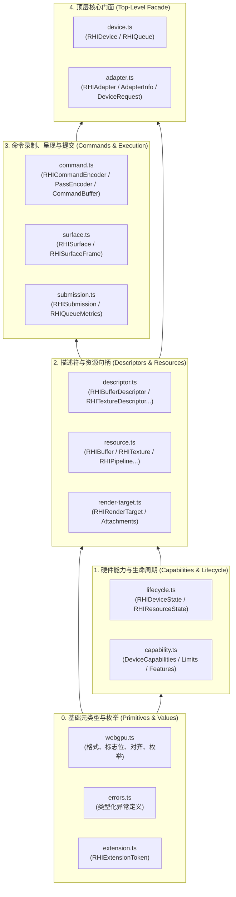

# RHI 契约层 (src/rhi/contracts) 规范指南

本文档阐述了 AetherEngine RHI 契约层（`contracts/`）的设计哲学、不可变规范、依赖层次及各核心接口定义。

---

## 1. 契约层的本质与设计哲学

[`src/rhi/contracts/`](./) 是 AetherEngine 图形硬件抽象层的**不可变规范基石**：

1. **零外部与零平台依赖**：全部由纯 TypeScript `interface`、`type` 与强类型运行时异常类组成，不引用浏览器 DOM、WebGPU 原生全局对象或 Node.js 环境；
2. **统一 WebGPU-like 接口面**：面向统一的现代显式（Explicit）图形 API 风格建模，为上层 RenderGraph、Material 与 Shader 提供稳定抽象；
3. **便携句柄与世代安全**：所有 GPU 资源句柄（`RHIBuffer`、`RHITexture` 等）继承自 [`RHIResource`](./resource.ts)，自带全局唯一 `id` 与 `generation`，跨设备或已失效资源在边界即时拦截；
4. **方法存在与能力可用分离**：所有后端实现相同的接口面（例如 `createComputePipeline`），底层能力通过 `DeviceCapabilities` 协商；若硬件不支持则抛出强类型 [`RHIUnsupportedOperationError`](./errors.ts)，杜绝隐式静默偷换。

---

## 2. 契约文件 5 级依赖层次图

---

## 3. 核心文件职责详解

| 文件                                         | 核心职责                                   | 关键类型与符号                                                                                                                       |
| :------------------------------------------- | :----------------------------------------- | :----------------------------------------------------------------------------------------------------------------------------------- |
| **[`webgpu.ts`](./webgpu.ts)**               | 定义纯值元数据类型、标志位、纹理格式与枚举 | `GPUTextureFormat`, `GPUBufferUsageFlags`, `GPUBlendState`, `GPUCompareFunction`                                                     |
| **[`capability.ts`](./capability.ts)**       | 定义硬件特性状态、数值限制与格式能力清单   | `DeviceCapabilities`, `RHIFeature`, `RHILimits`, `FormatCapabilities`, `QueueCapability`                                             |
| **[`resource.ts`](./resource.ts)**           | 定义所有 GPU 资源便携句柄接口              | `RHIResource`, `RHIBuffer`, `RHITexture`, `RHISampler`, `RHIShaderModule`, `RHIBindGroup`, `RHIRenderPipeline`, `RHIComputePipeline` |
| **[`descriptor.ts`](./descriptor.ts)**       | 定义资源创建所需的纯描述符对象             | `RHIBufferDescriptor`, `RHITextureDescriptor`, `RHIPipelineLayoutDescriptor`                                                         |
| **[`command.ts`](./command.ts)**             | 定义命令录制器与不可变指令流产物           | `RHICommandEncoder`, `RHIRenderPassEncoder`, `RHIComputePassEncoder`, `RHICommandBuffer`, `RHICommandStats`                          |
| **[`device.ts`](./device.ts)**               | 定义核心设备门面与提交队列                 | `RHIDevice`, `RHIQueue`                                                                                                              |
| **[`adapter.ts`](./adapter.ts)**             | 定义适配器与设备请求协商协议               | `RHIAdapter`, `AdapterInfo`, `DeviceRequest`                                                                                         |
| **[`surface.ts`](./surface.ts)**             | 定义画布呈现目标与交换链帧句柄             | `RHISurface`, `RHISurfaceFrame`, `RHISurfaceCapabilities`                                                                            |
| **[`render-target.ts`](./render-target.ts)** | 定义渲染目标与 RenderPass 附件描述符       | `RHIRenderTarget`, `RHIRenderPassDescriptor`, `RHIColorAttachment`                                                                   |
| **[`submission.ts`](./submission.ts)**       | 定义异步提交生命周期追踪与指标             | `RHISubmission`, `SubmissionResult`, `RHIQueueMetrics`                                                                               |
| **[`lifecycle.ts`](./lifecycle.ts)**         | 定义设备与资源生命周期状态流转             | `RHIDeviceState`, `RHIResourceState`, `DeviceLostInfo`                                                                               |
| **[`extension.ts`](./extension.ts)**         | 定义后端特化强类型扩展 Token               | `RHIExtensionToken<T>`                                                                                                               |
| **[`errors.ts`](./errors.ts)**               | 定义规范化 RHI 强类型运行时异常            | `RHIDeviceRequestError`, `RHIUnsupportedOperationError`, `RHIDeviceLostError`                                                        |

---

## 4. 核心机制设计

### 4.1 GPU 硬件队列模型 (`QueueCapability`)

RHI 契约将现代 GPU 硬件执行引擎抽象为 3 种标准队列角色：

- **`graphics`（图形主队列）**：执行标准的 3D 光栅化与着色，全能但开销最重；
- **`compute`（异步计算队列，Async Compute）**：专用于 Compute Shader 并行计算（物理模拟、视锥剔除、后处理），与图形管线并发执行（ALU Overlap）；
- **`transfer`（专用传输队列，DMA Engine）**：专用于 PCIe 总线大块内存搬运（大贴图流式加载、网格上传），不占用 GPU 渲染/计算算力。

### 4.2 特性（Features）与两阶段扩展协商

- **Baseline 核心特性（`WEBGPU_CORE_FEATURES`）**：包含 `compute`、`storage-buffer`、`storage-texture`、`indirect-draw`。在 WebGPU/Dawn 环境下默认为 `status: 'native'`。
- **可选扩展特性（如 `timestamp-query` GPU 硬件时间戳查询）**：
  - **安全与隐私防御**：高精度计时器可能涉及侧信道隐私安全，默认受保护；
  - **两阶段协商机制**：只有在 **“底层硬件物理支持”** 且 **“调用方在 `requestDevice` 中显式声明了该 Feature”** 时，协商状态才置为 `native`，否则置为 `unsupported` 并附带原因。
