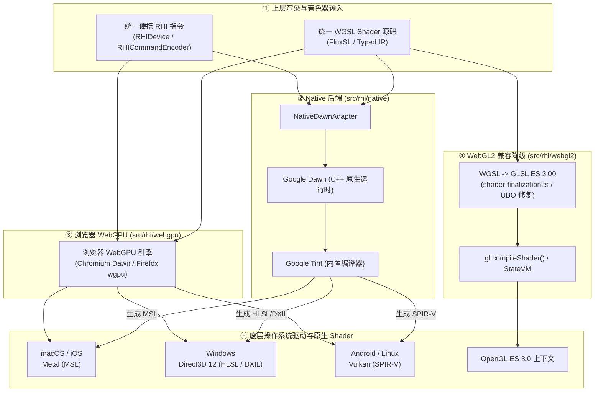

# Native RHI Backend: Dawn C++ 绑定与 Shader 转译机制指南

本文档阐述了 AetherEngine `src/rhi/native` 原生后端的 Shader 编译与转译链路、以及与 BabylonNative / bgfx 等业界方案的对比与演进。

---

## 目录

1. [Shader 编译与转译机制](#1-shader-编译与转译机制)
   - [1.1 统一上层输入：WGSL 与 Typed IR](#11-统一上层输入wgsl-与-typed-ir)
   - [1.2 底层转译引擎：Google Dawn 与 Google Tint](#12-底层转译引擎google-dawn-与-google-tint)
   - [1.3 多后端 Shader 流转全景图](#13-多后端-shader-流转全景图)
2. [与 BabylonNative 及 bgfx 的对比与演进](#2-与-babylonnative-及-bgfx-的对比与演进)
   - [2.1 方案对比矩阵](#21-方案对比矩阵)
   - [2.2 架构吸收与反模式剔除](#22-架构吸收与反模式剔除)
3. [源码结构与核心 API](#3-源码结构与核心-api)

---

## 1. Shader 编译与转译机制

### 1.1 统一上层输入：WGSL 与 Typed IR

在 AetherEngine 中，着色器体系是 **WebGPU-first** 的：

- 上层材质与管线统一采用 **WGSL**（以及由其演进的 FluxSL Typed IR）；
- 引擎不会在 TypeScript 层针对 Metal/D3D12/Vulkan 分别编写多套 AST 转换器。

### 1.2 底层转译引擎：Google Dawn 与 Google Tint

在 Native 运行时下，着色器确实最终直接运行在操作系统的原生图形 API 上，但**转译工作由 Google Dawn 内部集成的 Google Tint 编译器全权负责**：

1. TypeScript 引擎调用 `device.createShaderModule({ code: wgslSource })`，将 WGSL 字符串直接传递给 Dawn C++ 运行时；
2. **Google Tint** 在 C++ 本地驱动层执行快速词法解析与代码生成，自动将 WGSL 编译为目标平台的原生 Shader：
   - **macOS / iOS (Metal)** $\to$ **MSL (Metal Shading Language)**
   - **Windows (Direct3D 12)** $\to$ **HLSL $\to$ DXIL / DXBC**
   - **Android / Linux (Vulkan)** $\to$ **SPIR-V**
3. Dawn 直接使用编译好的原生 Shader 模块与管线状态对象（如 `MTLRenderPipelineState`、`ID3D12PipelineState`、`VkPipeline`）与硬件交互。

### 1.3 多后端 Shader 流转全景图



---

## 2. 与 BabylonNative 及 bgfx 的对比与演进

### 2.1 方案对比矩阵

| 评估维度                   | BabylonNative (bgfx 架构)                                 | AetherEngine (Dawn 架构)                                |
| :------------------------- | :-------------------------------------------------------- | :------------------------------------------------------ |
| **底层核心库**             | **bgfx**（独立 C++ 跨平台渲染库）                         | **Google Dawn**（WebGPU 官方 C++ 实现）                 |
| **着色器输入**             | 类 GLSL/HLSL 自定义宏方言                                 | **标准 WGSL**（未来支持 FluxSL）                        |
| **Shader 编译器**          | `shaderc`（基于 glslang / spirv-cross）                   | **Google Tint**（与 Dawn 深度集成）                     |
| **运行时对象模型**         | bgfx 私有 Handle 与命令流                                 | **1:1 W3C WebGPU C++ 标准对象模型**                     |
| **浏览器与 Native 一致性** | 浏览器（WebGL/WebGPU）与 Native（bgfx）存在抽象阻抗与分叉 | **浏览器与 Native 共享同一套 RHI 契约与 Lowering 管道** |

> **背景说明**：BabylonNative 诞生初期 WebGPU 规范尚未定稿，其核心架构选用 bgfx 作为跨平台底层渲染后端（NativeEngine 依赖 bgfx 驱动 DirectX/Metal/Vulkan/OpenGL）。而 AetherEngine 自设计伊始即采用 WebGPU-first 路线，Native 运行时直接采用 **Dawn + Tint** 架构，避免了 bgfx 的二次私有抽象开销与多套渲染后端维护包袱。

### 2.2 架构吸收与反模式剔除

在 [`engine/design/v2/03-platform/05-native-runtime.md`](file:///Users/hgis/myproject/AetherEngine/engine/design/v2/03-platform/05-native-runtime.md) 中，AetherEngine 对主流原生运行时方案进行了明确的取舍：

- **从 BabylonNative 吸收**：
  - `AppRuntime` / `JsRuntime` / `NativeEngine` 的分层所有权模型（OS 宿主拥有窗口与显示同步，JS 引擎运行在独立线程）；
- **从 React Native JSI 吸收**：
  - 在嵌入式场景（Embedded Mode）下由宿主持有 JS 运行时，不重复实例化第二套 JS 引擎；
- **从 Google Filament 吸收**：
  - 批处理命令流与 Driver 线程隔离设计；
- **明确拒绝的反模式（Rejected）**：
  - 拒绝将每帧的高频 `draw` / `bind` 封装为通用 Bridge RPC 调用（坚持走 Dawn Direct Hot Path）；
  - 拒绝 Babylon 历史遗留的全局可变单例状态，使用严格的 ECS 架构与世代隔离句柄（`id + generation + owner`）。

---

## 3. 源码结构与核心 API

```txt
src/rhi/native/
├── README.md            # 本文档：Dawn 绑定、Shader 转译机制与参考演进
├── index.ts             # Native 模块导出入口
├── adapter.ts           # NativeDawnAdapter 实现与 DeviceRequest 协商
├── capabilities.ts      # createNativeDawnCapabilities（Baseline 特性与 timestamp-query 协商）
└── types/
    ├── index.ts
    └── native-types.ts  # NativeDawnAdapterPort, NativeDawnBackend, NativeDawnFactsPort
```

### 核心类速查

- **[`NativeDawnAdapter`](./adapter.ts)**：实现 `RHIAdapter`，负责探测 Dawn 原生驱动信息并协商创建 `WebGPUDevice`；
- **[`NativeDawnAdapterFacts`](./types/native-types.ts)**：发布不可变的宿主事实数据（`dawnVersion: string`，`nativeBackend: 'metal' | 'vulkan' | 'd3d12'`）；
- **[`createNativeDawnCapabilities`](./capabilities.ts)**：构建 Dawn 特性快照，将 `compute`、`storage-buffer` 等核心能力标为 `native`，并对 `timestamp-query` 等扩展执行两阶段协商。
