# WebGL2 RHI Backend: 架构设计与模块组织指南

本文档阐述了 AetherEngine `src/rhi/webgl2` 后端的模块划分、分层设计、目录组织与核心不变量。

---

## 1. 核心定位与设计哲学

WebGL2 后端是 AetherEngine 便携 RHI（Render Hardware Interface）在 WebGL2 环境下的实现。与原生 1:1 薄 Lowering 的 WebGPU 后端不同，**WebGL2 必须将上层现代显式（Explicit）无状态 API 契约适配到底层基于全局状态机（Global State Machine）的同步驱动环境**。

为了实现这一目标，WebGL2 后端构建了四个关键机制：

1. **延迟命令流回放（Deferred Command Replay）**：在 `RHICommandEncoder` 阶段仅记录轻量不可变指令流，在 `queue.submit()` 时按需回放；
2. **状态机虚拟机（StateVM）与缓存池**：维护全局 GL 状态机缓存，智能过滤并消除冗余的 `glBind*` 与 `glUseProgram` 调用；
3. **管线着色器修整与绑定融合（Shader Finalization & Binding Fusion）**：负责将 WGSL 翻译后的 GLSL ES 3.00 规范化，建立 Combined Sampler 融合映射并保证 NDC `[0, 1]` 深度裁剪一致性；
4. **资源封装与租约管理（Resource Wrappers & Lease Tracking）**：管理底层 WebGL 原生句柄，并在异步提交生命周期内保障跨帧资源安全。

---

## 2. 目录结构与模块职责划分

`src/rhi/webgl2` 采用按职责划分的功能子目录结构，顶层保留与 `webgpu/`、`null/` 对齐的 RHI 契约门面：

```txt
src/rhi/webgl2/
├── README.md                  # 本文档：架构全景与模块组织规范
├── index.ts                   # WebGL2 后端统一对外导出
├── adapter.ts                 # RHIAdapter 实现：硬件能力探测与 Device 协商
├── device.ts                  # RHIDevice 门面：资源创建分发与 Context Lost 处理
├── queue.ts                   # RHIQueue 实现：批量提交回放与 Fence/Epoch 同步
├── capabilities.ts            # WebGL2 硬件能力探测、格式支持与 Limits 映射
├── context-control.ts         # 上下文控制扩展 Token (WebGL2ContextControlExtension)
├── metrics.ts                 # 性能指标收集器 (Draws, Skips, State Cache Hits)
├── errors.ts                  # WebGL2ProgramCreationError 等异常定义
├── diagnostics.ts             # Context Lost 诊断信息格式化
├── unsupported.ts             # 不支持操作守卫 (Compute / Storage 强类型抛错)
│
├── commands/                  # 【1. 命令录制与回放子系统】
│   ├── command.ts             # WebGL2CommandEncoder / WebGL2CommandBuffer
│   ├── pass.ts                # WebGL2RenderPassEncoder / WebGL2ComputePassEncoder
│   ├── replay.ts              # WebGL2ReplayExecutor (核心回放执行器)
│   ├── submission.ts          # WebGL2Submission 异步跟踪句柄
│   └── index.ts
│
├── state/                     # 【2. 状态机与缓存池子系统 (StateVM)】
│   ├── state.ts               # WebGL2StateVM (GL 全局状态机与冗余调用消除)
│   ├── cache-key.ts           # VAO / FBO / Sampler 缓存 Key 纯函数计算
│   ├── framebuffer-cache.ts   # WebGL2FramebufferCache (FBO 动态池与完整性校验)
│   ├── vertex-array-cache.ts  # WebGL2VertexArrayCache (VAO 动态池与布局复用)
│   └── index.ts
│
├── pipeline/                  # 【3. 管线、着色器与绑定融合】
│   ├── pipeline.ts            # WebGL2RenderPipeline / ComputePipeline / PipelineLayout
│   ├── shader.ts              # WebGL2ShaderModule
│   ├── shader-finalization.ts # finalizeWebGL2Shader (GLSL 3.00 #version 注入与 Uniform 修复)
│   ├── bindings.ts            # WebGL2BindGroupLayout 映射与 Binding Fusion Matrix
│   ├── clip-depth.ts          # WebGL2ClipDepthMode (NDC [0, 1] 深度规范化策略)
│   └── index.ts
│
├── resources/                 # 【4. GPU 资源封装与传输】
│   ├── resource.ts            # WebGL2Buffer / WebGL2Texture / WebGL2Sampler / WebGL2BindGroup
│   ├── upload.ts              # 纯函数数据行对齐校验与 Buffer/Texture 上传
│   ├── lease-count.ts         # Surface Backing 租约计数管理
│   └── index.ts
│
├── browser/                   # 【5. 浏览器环境适配 (Platform Seam)】
│   ├── README.md              # 浏览器端口架构设计与反射机制指南
│   ├── context-port.ts        # WebGL2RenderingContext 原始上下文创建与丢失监听
│   ├── capability-query.ts    # 硬件 Limits / Formats / 精度动态探测
│   ├── state-defaults.ts      # 确定性基线 GL 状态初始化
│   ├── surface.ts             # WebGL2BrowserSurface 画布呈现实现
│   ├── gl-call.ts             # 基于 Reflect 的安全反射调用与强类型工具
│   ├── operations/            # 原生 WebGL2 细粒度操作子系统 (Resource, Render, FBO 等)
│   └── types/
│
└── types/                     # 【6. 类型定义】
    ├── native-types.ts        # 原生 WebGL2 接口与上下文 Port 类型
    ├── command-types.ts       # 内部 Replay 指令与 Pass 快照定义
    ├── shader-types.ts        # 着色器翻译接口与绑定清单定义
    ├── resource-types.ts      # 资源描述与句柄类型
    ├── extension-types.ts     # 扩展控制接口
    └── index.ts
```

---

## 3. 子系统架构详解

### 3.1 命令录制与回放 (`commands/`)

```mermaid
flowchart LR
    Caller["RenderGraph / Caller"] -->|"1. beginRenderPass / draw"| Encoder["WebGL2CommandEncoder"]
    Encoder -->|"2. finish()"| CmdBuf["WebGL2CommandBuffer<br/>(只读命令流快照)"]
    CmdBuf -->|"3. queue.submit()"| Queue["WebGL2Queue"]
    Queue -->|"4. execute()"| Replay["WebGL2ReplayExecutor"]
    Replay -->|"5. 过滤冗余调用"| StateVM["WebGL2StateVM"]
    StateVM -->|"6. 发出实际 GL 调用"| GLContext["WebGL2NativeContextPort"]
```



- **`command.ts`**：实现 `RHICommandEncoder`，在录制期捕获输入参数的不可变快照，追踪资源租约（Lease），防止调用方可变对象在录制后产生副作用。
- **`pass.ts`**：实现 `RHIRenderPassEncoder`，维护当前 Pass 内的管线、绑定组、顶点缓冲和视口/裁剪状态；对于 WebGL2 不支持的 Compute Pass 或 Indirect Draw，显式抛出 `RHIUnsupportedOperationError`。
- **`replay.ts`**：`WebGL2ReplayExecutor` 顺序消费指令流，驱动 `WebGL2StateVM`、`WebGL2FramebufferCache` 和 `WebGL2VertexArrayCache`。
- **`submission.ts`**：管理逻辑提交生命周期状态（`pending` -> `completed` / `failed` / `device-lost`）。

### 3.2 状态机缓存与对象池 (`state/`)

WebGL2 是单线程全局状态机，频繁调用 `glBindBuffer`、`glUseProgram`、`glBindVertexArray` 会造成显著的驱动开销。

- **`state.ts` (`WebGL2StateVM`)**：跟踪当前上下文绑定的 Program、VAO、FBO、Viewport、Scissor、Vertex Buffers、Index Buffer、Uniform Buffers、Textures 与 Samplers。当新命令的状态与缓存完全一致时，自动跳过原生 GL 调用并记录 `stateSkips` 指标。外部代码若直接操作上下文，需通过 `invalidate()` 重置全部状态缓存为 `UNKNOWN`。
- **`cache-key.ts`**：提供确定性、纯函数的 Key 计算算法（如 Attachment 格式/层级构成的 FBO Key、顶点布局与 Buffer 句柄构成的 VAO Key）。
- **`framebuffer-cache.ts`**：按附件视图和采样配置动态复用 `WebGLFramebuffer`，并在创建时执行完整性校验（`checkFramebufferStatus`）。
- **`vertex-array-cache.ts`**：按顶点布局与缓冲绑定动态复用 `WebGLVertexArrayObject`，在资源销毁时自动驱逐对应条目。

### 3.3 管线与着色器降级 (`pipeline/`)

- **`pipeline.ts`**：创建 Program 并反射验证 Binding Manifest，确保 GLSL 中的 Uniform Block 与 Combined Sampler 接口与上层声明完全一致。
- **`shader-finalization.ts`**：纯函数管道，向翻译后的 GLSL ES 3.00 注入 `#version 300 es`、扩展需求指令（`#extension ... : require`）以及编译期宏定义常量（`#define ...`），并计算最终着色器指纹。
- **`bindings.ts`**：实现 Bind Group Layout、Pipeline Layout 以及绑定组验证，维护 256 字节 UBO 对齐与动态偏移（Dynamic Offset）检查。
- **`clip-depth.ts`**：实现 WebGL2 与 WebGPU 的 NDC 深度统一约定。若支持 `EXT_clip_control`，优先启用 `zero-to-one`；否则通过投影矩阵补偿将公共 `[0, 1]` 深度无缝降低到 WebGL 坐标系。

### 3.4 资源管理与数据上传 (`resources/`)

- **`resource.ts`**：封装 `WebGL2Buffer`、`WebGL2Texture`、`WebGL2Sampler` 等对象，携带唯一的 `id` 与 `generation`，在设备丢失或手动 `dispose()` 时安全释放驱动资源。
- **`upload.ts`**：处理内存数据上传，提供 4 字节/256 字节数据行步长校验、子资源包围盒边界检查与像素拷贝下发。
- **`lease-count.ts`**：维护跨帧复用资源（如 Surface Backing Texture）的引用计数，防止资源在 GPU 回放执行完成前被过早释放。

---

## 4. 关键设计不变量

1. **统一门面透明度**：上层系统仅通过 `src/rhi/index.ts` 访问标准 RHI 符号，目录重构与后端内部划分对调用方完全透明；
2. **无静默降级原则**：WebGL2 不支持 Compute Pipeline、Storage Buffer 等 WebGPU 特性，遇到时必须通过 `unsupported.ts` 抛出结构化 `RHIUnsupportedOperationError`，绝不在底层静默改写语义；
3. **世代（Generation）隔离**：Context Lost 后旧 Generation 的原生句柄全部失效，新 Device Generation 必须重新探测 Capabilities 与建立全新的 StateVM 缓存；
4. **纯函数计算优先**：所有 Key 计算、对齐计算、着色器修整均为无副作用的纯函数，与渲染调用解耦并具备独立可测试性。
