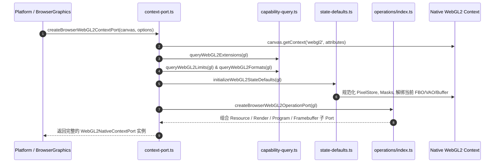
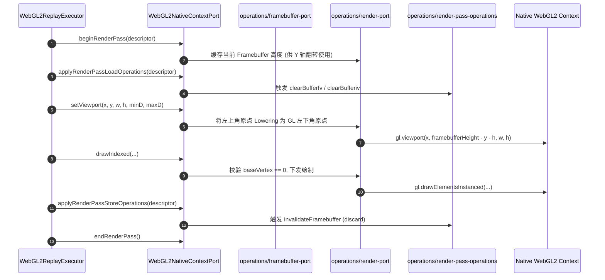
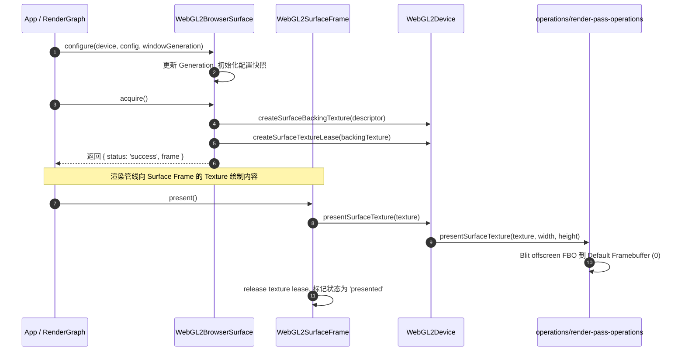

# WebGL2 Browser Platform Port: 架构设计与职责指南

本文档阐述了 AetherEngine `src/rhi/webgl2/browser` 模块的架构定位、目录组织、底层反射机制、生命周期数据流与核心不变量。

---

## 1. 核心定位与六边形架构角色

在 AetherEngine 的 RHI（Render Hardware Interface）分层架构中，`src/rhi/webgl2/browser` 扮演了 **六边形架构（Ports and Adapters）中的物理平台驱动适配器（Browser Platform Adapter）**。

```text
┌────────────────────────────────────────────────────────┐
│                   AetherEngine Portable RHI            │
│               (RHIDevice, RHIQueue, Encoder)           │
└───────────────────────────┬────────────────────────────┘
                            │
┌───────────────────────────▼────────────────────────────┐
│                  src/rhi/webgl2/ (Core)                │
│       StateVM, ReplayExecutor, Pipeline/FBO Cache      │
└───────────────────────────┬────────────────────────────┘
                            │ (通过 WebGL2NativeContextPort 契约解耦)
┌───────────────────────────▼────────────────────────────┐
│              src/rhi/webgl2/browser/ (Platform)        │
│   ├── surface.ts               (Canvas Surface 呈现)   │
│   ├── context-port.ts          (Context/Lost/Limits)   │
│   ├── capability-query.ts      (特性/格式/精度探测)     │
│   ├── state-defaults.ts        (确定性基线状态重置)     │
│   └── operations/              (底层原生 WebGL2 操作集合)│
└───────────────────────────┬────────────────────────────┘
                            │ (Reflect / native calls)
┌───────────────────────────▼────────────────────────────┐
│          Browser DOM / WebGL2RenderingContext          │
└────────────────────────────────────────────────────────┘
```

- **隔离核心与宿主**：`src/rhi/webgl2/`（StateVM、ReplayExecutor、Cache 池等）不直接引用浏览器全局变量与 DOM API，仅通过纯 TypeScript 接口 [`WebGL2NativeContextPort`](file:///Users/hgis/myproject/AetherEngine/src/rhi/webgl2/types/native-types.ts) 与底层通信；
- **平台专属实现**：`src/rhi/webgl2/browser` 负责获取真实的 `WebGL2RenderingContext`、监听 Canvas 的 `webglcontextlost` 与 `webglcontextrestored` 事件、动态探测硬件 Limits 与支持的格式，并将上层标准指令分发为原生 WebGL2 调用。

---

## 2. 目录结构与模块职责划分

```txt
src/rhi/webgl2/browser/
├── README.md                  # 本文档：架构全景与模块组织指南
├── index.ts                   # 统一对外导出入口 (ContextPort, Surface, Types)
├── context-port.ts            # 主入口：创建 WebGL2NativeContextPort，管理生命周期与 Lost/Restored
├── capability-query.ts        # 硬件能力动态探测 (Limits, Extensions, Precision, Formats)
├── state-defaults.ts          # 确定性基线 GL 状态初始化 (Masks, Alignments, Unbinds)
├── surface.ts                 # WebGL2BrowserSurface 与 WebGL2SurfaceFrame (Canvas 交换链呈现)
├── gl-call.ts                 # 基于 Reflect 的安全反射调用与强类型 Fail-Fast 工具
│
├── operations/                # 【底层原生 WebGL2 操作子系统】
│   ├── index.ts               # 聚合子 Port 并导出 createBrowserWebGL2OperationPort
│   ├── resource-port.ts       # Buffer / Texture / Sampler 创建、销毁与元数据跟踪
│   ├── render-port.ts         # 绘制指令 (draw / drawIndexed) 与视口/光栅化/深度模板配置
│   ├── program-port.ts        # 着色器编译、Program 链接与 Uniform Block / 纹理单元绑定
│   ├── framebuffer-port.ts    # FBO 创建、多渲染目标 drawBuffers 下发与 VAO 配置
│   ├── render-pass-operations.ts # RenderPass 的 Load / Store / Clear 与 MSAA Resolve
│   ├── binding-port.ts        # UBO (bindBufferRange) 与 Texture / Sampler 槽位绑定
│   ├── copy-port.ts           # Buffer-to-Buffer 复制 (copyBufferSubData) 与 Fence 同步
│   ├── texture-copy-port.ts   # 纹理数据写入 (writeTexture) 与各类纹理像素拷贝
│   └── texture-subresource.ts # 2D / 2D Array / 3D 纹理子资源尺寸计算与校验
│
└── types/                     # 【浏览器平台专有类型】
    ├── browser-types.ts       # BrowserWebGL2Canvas, BrowserWebGL2ContextOptions 等
    └── index.ts
```

---

## 3. `Reflect.get(gl, name)` 反射机制与设计哲学

在 [`gl-call.ts`](file:///Users/hgis/myproject/AetherEngine/src/rhi/webgl2/browser/gl-call.ts) 以及各操作 Port 中广泛使用了 `Reflect.get(gl, name)` 与 `Reflect.apply(method, gl, args)`。其背后的设计哲学包括：

### 3.1 零 `any` 侵入与严格类型收窄（Type Safety First）

- 模块中的 `gl` 对象被抽象为不透明的 `BrowserWebGL2Object`（即 `object`）；
- 若使用下标访问 `gl[name]`，TypeScript 会强制要求索引签名或推断为 `any`，直接破坏代码库的类型安全；
- 若使用 `(gl as any)[name]`，则违反了 `AGENTS.md` 中 **"Avoid `any`; use `unknown` plus safe narrowing"** 的基本原则；
- 使用 `const method = Reflect.get(gl, name);` 返回 `unknown`，随后通过 `if (typeof method !== 'function')` 进行确定性的类型收窄，兼具极高的严谨性与安全性。

### 3.2 宿主环境解耦与 Mock 单元测试友好

- 引擎无需强制引入庞大的浏览器 DOM 全局类型库（如 `@types/webgl2` 或复杂的 Polyfill），核心可以在纯 Node.js / Vitest 环境下平稳运行；
- 单测可以使用轻量化的 JS 对象 Mock 任意 WebGL2 接口（参见 `test/rhi/webgl2/webgl2-browser-*.test.ts`），而不需要依赖 Headless 浏览器环境。

### 3.3 统一的 Fail-Fast 异常拦截与驱动诊断

- 当宿主环境或特定移动端驱动缺失某项标准 WebGL2 方法时，`glCall` 能够抛出明确指示方法名称的异常（如 `WebGL2 context does not implement texStorage2D().`），而非让 JavaScript 引擎抛出模糊的 `TypeError: gl[name] is not a function`。

---

## 4. 数据流与生命周期序列

### 4.1 上下文创建与能力探测流程



### 4.2 渲染回放与操作分发流程



### 4.3 Canvas Surface 呈现生命周期



---

## 5. 核心不变量与 Fail-Fast 异常边界

1. **Context Lost 世代隔离**：
   - 注册 `webglcontextlost` 事件并调用 `event.preventDefault()` 防止浏览器默认丢弃画布；
   - 暴露 `lost` 与 `restored` Promise，上下文丢失后所有旧 Generation 的原生 WebGL 资源句柄立即失效；
   - 上下文恢复后必须重新执行 `initializeWebGL2StateDefaults`。
2. **NDC [0, 1] 深度与视口坐标规范化**：
   - 上层统一使用左上角原点视口与 NDC `[0, 1]` 深度约定；
   - `render-port.ts` 在下发 `gl.viewport` 与 `gl.scissor` 时，必须获取当前激活 FBO 的高度，并计算 `framebufferHeight - y - height`；若缺少有效附件尺寸，立即抛出 Fail-Fast 异常。
3. **附件尺寸与格式严格校验**：
   - `framebuffer-port.ts` 与 `render-pass-operations.ts` 在创建 FBO 或执行 Resolve 时，严格校验所有 Color 附件与 Depth/Stencil 附件的宽高一致性（`validateAttachmentExtents`），杜绝隐蔽的尺寸失配崩溃。
4. **非零 BaseVertex 显式防御**：
   - WebGL2 原生不支持 `firstInstance` 或 `baseVertex != 0` 的非索引/索引绘制，`render-port.ts` 对非零参数立即显式拒绝，防止驱动静默忽略导致图形撕裂。
