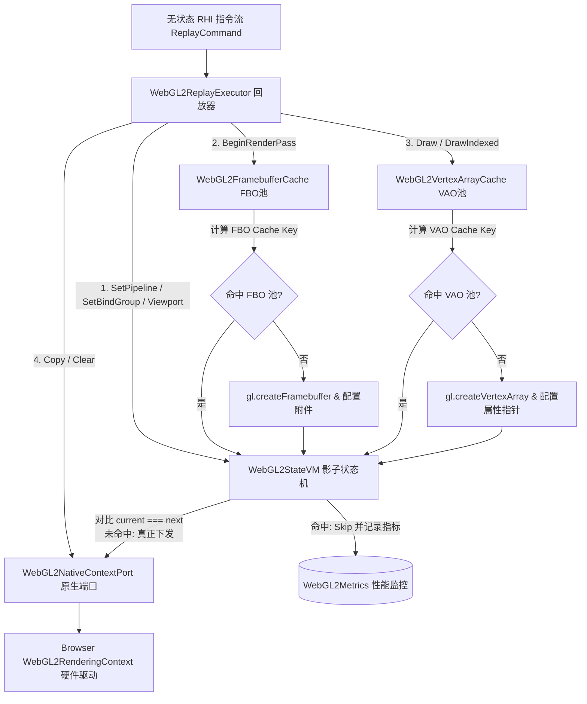

# WebGL2 State Management & Object Cache Subsystem: 架构设计与职责指南

本文档阐述了 AetherEngine `src/rhi/webgl2/state` 模块的架构定位、状态机虚拟机（StateVM）、FBO/VAO 缓存键计算、对象池复用机制与性能优化设计。

---

## 1. 核心定位与设计哲学

WebGL2 基于 OpenGL ES 3.0，本质上是一个**同步且具有全局状态机（Global State Machine）**的图形驱动 API。而在现代图形引擎中，上层 RHI（Render Hardware Interface）采用类似 WebGPU 的**显式、无状态指令录制范式（Explicit & Stateless Recording）**。

为了高效调和两者的范式冲突，`src/rhi/webgl2/state` 子系统承担了以下核心职责：

1. **影子状态追踪与冗余消除（Shadow State & Redundant Call Elimination）**：在 JavaScript 端维护轻量影子状态机（`WebGL2StateVM`），自动过滤幂等的 GL 状态切换（如 `gl.useProgram`, `gl.bindTexture`, `gl.viewport`），最小化 JS ↔ C++ 跨边界调用与 GPU 驱动验证开销；
2. **确定性 Cache Key 计算（Deterministic Hash Keys）**：将复合渲染目标与顶点布局转化为紧凑的字符串缓存键（`cache-key.ts`）；
3. **重量级容器对象池化复用（Heavy Object Caching & Pooling）**：按需创建并缓存 Framebuffer（FBO）和 Vertex Array Object（VAO），避免频繁触发底层对象的创建与绑定开销；
4. **安全失效与上下文恢复（Fail-Safe Invalidation）**：支持外部污染时的局部失效及 WebGL Context Lost 时的确定性资源废弃。

---

## 2. GL 操作分类与缓存设计策略

并非所有 GL 函数都使用同一种缓存机制。引擎对 WebGL2 的所有操作进行了精准的分层与分类：

| 操作类别                                         | 代表性原生 GL 函数                                                                                                                                             | 缓存与处理策略                                                                                         | 设计依据与动机                                                                     |
| :----------------------------------------------- | :------------------------------------------------------------------------------------------------------------------------------------------------------------- | :----------------------------------------------------------------------------------------------------- | :--------------------------------------------------------------------------------- |
| **1. 标量 / 槽位状态变更**<br>(State Changes)    | `gl.useProgram`<br>`gl.bindTexture`<br>`gl.bindSampler`<br>`gl.viewport`<br>`gl.scissor`<br>`gl.bindBufferRange(UNIFORM)`<br>`gl.cullFace` / `gl.depthFunc` 等 | **由 `WebGL2StateVM` 维护影子状态**。<br>若新值与当前缓存一致则直接 **Skip**，否则下发底层并更新缓存。 | 具有**幂等性**与状态保持性。同一帧内重复设置同一状态是纯粹的 CPU/驱动浪费。        |
| **2. 复杂容器对象**<br>(Heavy Container Objects) | `gl.createFramebuffer`<br>`gl.framebufferTexture2D`<br>`gl.createVertexArray`<br>`gl.vertexAttribPointer` 等                                                   | **通过确定性 Cache Key 在对象池中管理**。<br>复用已有句柄，无需反复组装绑定。                          | FBO 和 VAO 内部状态复杂，反复配置会触发显存重新映射和驱动层校验。                  |
| **3. 动作与副作用指令**<br>(Action / Execution)  | `gl.drawArrays`<br>`gl.drawElements`<br>`gl.clear`<br>`gl.copyBufferSubData`<br>`gl.texSubImage2D` 等                                                          | **不缓存，直接下发底层执行**。                                                                         | 这些是产生实际显存修改或像素渲染的**动作指令**，每次执行都有独立副作用，不能跳过。 |

---

## 4. 整体流水线与数据流（Pipeline Architecture）



---

## 5. Cache Key 机制详解 (`cache-key.ts`)

为了在对象池中快速检索复用已有 FBO / VAO，引擎通过纯函数计算确定性 Cache Key。

### 5.1 FBO 缓存键：`createFramebufferCacheKey`

唯一标识一个渲染通道（RenderPass）的完整附件拓扑：

```txt
g{generation}|c:{colors}|d:{depth}
```

- **`g{generation}`**：设备/上下文代数，确保 Context Lost 后不会跨代复用已失效句柄；
- **`c:{colors}`**：颜色附件列表，每个附件用 `>` 连接：
  - `viewKey(view)`：底层纹理视图描述符切片；
  - `resolveTarget`：MSAA 解析目标视图（无则为 `'-'`）；
  - `sampleCount`：采样数（如 `1`, `4`）；
- **`d:{depth}`**：深度/模板视图 `viewKey(view)`（无则为 `'-'`）。

> **`viewKey` 的切片结构**：  
> `view.id@generation:baseMipLevel:mipLevelCount:baseArrayLayer:arrayLayerCount:format`

### 5.2 VAO 缓存键：`createVertexArrayCacheKey`

唯一标识当前 Draw Call 所需的“顶点布局 + VBO 绑定 + IBO 索引”：

```txt
g{pipeline.generation}|l:{layout}|v:{vertices}|i:{index}
```

- **`g{pipeline.generation}`**：管线唯一代数；
- **`l:{layout}`**：管线中顶点布局描述符（`vertex.buffers`）的序列化摘要；
- **`v:{vertices}`**：按 `slot` 升序排列的顶点缓冲状态：  
  `{slot}:{buffer.id}@{generation}:{offset}:{size}:{arrayStride}`
- **`i:{index}`**：索引缓冲状态（无则为 `'-'`）：  
  `{buffer.id}@{generation}:{offset}:{size}:{format}`

---

## 6. 状态机虚拟机 (`WebGL2StateVM`)

### 6.1 追踪的影子状态

- **标量 / 句柄状态**：`program`, `rasterKey`, `depthStencilKey`, `framebuffer`, `vertexArray`
- **几何裁剪状态**：`viewport [x, y, w, h, minDepth, maxDepth]`, `scissor [x, y, w, h]`
- **槽位绑定状态**：
  - `vertexBuffers: Map<slot, BufferState>`
  - `uniformBuffers: Map<binding, BufferState>`
  - `textures: Map<unit, WebGL2NativeObject>`
  - `samplers: Map<unit, WebGL2NativeObject>`

### 6.2 哨兵标记 `UNKNOWN` 与失效处理

```ts
const UNKNOWN = Symbol('unknown-webgl2-state');
```

- 初始状态或被污染状态使用 `UNKNOWN` 标记；
- **`invalidate()`**：当第三方库（如 2D Canvas、外部 UI）调用了原生 GL 接口，或发生 Context Reset 时，调用此方法清空所有本地状态缓存，强制下一次渲染完整同步。

### 6.3 性能监控与指标收集 (`WebGL2Metrics`)

`StateVM` 内置性能度量：

- `recordProgramCacheHit()` / `recordProgramCacheMiss()`：跟踪着色器程序切换命中率；
- `recordStateSkip()`：记录成功消除的冗余 GL 调用次数；
- `recordGLCall()`：记录实际穿透至底层的 GL 指令数。

---

## 7. 上下文丢失与资源废弃 (`abandon`)

在 WebGL 环境下，发生 `webglcontextlost` 时：

1. 底层所有的 GL 句柄（FBO、VAO、Texture、Buffer）已被 GPU 驱动自动作废；
2. 此时调用 `gl.deleteFramebuffer` 或 `gl.deleteVertexArray` 不仅无意义，还可能触发驱动异常；
3. 对象池提供了 `abandon()` 方法，直接清空哈希表释放 JS 引用，而不尝试向已损坏的上下文发送 `delete*` 命令。
