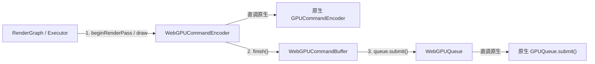

# WebGPU RHI Backend: 原生 1:1 薄 Lowering 实现指南

本文档阐述了 AetherEngine `src/rhi/webgpu` 原生 WebGPU 后端的架构定位、1:1 薄 Lowering 机制、模块划分与核心不变量。

---

## 1. 核心定位与设计哲学

WebGPU 后端是 AetherEngine 面向现代浏览器环境的原生快路径实现。

核心设计哲学：

1. **零二次解释开销（Zero Overhead 1:1 Lowering）**：在命令录制期，`WebGPUCommandEncoder` **1:1 直接调用浏览器原生 `GPUCommandEncoder`**，不产生第二套中间指令 IR；
2. **提前验证，快速失败**：在创建阶段将便携描述符一次性 Lower 为原生对象，结合 `upload-validation.ts` 等纯函数算法在提交前拦截非法内存越界与行步长未对齐；
3. **完全复用于 Native Dawn**：由于 Google Dawn 遵循 1:1 WebGPU C++ 规范，`src/rhi/webgpu` 的全部核心实现（`device.ts`、`command.ts`、`queue.ts` 等）直接作为 [`src/rhi/native`](../native/) 的执行下沉端。

---

## 2. 源码结构与模块职责

```txt
src/rhi/webgpu/
├── README.md               # 本文档：架构定位与 1:1 Lowering 指南
├── index.ts                # WebGPU 模块统一导出入口
├── adapter.ts              # WebGPUAdapter (浏览器 GPUAdapter 协商与设备创建)
├── device.ts               # WebGPUDevice (统一核心设备门面，管理代际与资源创建)
├── queue.ts                # WebGPUQueue (原生队列提交与 Fence 同步)
├── command.ts              # WebGPUCommandEncoder / WebGPUCommandBuffer
├── passes.ts               # WebGPURenderPassEncoder / WebGPUComputePassEncoder
├── resource.ts             # WebGPUBuffer, WebGPUTexture, WebGPUSampler, WebGPUBindGroup
├── surface.ts              # WebGPUSurface (Canvas 上下文配置与交换链获取)
├── submission.ts           # WebGPUSubmission (异步工作完成追踪)
├── pipeline-async.ts       # 异步管线并行编译支持
├── upload-validation.ts    # 256 字节对齐与贴图内存上传纯函数校验
├── core-features.ts        # WEBGPU_CORE_FEATURES 核心基线特性常量
├── diagnostics.ts          # WebGPU 设备丢失与诊断信息格式化
├── metrics.ts              # 队列提交与命令指标收集
├── browser/                # 浏览器环境适配 (GPU / GPUAdapter / GPUDevice Port)
└── types/                  # WebGPU 原生接口与内部类型
```

---

## 3. 核心机制详解

### 3.1 命令录制与直通提交



- 命令录制直接穿透到底层浏览器原生编码器；
- 在 `finish()` 时直接封装原生 `GPUCommandBuffer`，在 `queue.submit()` 时批量下发。

### 3.2 内存上传与 256 字节行对齐校验

- 在调用 `writeBuffer` 或 `writeTexture` 前，由 `upload-validation.ts` 纯函数严格校验 `bytesPerRow` 是否满足 WebGPU 规范要求的 **256 字节对齐**，提前抛出可读异常，避免底层驱动产生静默黑屏或崩溃。
