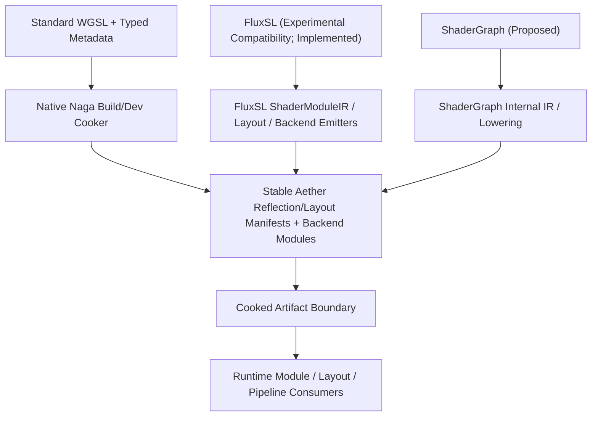

# AetherEngine Shader Subsystem

> Status: `Migrating / P1 Baseline`
> Design Authority: [`engine/design/v2/04-rendering/02-shader-system.md`](../../engine/design/v2/04-rendering/02-shader-system.md)

---

## 1. Overview & Architecture Philosophy

The approved production authoring contract is standard WGSL plus versioned typed sidecar metadata. The native build/dev cooker validates and reflects WGSL with Naga and publishes cooked modules and manifests for downstream GPU execution. FluxSL remains available as an explicitly opted-in experimental compatibility input, not the default production recommendation. ShaderGraph remains Proposed.

### Core Invariants

1. **Closed Authoring Boundary**: `ShaderSourceKind` is exactly `'wgsl' | 'flux-experimental' | 'shader-graph'`. Materials, RenderGraph, and RHI never branch on authoring language or parse raw source strings; they consume cooked modules and manifests.
2. **Reflection-Driven ABI**: Uniform and storage buffer offsets, sizes, alignments, and strides are strictly derived from layout policy calculators (`std140` / `WGSL uniform` / `WGSL storage`) via `ShaderBindingManifest` and `BufferLayoutManifest`. CPU writers must never guess padding or offsets.
3. **Multi-Backend & Variant Specialization**: Backends emit target-compliant code (WGSL for WebGPU, GLSL ES 3.00 with binding fusion for WebGL2) and perform validation before caching. Variant selections are normalized into canonical `VariantKey` strings with conflict/mutex validation.
4. **Tool/Runtime Separation**: Naga belongs only in the native build/dev cooker. Production browser/runtime bundles contain no compiler/parser or Naga WASM fallback and never download compiler components.
5. **Metadata Is Not Source Rewriting**: Typed sidecars carry schema version, entry points, imports, variants, capability requirements, material bindings, and cook policy. They cannot override reflected types, resource layouts, offsets, or entry-point signatures and cannot textually preprocess WGSL.

---

## 2. Directory Responsibilities

| Directory                          | Responsibility                                                                                    | Key Exports                                                                                    |
| :--------------------------------- | :------------------------------------------------------------------------------------------------ | :--------------------------------------------------------------------------------------------- |
| [`types/`](./types/)               | Canonical shared types, diagnostics, AST, IR, manifests, and compilation options                  | `ShaderBindingManifest`, `BufferLayoutManifest`, `ShaderDiagnostic`, `ShaderCompileRequest`    |
| [`layout/`](./layout/)             | std140/WGSL memory layout calculation, struct sizing, binding group reflection, CPU buffer writer | `createBufferLayoutManifest`, `createShaderBindingManifest`, `ShaderParameterWriter`           |
| [`pipeline/`](./pipeline/)         | Runtime artifact loading, variant specialization, cache, and fallback                             | `loadCookedShaderModule`, `resolveShaderVariants`, `ShaderArtifactCache`                       |
| [`builtins/`](./builtins/)         | Authored built-in WGSL, cooked runtime artifacts, and WebGL2 translation ports                    | `STANDARD_LIT_SHADER_SOURCE`, `STANDARD_LIT_SHADER_ARTIFACT`, `STANDARD_LIT_WEBGL2_TRANSLATOR` |
| [`experimental/`](./experimental/) | Clustered experimental/legacy pipelines: FluxSL compatibility compiler and ShaderGraph (Proposed) | `parseFluxShader`, `lexFluxSource`, `ShaderCompiler`, `ShaderGraphCompiler`                    |

---

## 3. Data Flow & Compilation Lifecycle

`ShaderModuleIR`, the TypeScript layout calculators, and the TypeScript WGSL/GLSL emitters describe
the implemented FluxSL pipeline. They are not a normative intermediate representation or lowering path
for authored WGSL. The native cooker owns WGSL parsing, validation, reflection, layout derivation,
and backend lowering, then publishes the same stable Aether-owned manifest/module boundary consumed by
the runtime. ShaderGraph may use its own internal IR, but must converge at that boundary as well.

Built-in standard-lit uses authored `.wgsl` plus typed sidecar metadata. `pnpm run shader:generate`
publishes a validated immutable runtime artifact with WGSL, GLSL ES 3.00, bindings, buffer layouts,
and stage IO; `pnpm run shader:check` rejects stale generated artifacts.
Loading the runtime package never parses the authored source. Standard-lit implements the direct GGX/Smith/Schlick metallic-roughness BRDF
with world-space normal, position, and camera inputs. Its first LDR browser slice treats the light
color as normalized direct radiance; physical lux, HDR accumulation, exposure, tonemap, and IBL
remain coordinated Lighting and Post/Color work.

---

## 4. Fail-Fast & Diagnostic Invariants

- **Syntax & Parsing**: Unexpected tokens or unterminated blocks throw structured `ShaderDiagnostic` with exact `SourceSpan` (URI, line, column, length) and stage `'parse'`.
- **Type Checking**: Duplicate structs, conflicting bindings, unknown types, and illegal address space access are flagged at stage `'typecheck'`.
- **Memory Layout**: Recursive structs without pointers/indirection are rejected with cycle paths. Struct member alignment must satisfy target policy invariants.
- **Backend Validation**: Any shader that fails backend validation produces a diagnostic with the driver log in `backendLog`.
