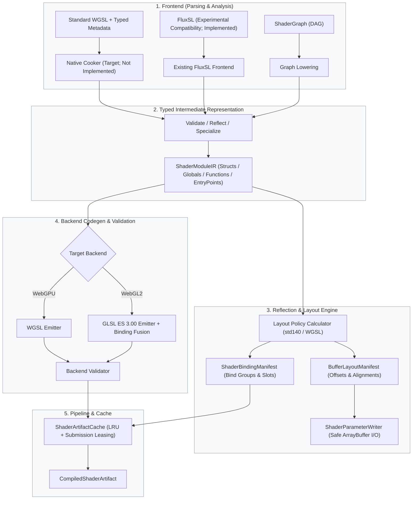

# AetherEngine Shader Subsystem

> Status: `Migrating / P1 Baseline`
> Design Authority: [`engine/design/v2/04-rendering/02-shader-system.md`](../../engine/design/v2/04-rendering/02-shader-system.md)

---

## 1. Overview & Architecture Philosophy

The approved production authoring contract is standard WGSL plus versioned typed sidecar metadata. A planned native build/dev cooker will validate and reflect WGSL with Naga and publish cooked modules and manifests for downstream GPU execution. That native cooker is not implemented yet. The repository currently implements the FluxSL compiler pipeline; FluxSL remains available as an explicitly opted-in experimental compatibility input, not the default production recommendation. ShaderGraph remains Proposed.

### Core Invariants

1. **Closed Authoring Boundary**: `ShaderSourceKind` is exactly `'wgsl' | 'flux-experimental' | 'shader-graph'`. Materials, RenderGraph, and RHI never branch on authoring language or parse raw source strings; they consume cooked modules and manifests.
2. **Reflection-Driven ABI**: Uniform and storage buffer offsets, sizes, alignments, and strides are strictly derived from layout policy calculators (`std140` / `WGSL uniform` / `WGSL storage`) via `ShaderBindingManifest` and `BufferLayoutManifest`. CPU writers must never guess padding or offsets.
3. **Multi-Backend & Variant Specialization**: Backends emit target-compliant code (WGSL for WebGPU, GLSL ES 3.00 with binding fusion for WebGL2) and perform validation before caching. Variant selections are normalized into canonical `VariantKey` strings with conflict/mutex validation.
4. **Tool/Runtime Separation**: Naga belongs only in the planned native build/dev cooker. Production browser/runtime bundles contain no compiler/parser or Naga WASM fallback and never download compiler components.
5. **Metadata Is Not Source Rewriting**: Typed sidecars carry schema version, entry points, imports, variants, capability requirements, material bindings, and cook policy. They cannot override reflected types, resource layouts, offsets, or entry-point signatures and cannot textually preprocess WGSL.

---

## 2. Directory Responsibilities

| Directory                  | Responsibility                                                                                    | Key Exports                                                                                   |
| :------------------------- | :------------------------------------------------------------------------------------------------ | :-------------------------------------------------------------------------------------------- |
| [`types/`](./types/)       | Canonical shared types, diagnostics, AST, IR, manifests, and compilation options                  | `ShaderBindingManifest`, `BufferLayoutManifest`, `ShaderDiagnostic`, `ShaderCompileRequest`   |
| [`ir/`](./ir/)             | Strongly typed intermediate representation (IR) nodes, symbol IDs, and module definitions         | `ShaderModuleIR`, `ShaderTypeId`, `ShaderSymbolId`, `ShaderExpressionIR`, `ShaderStatementIR` |
| [`frontend/`](./frontend/) | Source include resolution, cycle detection, lexer, recursive-descent parser, and typechecker      | `resolveShaderSource`, `lexFluxSource`, `parseFluxShader`, `lowerFluxModules`                 |
| [`layout/`](./layout/)     | std140/WGSL memory layout calculation, struct sizing, binding group reflection, CPU buffer writer | `createBufferLayoutManifest`, `createShaderBindingManifest`, `ShaderParameterWriter`          |
| [`backends/`](./backends/) | Backend emitters (WGSL, GLSL ES 3.00), WebGL2 binding fusion, and backend validation dispatch     | `emitShaderBackend`, `emitWgslModule`, `emitGlslEsModule`, `fuseGlslTextureSamplerBindings`   |
| [`pipeline/`](./pipeline/) | High-level compiler orchestration, variant specialization, content-addressed cache, and cooking   | `ShaderCompiler`, `resolveShaderVariants`, `ShaderArtifactCache`, `cookShaderArtifact`        |
| [`graph/`](./graph/)       | ShaderGraph DAG compiler, node caching, and IR lowering service                                   | `ShaderGraphCompiler`, `ShaderGraphCompileService`                                            |
| [`builtins/`](./builtins/) | Authored built-in FluxSL, generated typed artifacts, and WebGL2 translation ports                 | `STANDARD_LIT_SHADER_SOURCE`, `STANDARD_LIT_SHADER_MODULE`, `STANDARD_LIT_WEBGL2_TRANSLATOR`  |
| [`utils/`](./utils/)       | Deterministic 64-bit FNV-1a content hashing and canonical JSON stringification                    | `stableHash`, `canonicalStringify`                                                            |

---

## 3. Data Flow & Compilation Lifecycle

Built-in shaders currently use the implemented FluxSL frontend during repository cooking. The authored
`.flux` file remains the source of truth for this compatibility implementation; `pnpm run shader:generate`
publishes a generated immutable IR snapshot, and `pnpm run shader:check` rejects stale generated artifacts.
This describes current behavior, not the approved authoring target or an implemented native WGSL cooker.
Loading the runtime package never parses the authored source. Standard-lit implements the direct GGX/Smith/Schlick metallic-roughness BRDF
with world-space normal, position, and camera inputs. Its first LDR browser slice treats the light
color as normalized direct radiance; physical lux, HDR accumulation, exposure, tonemap, and IBL
remain coordinated Lighting and Post/Color work.

---

## 4. Fail-Fast & Diagnostic Invariants

- **Syntax & Parsing**: Unexpected tokens or unterminated blocks throw structured `ShaderDiagnostic` with exact `SourceSpan` (URI, line, column, length) and stage `'parse'`.
- **Type Checking**: Duplicate structs, conflicting bindings, unknown types, and illegal address space access are flagged at stage `'typecheck'`.
- **Memory Layout**: Recursive structs without pointers/indirection are rejected with cycle paths. Struct member alignment must satisfy target policy invariants.
- **Backend Validation**: Any shader that fails backend validation produces a diagnostic with the driver log in `backendLog`.
