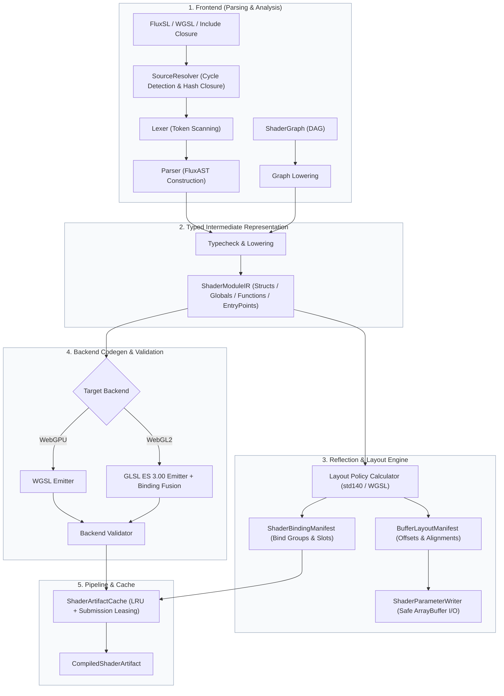

# AetherEngine Shader Subsystem

> Status: `Migrating / P1 Baseline`
> Design Authority: [`engine/design/v2/04-rendering/02-shader-system.md`](../../engine/design/v2/04-rendering/02-shader-system.md)

---

## 1. Overview & Architecture Philosophy

The Shader subsystem is a deterministic, content-addressed, type-safe compiler and reflection production chain. It bridges high-level authoring inputs (FluxSL, WGSL bootstrap, and ShaderGraph) with downstream GPU execution in the Render System and RHI.

### Core Invariants

1. **Frontend Convergence at Typed IR**: All input dialects (FluxSL, WGSL bootstrap, ShaderGraph) must lower into the strongly typed `ShaderModuleIR`. Materials, RenderGraph, and RHI never branch on authoring language or parse raw source strings.
2. **Reflection-Driven ABI**: Uniform and storage buffer offsets, sizes, alignments, and strides are strictly derived from layout policy calculators (`std140` / `WGSL uniform` / `WGSL storage`) via `ShaderBindingManifest` and `BufferLayoutManifest`. CPU writers must never guess padding or offsets.
3. **Multi-Backend & Variant Specialization**: Backends emit target-compliant code (WGSL for WebGPU, GLSL ES 3.00 with binding fusion for WebGL2) and perform validation before caching. Variant selections are normalized into canonical `VariantKey` strings with conflict/mutex validation.
4. **Content-Addressed Immutability**: All compiled artifacts, IR modules, and reflection manifests are keyed by deterministic 64-bit FNV-1a content hashes. Cache eviction is LRU-managed with active submission leasing to prevent in-flight use-after-free.

---

## 2. Directory Responsibilities

| Directory                  | Responsibility                                                                                    | Key Exports                                                                                   |
| :------------------------- | :------------------------------------------------------------------------------------------------ | :-------------------------------------------------------------------------------------------- |
| [`types/`](./types/)       | Canonical shared types, diagnostics, AST, IR, manifests, and compilation options                  | `ShaderBindingManifest`, `BufferLayoutManifest`, `ShaderDiagnostic`, `ShaderCompileRequest`   |
| [`ir/`](./ir/)             | Strongly typed intermediate representation (IR) nodes, symbol IDs, and module definitions         | `ShaderModuleIR`, `ShaderTypeId`, `ShaderSymbolId`, `ShaderExpressionIR`, `ShaderStatementIR` |
| [`frontend/`](./frontend/) | Source include resolution, cycle detection, lexer, recursive-descent parser, and typechecker      | `resolveShaderSource`, `lexFluxSource`, `parseFluxShader`, `lowerFluxModules`                 |
| [`layout/`](./layout/)     | std140/WGSL memory layout calculation, struct sizing, binding group reflection, CPU buffer writer | `createBufferLayoutManifest`, `createShaderBindingManifest`, `ShaderParameterWriter`          |
| [`backends/`](./backends/) | Backend emitters (WGSL, GLSL ES 3.00), WebGL2 binding fusion, and backend validation dispatch     | `emitShaderBackend`, `emitWgslModule`, `emitGlslEsModule`, `fuseGlslTextureSamplerBindings`   |
| [`pipeline/`](./pipeline/) | High-level compiler orchestration, variant specialization, content-addressed cache, and cooking   | `ShaderCompiler`, `resolveShaderVariants`, `ShaderArtifactCache`, `cookShaderArtifact`        |
| [`graph/`](./graph/)       | ShaderGraph DAG compiler, node caching, and IR lowering service                                   | `ShaderGraphCompiler`, `ShaderGraphCompileService`                                            |
| [`builtins/`](./builtins/) | Authored built-in FluxSL, generated typed artifacts, and WebGL2 translation ports                 | `STANDARD_LIT_SHADER_SOURCE`, `STANDARD_LIT_SHADER_MODULE`, `STANDARD_LIT_WEBGL2_TRANSLATOR`  |
| [`utils/`](./utils/)       | Deterministic 64-bit FNV-1a content hashing and canonical JSON stringification                    | `stableHash`, `canonicalStringify`                                                            |

---

## 3. Data Flow & Compilation Lifecycle

Built-in shaders use the same frontend during repository cooking. The authored `.flux` file is
the source of truth; `pnpm run shader:generate` publishes a generated immutable IR snapshot, and
`pnpm run shader:check` rejects stale generated artifacts. Loading the runtime package never parses
the authored source. The current standard-lit source intentionally preserves the first rendered
slice's Lambert lighting; Cook-Torrance PBR and IBL remain separate Lighting/Shadow work.

---

## 4. Fail-Fast & Diagnostic Invariants

- **Syntax & Parsing**: Unexpected tokens or unterminated blocks throw structured `ShaderDiagnostic` with exact `SourceSpan` (URI, line, column, length) and stage `'parse'`.
- **Type Checking**: Duplicate structs, conflicting bindings, unknown types, and illegal address space access are flagged at stage `'typecheck'`.
- **Memory Layout**: Recursive structs without pointers/indirection are rejected with cycle paths. Struct member alignment must satisfy target policy invariants.
- **Backend Validation**: Any shader that fails backend validation produces a diagnostic with the driver log in `backendLog`.
