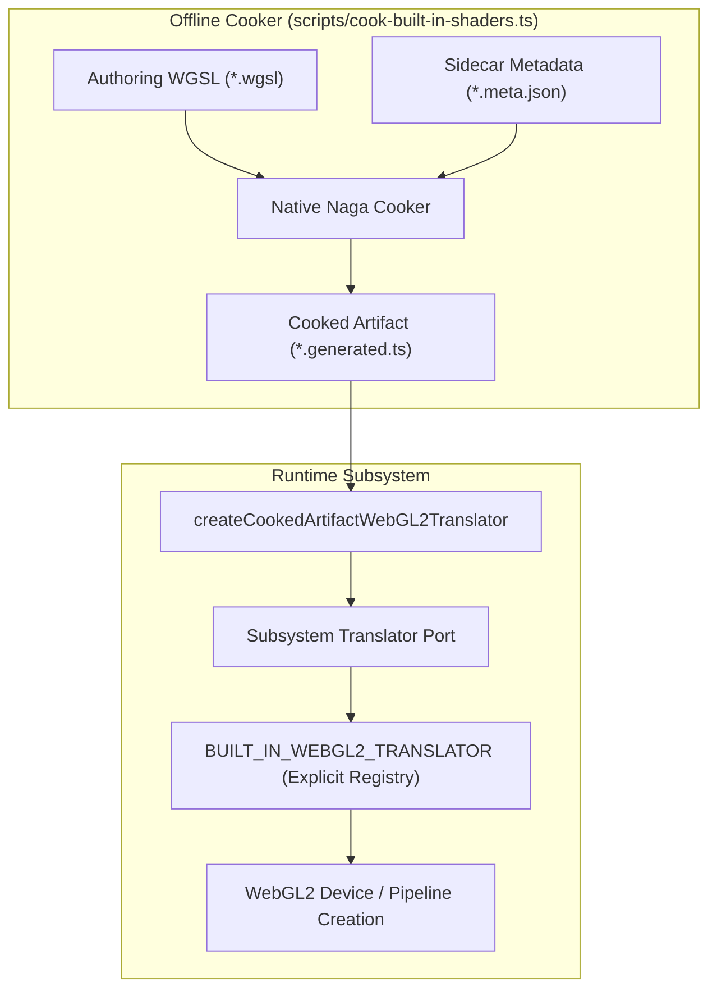

# Built-in Shader Subsystem

> Status: `Production Baseline`
> Design Authority: [`engine/design/v2/04-rendering/02-shader-system.md`](../../../engine/design/v2/04-rendering/02-shader-system.md)

---

## 1. Overview & Architecture Philosophy

The built-in shader subsystem provides the engine's core materials, post-processing filters, and culling/lighting kernels. Built-in shaders are authored in standard WGSL accompanied by versioned typed sidecar metadata (`*.wgsl.meta.json`). The native cooker compiles, reflects, and validates them via Naga at build time, generating immutable TypeScript runtime artifacts (`*.generated.ts`).

### Core Design Principles

1. **Logical Family Clustering**: Shaders are clustered into cohesive functional family subdirectories rather than flat files, grouping authoring sources, metadata, generated runtime artifacts, and runtime translation adapters together.
2. **Generic Translator Adapter**: Runtime WebGL2 lowering delegates to `createCookedArtifactWebGL2Translator`, which standardizes active binding reflection, `#version 300 es` stripping, physical/program slot assignment, and ABI fingerprints without code duplication.
3. **Explicit Fail-Fast Translation Routing**: The WebGL2 router (`BUILT_IN_WEBGL2_TRANSLATOR`) matches shaders by explicit WGSL module identity and fails fast on any unrecognized module, preventing silent fallback to standard-lit.
4. **Backend-Specific Family Implementations**: Where platform capabilities diverge (e.g. WebGPU compute shaders vs. WebGL2 integer-MRT raster kernels for light lists), families provide backend-explicit subdirectories (`webgpu/` and `webgl2/`) rather than ad-hoc suffix chains.

---

## 2. Directory Responsibilities

| Directory / File                                                   | Responsibility                                                                                          | Key Exports                                                                       |
| :----------------------------------------------------------------- | :------------------------------------------------------------------------------------------------------ | :-------------------------------------------------------------------------------- |
| [`standard-lit/`](./standard-lit/)                                 | Baseline metallic-roughness PBR forward shading material                                                | `STANDARD_LIT_SHADER_ARTIFACT`, `STANDARD_LIT_WEBGL2_TRANSLATOR`                  |
| [`post-color/`](./post-color/)                                     | Post-processing tonemapping and color grading filter                                                    | `POST_COLOR_SHADER_ARTIFACT`, `POST_COLOR_WEBGL2_TRANSLATOR`                      |
| [`light-list/`](./light-list/)                                     | Clustered light-culling kernels: WebGPU compute storage-buffer and WebGL2 integer-MRT raster transforms | `LIGHT_LIST_SHADER_ARTIFACT`, `LIGHT_LIST_WEBGL2_SHADER_ARTIFACT`                 |
| [`standard-lit-list/`](./standard-lit-list/)                       | Forward lighting evaluation against clustered light lists with sampler-to-texture fanout                | `STANDARD_LIT_LIST_WEBGPU_SHADER_ARTIFACT`, `STANDARD_LIT_LIST_WEBGL2_TRANSLATOR` |
| [`cooked-artifact-translator.ts`](./cooked-artifact-translator.ts) | Generic WebGL2 translation adapter for cooked runtime artifacts                                         | `createCookedArtifactWebGL2Translator`                                            |
| [`webgl2-translator.ts`](./webgl2-translator.ts)                   | Explicit module-identity router dispatching to subsystem translators with fail-fast validation          | `BUILT_IN_WEBGL2_TRANSLATOR`, `createWebGL2TranslationRouter`                     |
| [`index.ts`](./index.ts)                                           | Public package facade re-exporting all canonical symbols and legacy compatibility aliases               | All family exports & backward-compatibility aliases                               |

---

## 3. Data Flow & Compilation Lifecycle

---

## 4. Fail-Fast Invariants & Error Boundaries

- **Router Fail-Fast**: Passing an unknown or unregistered shader module to `BUILT_IN_WEBGL2_TRANSLATOR` throws immediately with the entry-point name and stage; it never silently falls back to a default material.
- **Entry-Point Enforcement**: Subsystem translators validate that requested entry points exist in the cooked artifact and conform to any declared `supportedEntryPoints` whitelist.
- **Binding Limits & Kinds**: Only supported WebGL2 binding kinds (`uniform-buffer`, `texture`, `sampler`) are accepted by the adapter; unhandled binding kinds throw structured errors during translation rather than producing invalid GLSL.
- **Artifact Immutability**: All generated runtime artifacts and reflected arrays/objects are deeply frozen (`Object.freeze`) at initialization.
