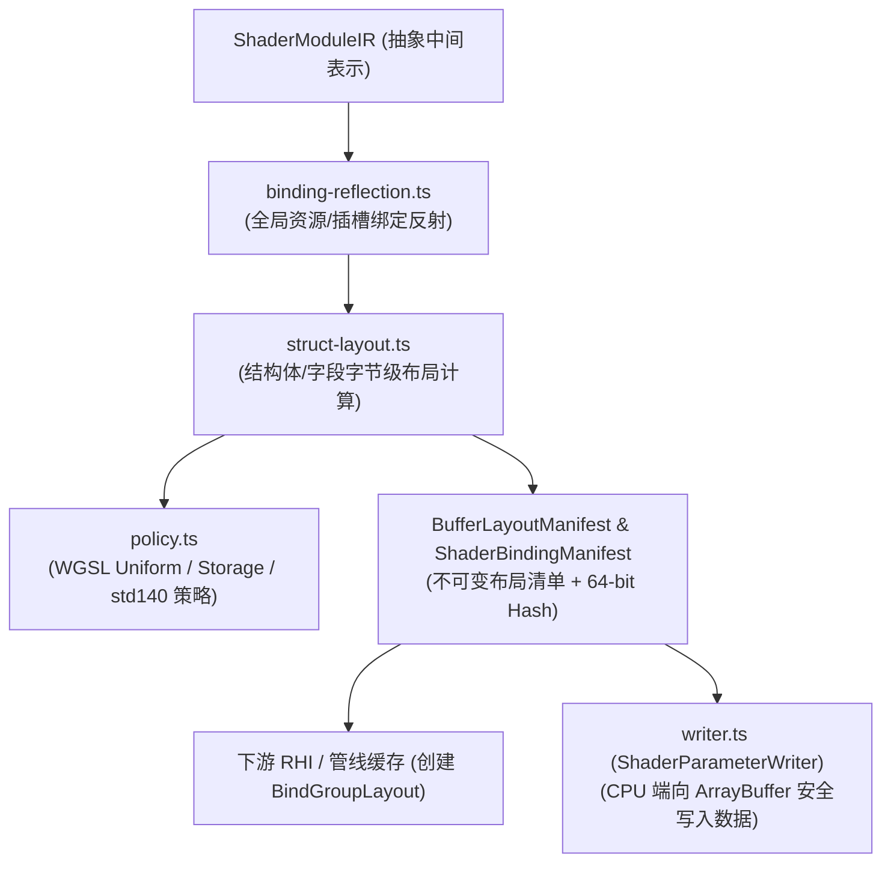
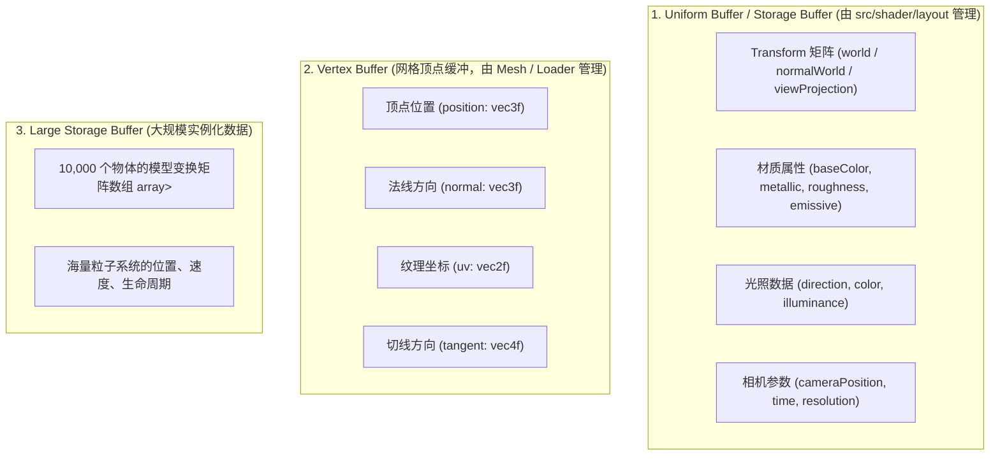

# AetherEngine Shader Layout 核心架构与对齐机制深度解析

本文档全面梳理了 AetherEngine 着色器子系统（Shader Subsystem）中 `src/shader/layout` 模块的设计架构、内存对齐原理、Padding 机制、ArrayBuffer 数据存储分类，以及与 `/Users/hgis/myproject/render-engine` 中其他主流开源引擎的设计对比。

---

## 一、 核心要解决什么问题？（Why Layout Matters）

在现代图形渲染中，CPU（TypeScript）需要把材质参数、光照数据、相机矩阵等写入内存（`ArrayBuffer`），然后上传到 GPU 的 Uniform Buffer 或 Storage Buffer 中供着色器使用。

但 GPU 硬件和着色语言标准（WGSL、GLSL std140）有着极其严苛且复杂的**内存对齐（Alignment）与填充（Padding）规则**：

- **`vec3<f32>` 陷阱**：虽然只占 12 个字节，但在 Uniform 缓冲区中强制按 **16 字节对齐**。
- **数组跨步（Stride）**：在 Uniform / std140 规范下，哪怕是 `array<f32, 4>`，每个 `f32` 元素都会被强制填充为 **16 字节步长**。
- **结构体整体补齐**：结构体的大小必须向上取整为其最大成员对齐（或标准规定的 16 字节）的整数倍。
- **双后端差异**：WebGPU Storage Buffer 允许更紧凑的对齐，而 WebGL2 则完全不支持 Storage Buffer 且必须遵循传统的 `std140`。

> **设计原则**：CPU 开发者绝不能在代码中靠“猜”或“硬编码”来计算内存偏移量（Magic Number Offset）。`layout` 模块的作用就是：**根据 Shader 定义自动精确推导每一个字段的字节偏移、大小和对齐，并提供类型安全的 CPU 内存写入工具。**

---

## 二、 目录架构与职责划分

`src/shader/layout` 目录由 5 个核心文件构成，形成了从“标准策略 -> 结构体测量 -> 全局绑定反射 -> CPU 安全写入”的完整闭环：



### 各文件核心职责与 API：

| 文件                        | 核心职责                                                                                                                                                          | 关键 API / 类型                                                    |
| :-------------------------- | :---------------------------------------------------------------------------------------------------------------------------------------------------------------- | :----------------------------------------------------------------- |
| **`policy.ts`**             | **对齐策略定义**：封装 WebGPU Uniform、Storage 以及 WebGL2 std140 的对齐与步长计算规则。                                                                          | `ShaderLayoutPolicy`, `selectShaderLayoutPolicy()`, `align()`      |
| **`struct-layout.ts`**      | **结构体与类型布局计算**：递归遍历计算基本标量、向量、矩阵、数组和嵌套结构体的字节大小、对齐与每个字段的绝对 byte offset。                                        | `createBufferLayoutManifest()`, `measureStruct()`, `measureType()` |
| **`binding-reflection.ts`** | **全局绑定与管线反射**：反射 BindGroup (`@group/@binding`)、Uniform/Storage Buffer、Texture、Sampler、顶点输入（`vertexInputs`）与片元输出（`fragmentOutputs`）。 | `createShaderBindingManifest()`, `reflectBindingEntry()`           |
| **`writer.ts`**             | **CPU 端安全写入器**：根据布局 Manifest，通过 `DataView` 安全、准确地将 JS 数值/数组/布尔写入底层 `ArrayBuffer`。                                                 | `ShaderParameterWriter`, `scalarOffset()`                          |
| **`index.ts`**              | **统一公共导出入口**。                                                                                                                                            | Re-exports all                                                     |

---

## 三、 深入解析：什么是“内存对齐”（Memory Alignment）？

### 1. 为什么 GPU/CPU 需要对齐？

GPU 底层的显存控制器和 SIMD 寄存器（通常是 128 位 / 16 字节宽度）是以**固定步长（如 16 字节）**批量读取显存的。

如果某个数据跨越了两个 16 字节的物理边界（例如一个 16 字节的 `vec4` 被放在了内存地址 `10`，横跨了 `0~15` 和 `16~31` 两个块），GPU 就必须发起**两次读取操作、进行位移然后再拼接**。这在硬件上效率极低，因此 WebGPU / OpenGL 驱动标准（WGSL / std140）强制要求：

> **核心规则**：数据的起始字节偏移量（Offset）必须是其对齐值（Alignment）的整数倍，即 `Offset % Alignment === 0`。

### 2. 标准类型尺寸与对齐对照表（WGSL Uniform 规范）

- 标量 `f32` / `i32` / `u32` / `bool`：大小 **4 字节**，对齐 **4 字节**。
- `vec2<f32>`：大小 **8 字节**，对齐 **8 字节**。
- `vec3<f32>`：大小 **12 字节**，对齐 **16 字节**（注意：必须占用 16 字节槽位）。
- `vec4<f32>`：大小 **16 字节**，对齐 **16 字节**。
- `mat4x4<f32>`：大小 **64 字节**，由 4 个 `vec4` 构成，列跨步（Column Stride）为 **16 字节**。

---

## 四、 对齐与 Padding 深度剖析：为什么字段顺序会导致大小翻倍？

结构体字段在内存中是严格按照声明顺序依次放置的，放置每个字段必须执行：
$$\text{NextOffset} = \text{align}(\text{CurrentOffset}, \text{FieldAlignment})$$

### 案例对比：

#### 示例 A（紧凑排布，16 字节）：

```wgsl
struct Light {
  direction: vec3<f32>, // 大小 12 字节，对齐要求 16
  enabled: bool,        // 大小 4 字节，对齐要求 4
};
```

- **第 1 步**：从 `0` 开始放置 `direction`，占 Byte 0 ~ 11（12 字节），游标到达 `12`。
- **第 2 步**：当前游标 `12` 满足 `enabled` 的 4 字节对齐要求（`12 % 4 === 0`），直接放入 Byte 12 ~ 15，游标到达 `16`。
- **第 3 步**：结构体整体大小为 16，满足 16 字节倍数。
- **内存布局**：
  ```
  [ Byte 0 ~ 11: direction.xyz (12B) ] [ Byte 12 ~ 15: enabled (4B) ]
  |-------------------------- 16 Bytes -----------------------------|
  ```

#### 示例 B（顺序调换，膨胀至 32 字节）：

```wgsl
struct Light {
  enabled: bool,        // 大小 4 字节，对齐要求 4
  direction: vec3<f32>, // 大小 12 字节，对齐要求 16
};
```

- **第 1 步**：从 `0` 开始放置 `enabled`，占 Byte 0 ~ 3，游标到达 `4`。
- **第 2 步**：`direction` 对齐要求必须是 16 的倍数。当前游标 `4` 不合法，必须推到下一个 16 的倍数（即 `16`）。**中间的 Byte 4 ~ 15（共 12 字节）被作为内部填充（Internal Padding）空出**。
- **第 3 步**：在 Byte 16 ~ 27 放入 `direction`，游标到达 `28`。
- **第 4 步**：结构体整体对齐要求为 16，游标 `28` 必须向上补齐到 `32`。**末尾的 Byte 28 ~ 31（共 4 字节）被作为尾部填充（Tail Padding）**。
- **内存布局**：
  ```
  [ Byte 0~3: enabled ] [ Byte 4~15: 内部Padding(12B) ] [ Byte 16~27: direction(12B) ] [ Byte 28~31: 尾部Padding(4B) ]
  |--------------------------------------------- 32 Bytes ---------------------------------------------------|
  ```

### 两种 Padding 的必要性：

1. **内部填充（Internal Padding）**：满足**当前/下一个字段**自身起始地址的对齐约束。
2. **尾部填充（Tail Padding）**：保证在定义结构体数组（如 `array<Light, 2>`）时，**下一个结构体元素的起始地址依然满足对齐约束**（否则第二个元素的子字段地址将错位崩溃）。

---

## 五、 ArrayBuffer 存储的数据分类与在引擎中的流转

在 AetherEngine 中，底层通过 `ArrayBuffer` 承载并上传到 GPU 的数据分为三类：



### CPU 端使用 `ShaderParameterWriter` 写入实战：

```ts
// 1. CPU 端根据 Manifest 分配正确大小的内存块 (例如 32 字节)
const cpuArrayBuffer = new ArrayBuffer(materialManifest.byteSize);

// 2. 使用 ShaderParameterWriter 写入，自动处理对齐和字节偏移
const writer = new ShaderParameterWriter(materialManifest, cpuArrayBuffer);
writer.write('baseColor', [1.0, 0.5, 0.2, 1.0]); // 写入 RGBA (Byte 0 ~ 15)
writer.write('metallic', 0.8); // 写入金属度 (Byte 16 ~ 19)
writer.write('roughness', 0.2); // 写入粗糙度 (Byte 20 ~ 23)

// 3. 一次性上传到 GPU 对应的 Uniform 缓冲区
device.queue.writeBuffer(gpuMaterialBuffer, 0, cpuArrayBuffer);
```

---

## 六、 `/Users/hgis/myproject/render-engine` 中其他开源引擎的类似做法

在本地项目集合中，各个成熟引擎处理 GPU 内存布局和对齐的机制高度契合：

### 1. **luma.gl / deck.gl**

- **核心模块**：`modules/core/src/shadertypes/shader-types/shader-block-layout.ts` 与 `UniformStore`。
- **做法**：基于 `std140` / `std430` 规则推导 Uniform Block 布局，通过 `DataView` 驱动的 UniformStore 将 JS 材质对象序列化入底层 TypedArray。

### 2. **Babylon.js**

- **核心模块**：`UniformBuffer` (`packages/dev/core/src/Materials/uniformBuffer.ts`)。
- **做法**：提供显式 `addUniform` 注册机制，运行时按照 std140 规范维护内存偏移，通过 `updateFloat4` / `updateMatrix` 执行类型化内存拷贝。

### 3. **zephyr3d**

- **核心模块**：`libs/device/src/builder/types.ts` 与 `programbuilder.ts`。
- **做法**：基于 AST 类型推导器内置 `getStructLayout` 与 `std140` 步长计算函数，实现 WebGPU/WebGL2 跨后端的 Buffer 尺寸规划。

### 4. **Cocos Engine (Native / Web)**

- **核心模块**：`ClusterLightCulling.cpp`、`pipeline/deferred`。
- **做法**：通过严格的结构体描述符定义 UBO 内存对齐规则，生成 CPU-GPU 共享的内存对齐块。
