# AetherEngine Transform Subsystem: 架构设计、数学原理与渲染管线全景指南

本文档全面梳理了 AetherEngine `src/transform` 模块的架构设计、数学推导、渲染管线坐标空间变换、大世界浮点精度优化以及 ECS 底层 SOA 连续内存与零 GC 机制。

---

## 目录

1. [系统全景架构与数据流](#1-系统全景架构与数据流)
2. [LocalTransform 与 WorldTransform 读写分离与 Schema 设计](#2-localtransform-与-worldtransform-读写分离与-schema-设计)
   - [2.1 场景图（Scene Graph）父子层级结构](#21-场景图scene-graph父子层级结构)
   - [2.2 核心职责对比](#22-核心职责对比)
   - [2.3 Schema 字段设计深度剖析](#23-schema-字段设计深度剖析)
3. [ECS 响应式脏标记与层级传播机制 (Observer vs Change-Tracker)](#3-ecs-响应式脏标记与层级传播机制-observer-vs-change-tracker)
   - [3.1 ECS 框架通用基础设施：推（Observer） vs 拉（Change-Tracker）](#31-ecs-框架通用基础设施推observer-vs-拉change-tracker)
   - [3.2 Transform 的混合追踪与脏标记策略](#32-transform-的混合追踪与脏标记策略)
   - [3.3 传播算法（propagate）与树形拓扑剪枝执行流](#33-传播算法propagate与树形拓扑剪枝执行流)
4. [图形学渲染管线与 Camera-Relative Rendering (RTC)](#4-图形学渲染管线与-camera-relative-rendering-rtc)
   - [4.1 坐标空间变换与 CPU/GPU 阶段划分](#41-坐标空间变换与-cpugpu-阶段划分)
   - [4.2 传统管线 vs Camera-Relative 管线矩阵相乘对比](#42-传统管线-vs-camera-relative-管线矩阵相乘对比)
   - [4.3 浮点精度丢失与大数相消（Catastrophic Cancellation）推导](#43-浮点精度丢失与大数相消catastrophic-cancellation推导)
   - [4.4 CPU 相减到 GPU 执行的数值流动机制](#44-cpu-相减到-gpu-执行的数值流动机制)
   - [4.5 为什么相机的 View 矩阵没有 Scale？](#45-为什么相机的-view-矩阵没有-scale)
   - [4.6 工业界主流引擎实现与对比](#46-工业界主流引擎实现与对比)
   - [4.7 Camera-Relative 带来的引擎全局协同改造](#47-camera-relative-带来的引擎全局协同改造)
   - [4.8 Shader 内的坐标使用策略：何时相对？何时绝对？](#48-shader-内的坐标使用策略何时相对何时绝对)
   - [4.9 投影矩阵与 View-Projection 合成代码定位](#49-投影矩阵与-view-projection-合成代码定位)
5. [大世界浮点原点系统 (Floating Origin & RTR)](#5-大世界浮点原点系统-floating-origin--rtr)
   - [5.1 空间网格切片 (Cell Grid) 与数理模型](#51-空间网格切片-cell-grid-与数理模型)
   - [5.2 空间四级火箭：Cell、Scene Graph、3D Tiles 与 BVH 的协同](#52-空间四级火箭cellscene-graph3d-tiles-与-bvh-的协同)
   - [5.3 RTR (Relative to Root) 与 RTP (Relative to Parent) 的异同](#53-rtr-relative-to-root-与-rtp-relative-to-parent-的异同)
   - [5.4 Floating Origin 与 Relative to Camera (RTC) 的关系](#54-floating-origin-与-relative-to-camera-rtc-的关系)
   - [5.5 原点重置 (Rebase) 算法与剔除系统联动](#55-原点重置-rebase-算法与剔除系统联动)
6. [ECS SOA 架构与零 GC 内存管理](#6-ecs-soa-架构与零-gc-内存管理)
   - [6.1 AOS vs SOA 内存布局对比](#61-aos-vs-soa-内存布局对比)
   - [6.2 分块预分配（Chunk）与 Swap-and-Pop 销毁复用](#62-分块预分配chunk与-swap-and-pop-销毁复用)
   - [6.3 Direct GPU Upload 全链路流程与源码实现](#63-direct-gpu-upload-全链路流程与源码实现)
7. [文件结构与核心 API 速查表](#7-文件结构与核心-api-速查表)

---

## 1. 系统全景架构与数据流

Transform 子系统是连接**业务逻辑驱动端**与**底层 GPU 渲染管线**的核心中枢：

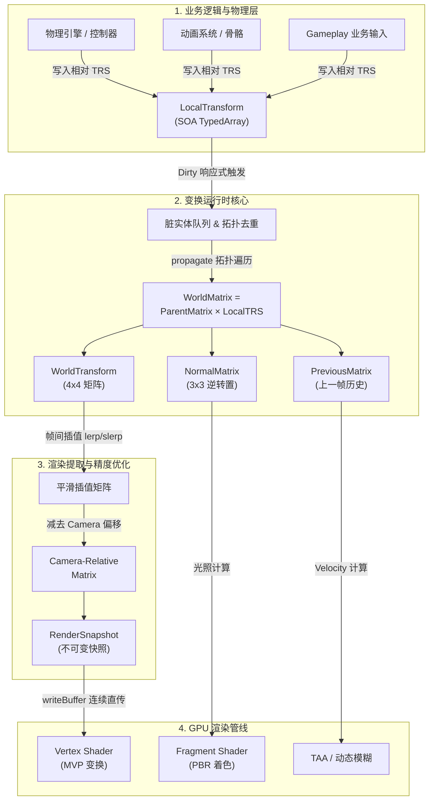

---

## 2. LocalTransform 与 WorldTransform 读写分离与 Schema 设计

### 2.1 场景图（Scene Graph）父子层级结构

在 3D 引擎中，场景由父子树形层级（Scene Graph）组织：

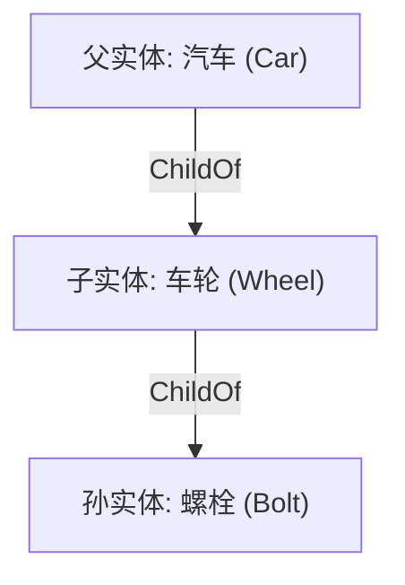

### 2.2 核心职责对比

| 维度         | `LocalTransform`                                          | `WorldTransform`                                                  |
| :----------- | :-------------------------------------------------------- | :---------------------------------------------------------------- |
| **坐标系**   | 相对直接父节点空间（Parent Space）                        | 绝对全局世界坐标空间（World Space）                               |
| **数据形态** | **TRS**（Translation: Vec3, Rotation: Quat, Scale: Vec3） | **$4 \times 4$ 矩阵**（Mat4, NormalMatrix: Mat3, Previous: Mat4） |
| **读写权**   | **业务逻辑（写端）**：输入、物理、动画直接更新            | **渲染管线（只读派生端）**：由 `propagate()` 自动合成             |
| **序列化**   | 参与持久化存盘（关卡/Prefab 配置）                        | **`runtime-only`**，纯运行时派生，不存盘                          |

- **解耦价值**：
  1. **直观相对运动**：车轮只需围绕自身局部轴旋转（修改 Local Rotation）；车身移动时，车轮世界坐标自动跟随，业务逻辑无需处理复杂的逆矩阵反算。
  2. **惰性更新与脏标记防抖**：局部变换变化频繁，但矩阵乘法开销昂贵。引擎通过脏标记机制在 `propagate()` 集中拓扑遍历，避免每次修改局部坐标都同步遍历整棵树。

### 2.3 Schema 字段设计深度剖析

#### `LocalTransform` Schema

```ts
{ id: 'translation', type: 'vec3', compare: 'epsilon' },
{ id: 'rotation',    type: 'vec4', compare: 'epsilon' },
{ id: 'scale',       type: 'vec3', compare: 'epsilon' },
{ id: 'local-version', type: 'u32', serialization: 'runtime-only' }
```

- **`compare: 'epsilon'`**：过滤浮点微弱噪点（如 $10^{-8}$ 级别），避免无实质位移触发昂贵的矩阵重算与脏标记广播。
- **`local-version`**：单调递增版本号，下游系统比对版本即可完成高效 Change Detection。

#### `WorldTransform` Schema

```ts
{ id: 'matrix',          type: 'mat4', serialization: 'runtime-only' },
{ id: 'previous-matrix', type: 'mat4', serialization: 'runtime-only' },
{ id: 'normal-matrix',   type: 'mat3', serialization: 'runtime-only' },
{ id: 'determinant-sign',type: 'f32',  serialization: 'runtime-only' },
{ id: 'world-version',   type: 'u32',  serialization: 'runtime-only' },
{ id: 'origin-cell',     type: 'ivec3',serialization: 'runtime-only' }
```

- **`previous-matrix`（上一帧矩阵）**：用于 **TAA（时间性抗锯齿）**、**Motion Blur（动态模糊）** 与 **Velocity Buffer（运动矢量缓冲）**。发生瞬移（Teleport）或切镜时，通过 `resetHistory()` 强制重置，防止整屏拉伸残影。
- **`normal-matrix`（3x3 法向逆转置矩阵 $(\mathbf{M}_{3\times 3}^{-1})^T$）**：当物体发生**非等比缩放**（Non-uniform Scale）时，直接用模型矩阵变换法线会导致法线不再垂直于表面。预先在 CPU 计算法线矩阵确保光照正确。
- **`determinant-sign`（行列式符号 $+1 / -1$）**：检测负缩放（例如 $scale.x = -1$ 镜像翻转）。镜像会导致多边形顶点绕序（Winding Order）颠倒引发背面剔除（Back-face Culling）误剔除，该标志告知渲染器是否需反转剔除面。

---

## 3. ECS 响应式脏标记与层级传播机制 (Observer vs Change-Tracker)

### 3.1 ECS 框架通用基础设施：推（Observer） vs 拉（Change-Tracker）

在 AetherEngine 的 ECS 核心架构中，状态变更的感知与处理分为两种互补的经典范式：

| 维度         | `Query ({ changed, added })`                                                      | `Observer`                                                                             |
| :----------- | :-------------------------------------------------------------------------------- | :------------------------------------------------------------------------------------- |
| **所属层级** | **ECS 核心通用能力**（[`ChangeTracker`](../ecs/change-tracker.ts)）               | **ECS 核心通用能力**（[`ObserverRegistry`](../ecs/observer.ts)）                       |
| **设计哲学** | **拉取模型 (Pull / Batch / Polling)**                                             | **推送模型 (Push / Reactive / Immediate)**                                             |
| **触发时机** | **按帧/按 Tick 延迟批量拉取**：在 System 调度时按需过滤                           | **即时响应 (Immediate Hook)**：在 `insertComponent` / `addRelation` 发生的瞬间同步回调 |
| **核心优势** | 适合高频数值计算、连续内存批量扫描，零回调开销与零上下文分配                      | 适合低频结构变更、拓扑关系联动、跨子系统生命周期资源同步                               |
| **开销特征** | 写入时仅记录单调递增的 `u32` Tick（纳秒级开销），读取时通过 bitmask/tick 快速过滤 | 触发时需遍历匹配规则、构造 `DeferredWorld` 上下文、发生函数调用与栈切换                |

> **架构澄清**：`Query (changed/added)` 与 `Observer` 都是 ECS 框架底层的通用一等公民特性（First-class ECS Features），绝非针对 Transform 特殊定制。Transform 子系统是同时将这两种通用能力结合到极致的典型代表。

---

### 3.2 Transform 的混合追踪与脏标记策略

`TransformRuntime` 的核心职责是将写端的 `LocalTransform` 结合 `ChildOf` 拓扑树，通过矩阵乘法派生出只读的 `WorldTransform`。在 3D 引擎中，**“树形拓扑破坏（低频）”** 与 **“海量局部数值变动（高频）”** 的开销特征截然不同，Transform 采取了精细切分的混合追踪策略：

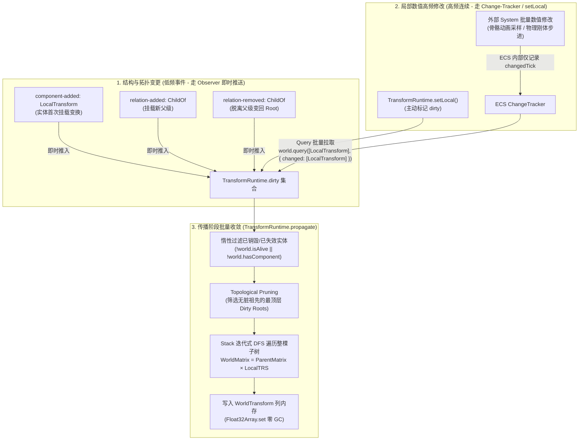

#### 1. 结构与拓扑变更（低频）—— 为什么用 Observer？

在 [`TransformRuntime`](runtime.ts) 的构造函数中，专门注册了 3 个 Observer：

```ts
world.addObserver({
  id: TRANSFORM_OBSERVERS.LocalAdded,
  event: 'component-added',
  component: LocalTransform,
  run: (event) => this.dirty.add(event.entity)
});
world.addObserver({
  id: TRANSFORM_OBSERVERS.ParentAdded,
  event: 'relation-added',
  relation: ChildOf,
  run: (event) => this.dirty.add(event.entity)
});
world.addObserver({
  id: TRANSFORM_OBSERVERS.ParentRemoved,
  event: 'relation-removed',
  relation: ChildOf,
  run: (event) => this.dirty.add(event.entity)
});
```

- **`component-added: LocalTransform`**：当实体首次被附加 `LocalTransform`（如通过 `world.insertComponent` 或 `EntityBuilder`）时，自动加入 `dirty` 队列，确保下一次 `propagate()` 会为其计算并写入 `WorldTransform`。
- **`relation-added: ChildOf`**：当实体挂载到新父级时，其世界变换空间发生改变，必须标记 dirty，使得自身及其整棵子树在下次传播时基于新父级矩阵重新派生。
- **`relation-removed: ChildOf`**：当实体与父级解除关系（变为根节点）时，触发标记 dirty，重新按 Root 空间计算世界矩阵。
- **适用理由**：场景图层级挂载/解挂和 Prefab 实例化属于低频操作，即时推入 `dirty` 集合能在 $O(1)$ 时间内捕获拓扑事实，开销极低。

#### 2. 局部数值修改（高频）—— 为什么不用 Observer 而用 Change-Tracker / setLocal？

- **为什么不为数值修改（Mutation）注册 Observer？**
  在大型 3D 场景中，每帧可能存在成千上万个骨骼节点、粒子、物理刚体在运动。如果每次修改 TRS 局部数值都触发一次 Observer 回调派发（构造事件对象、上下文参数传递、调用栈切换），将造成严重的 CPU 瓶颈和 Cache Miss，直接拖垮主循环。
- **解决之道**：
  1. **主动更新通道**：调用 `transformRuntime.setLocal(entity, patch)` 时，方法内部直接将实体压入 `dirty` 集合；
  2. **通用 ECS 批量拉取**：在 `propagate()` 启动时，通过 ECS 底层高效的 `changedTick` 批量拉取自上一 tick 以来变动过的实体：
     ```ts
     for (const [entity] of this.world.query([LocalTransform], {
       changed: [LocalTransform]
     })) {
       this.dirty.add(entity);
     }
     ```

#### 3. 组件移除与实体销毁 —— 为什么不用 Observer 而用惰性过滤（Lazy Pruning）？

- **为什么没有监听 `component-removed: LocalTransform` 或 `entity-despawned` 来从 dirty 移除？**
  若在实体销毁或组件移除时再逐个派发 Observer 遍历执行 `this.dirty.delete(entity)`，依然会产生额外的函数调用开销。
- **解决之道**：
  在 `propagate()` 真正展开子树计算前，统一执行一次 $O(\text{dirty})$ 的轻量惰性判定，自动剔除已失效实体：
  ```ts
  for (const entity of [...this.dirty]) {
    if (!this.world.isAlive(entity) || !this.world.hasComponent(entity, LocalTransform)) {
      this.dirty.delete(entity);
    }
  }
  ```

---

### 3.3 传播算法（propagate）与树形拓扑剪枝执行流

当 `TransformRuntime.propagate()` 执行时，算法按以下 4 步完成高效传播：

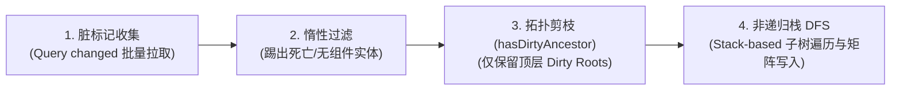

1. **收集脏实体**：通过 `world.query([LocalTransform], { changed: [LocalTransform] })` 将变动实体合并入 `dirty`。
2. **过滤死亡实体**：剔除已死亡或不再包含 `LocalTransform` 的脏实体。
3. **拓扑剪枝（Topological Pruning）**：
   ```ts
   const roots = [...this.dirty]
     .filter((entity) => !this.hasDirtyAncestor(entity))
     .sort((left, right) => left - right);
   ```
   - **`hasDirtyAncestor(entity)`**：自底向上追溯实体的祖先链，若其祖先已在 `dirty` 集合中，则该实体**无需作为独立根遍历**（因为遍历其脏祖先时会连带更新整棵子树）。该剪枝彻底避免了父子同时变动时的**子树重复计算（Redundant Subtree Traversal）**。
4. **非递归栈 DFS 传播（`propagateSubtree`）**：
   - 使用显式数组栈（Stack）模拟深度优先搜索，彻底避免 JavaScript 引擎在深度层级下的递归调用栈溢出（Call Stack Overflow）；
   - 自顶向下计算 $\mathbf{M}_{\text{world}} = \mathbf{M}_{\text{parent}} \times \mathbf{M}_{\text{local}}(\text{TRS})$；
   - 通过 `Float32Array.set()` 直接写入 `WorldTransform` 底层连续 TypedArray 列内存，**全程零对象分配与零 GC 开销**。

---

## 4. 图形学渲染管线与 Camera-Relative Rendering (RTC)

### 4.1 坐标空间变换与 CPU/GPU 阶段划分

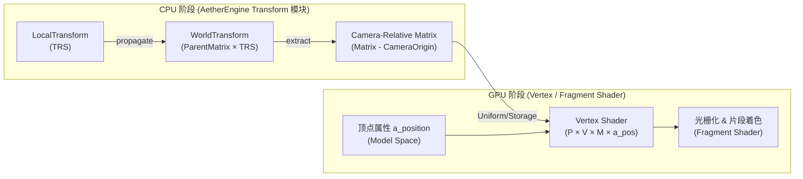

### 4.2 传统管线 vs Camera-Relative 管线矩阵相乘对比

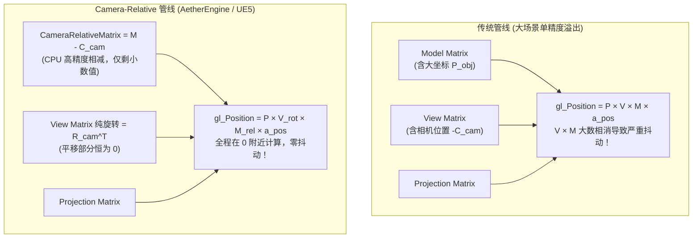

---

### 4.3 浮点精度丢失与大数相消（Catastrophic Cancellation）推导

#### 1. 负号从何而来？

相机的世界变换矩阵为刚体变换 $\mathbf{M}_{\text{cam}} = \mathbf{T}_{\text{cam}} \cdot \mathbf{R}_{\text{cam}}$。
View 矩阵本质是相机的逆矩阵：
$$\mathbf{V} = \mathbf{M}_{\text{cam}}^{-1} = (\mathbf{T}_{\text{cam}} \mathbf{R}_{\text{cam}})^{-1} = \mathbf{R}_{\text{cam}}^T \cdot \mathbf{T}_{\text{cam}}^{-1} = \mathbf{R}_{\text{cam}}^T \cdot \begin{bmatrix} 1 & 0 & 0 & \mathbf{-C_x} \\ 0 & 1 & 0 & \mathbf{-C_y} \\ 0 & 0 & 1 & \mathbf{-C_z} \\ 0 & 0 & 0 & 1 \end{bmatrix}$$

> **View 矩阵最后一列平移分量自带负号（$-C_{\text{cam}}$）！**

#### 2. 大数相消数值灾难

设：

- 远景物体绝对坐标：$P_{\text{obj}} = [100000.0, 0, 0]$；
- 附近观察的相机坐标：$C_{\text{cam}} = [100000.5, 0, 0]$。

在 GPU 32 位单精度浮点（Float32，仅 24 位有效尾数，约 7 位十进制有效数字）下执行矩阵乘法：
$$\text{ViewPos}_x = P_{\text{obj}} + (-C_{\text{cam}}) = 100000.0 - 100000.5$$
大数将低位有效数字完全挤出，计算结果在 $-0.49987$ 到 $-0.50012$ 之间跳变，画面产生严重的**远景模型抽搐与深度闪烁（Z-fighting）**。

---

### 4.4 CPU 相减到 GPU 执行的数值流动机制

Camera-Relative 将减法提前至 CPU 阶段：

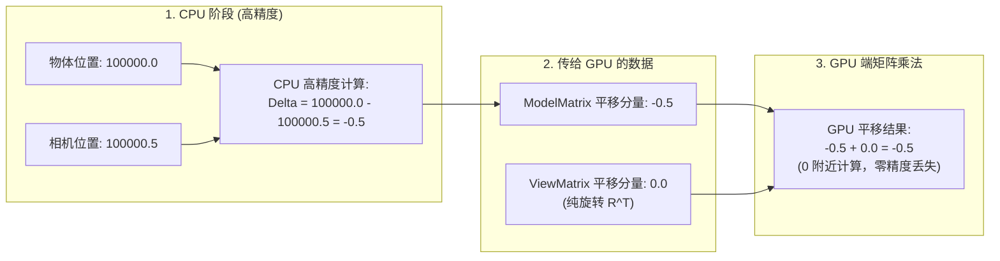

---

### 4.5 为什么相机的 View 矩阵没有 Scale？

1. **物理现实**：相机作为观察者只有位置（Eye）和朝向（LookAt/Rotation）。相机的缩放/视野变化在图形学中**完全由投影矩阵（Projection Matrix）的 FOV / Orthographic Size 控制**。
2. **数学约束**：相机的世界矩阵为刚体变换 $\mathbf{M}_{\text{cam}} = \mathbf{T} \cdot \mathbf{R}$。若相机包含缩放：
   - 逆矩阵破坏正交转置特性（$\mathbf{R}^{-1} \neq \mathbf{R}^T$），计算开销陡增；
   - View 空间的物理尺度被破坏，导致点光源的距离平方反比衰减（$1/\text{dist}^2$）和法向计算全部失真。

---

### 4.6 工业界主流引擎实现与对比

| 类别                           | 典型引擎                   | 做法与原理                                                                                                                                     |
| :----------------------------- | :------------------------- | :--------------------------------------------------------------------------------------------------------------------------------------------- |
| **采用 Camera-Relative / RTC** | **Unreal Engine 5 (UE5)**  | **LWC (Large World Coordinates)**：CPU 64 位双精度计算，进入 GPU 前统一减去 `PreViewTranslation`（$-C_{\text{cam}}$），Shader 全程单精度运行。 |
|                                | **CesiumJS**               | 经典 **RTC (Relative to Center)** 与 **RTR (Relative to Root)** 算法，解决地球级 GIS 渲染抖动。                                                |
|                                | **StarEngine / CryEngine** | 采用 64-bit Floating Origin 与相机相对渲染。                                                                                                   |
|                                | **Unity (HDRP 管线)**      | 默认开启 Camera-Relative Rendering 模式。                                                                                                      |
|                                | **AetherEngine**           | [runtime.ts](runtime.ts) 的 `extract()` 方法执行此减法。                                                                                       |
| **默认原始坐标（不做减法）**   | **Three.js** (默认)        | 直接传递 `mesh.matrixWorld`，大地图/GIS 场景必须借助扩展插件。                                                                                 |
|                                | **Babylon.js** (默认)      | 默认管线直接传递原始 `worldMatrix`。                                                                                                           |

---

### 4.7 Camera-Relative 带来的引擎全局协同改造

将模型矩阵改为相对矩阵后，以下 4 个系统需协同适配：

1. **View 矩阵**：平移分量必须置零，退化为纯旋转矩阵 $\mathbf{R}_{\text{cam}}^T$。
2. **光照与阴影系统**：点光源/聚光灯位置、CSM 级联阴影包围盒必须同步转为相对坐标。
3. **着色器全局特效**：高度雾、程序化纹理等若需绝对坐标，需在 Shader 内加上 `u_CameraWorldPos`。
4. **物理引擎**：物理世界保留在分块 Grid/Cell 空间，渲染同步阶段做相对化转换。

---

### 4.8 Shader 内的坐标使用策略：何时相对？何时绝对？

- **95% 的着色直接使用 Camera-Relative 坐标（无需还原）**：
  - PBR 光照计算：视线向量 $\mathbf{V} = -P_{\text{rel}}$，光照向量 $\mathbf{L} = L_{\text{rel}} - P_{\text{rel}}$，相对向量与夹角守恒。
  - 点光源/聚光灯衰减、法线贴图、粗糙度计算。
- **极少数全局空间场必须还原绝对 WorldPosition**：

| 特效场景                               | 为什么必须还原绝对 WorldPosition？ | 若仅使用 Relative 坐标的后果                         |
| :------------------------------------- | :--------------------------------- | :--------------------------------------------------- |
| **世界高度雾 (World Height Fog)**      | 雾浓度依赖绝对海拔高度。           | 相机垂直上升时，地面雾跟着相机上移。                 |
| **程序化三向贴图 (Triplanar Noise)**   | 表面根据绝对坐标采样 3D 连续噪声。 | 相机移动时，纹理在物体表面滑动（Texture Swimming）。 |
| **跨区域风场 / 海浪 (Gerstner Waves)** | 依赖世界网格保证波浪相位对齐。     | 相机移动导致海浪相位突变。                           |

```glsl
// Shader 内还原绝对坐标极简高效：
vec3 worldPosRelative = (u_ModelMatrixRelative * vec4(a_Position, 1.0)).xyz;
vec3 absoluteWorldPos = worldPosRelative + u_CameraWorldPosHighPrecision;
```

---

### 4.9 投影矩阵与 View-Projection 合成代码定位

- **CPU 阶段预合成**：在 `src/rendering/camera.ts` 的 `extractView()` 中：
  ```ts
  const viewProjection = Mat4.multiply(projection, view);
  ```
- **GPU 阶段顶点变换**：Vertex Shader 接收并执行：
  ```glsl
  gl_Position = u_ViewProjection * u_CameraRelativeModelMatrix * vec4(a_Position, 1.0);
  ```

---

## 5. 大世界浮点原点系统 (Floating Origin & RTR)

### 5.1 空间网格切片 (Cell Grid) 与数理模型

为了在大世界（跨越几十公里甚至行星级尺度）中消除 32 位单精度浮点（`Float32`）的尾数精度丢失问题，AetherEngine 将全局绝对坐标拆分为“**整数网格索引 + 局部浮点偏移**”：

$$\text{WorldPosition} = \text{Cell} \times \text{cellSize} + \text{Offset}$$

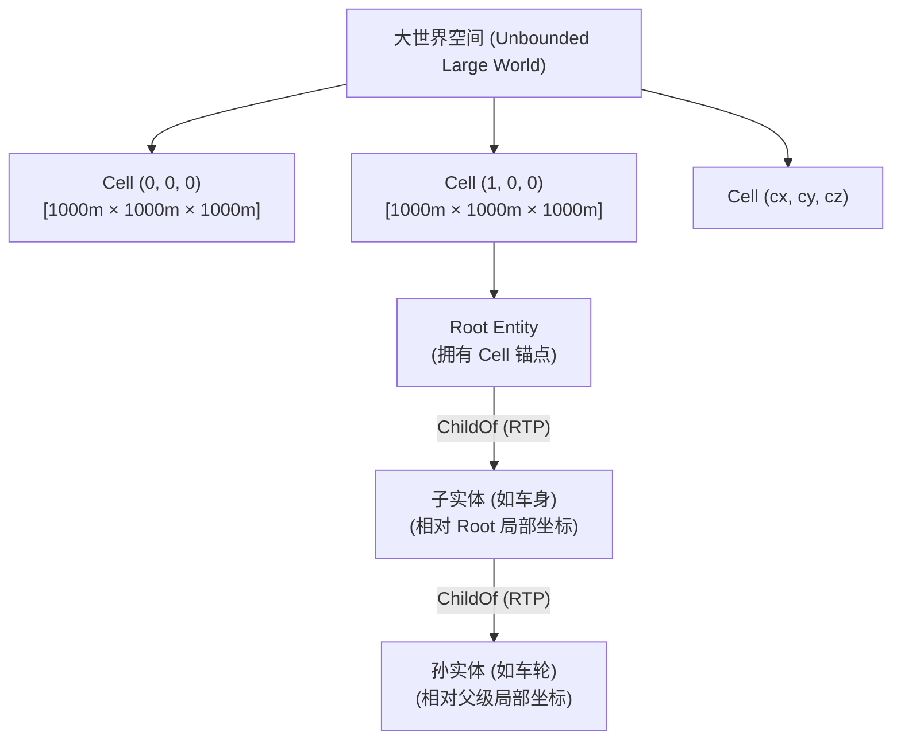

#### 1. 3D 立方体网格与中心锚点基准

- **`cell: ivec3`（32 位有符号整型）**：网格三维整数索引 $[c_x, c_y, c_z]$（默认 `DEFAULT_CELL_SIZE = 1000m`），可覆盖数千亿公里且绝对不丢失精度。
- **`offset: vec3`（浮点局部坐标）**：物体相对于当前 **Cell 几何中心点 $[0, 0, 0]$** 的三维偏移量。
  - **为什么基准点选在中心而非角点？** 偏移范围被严格约束在 $[-\frac{\text{cellSize}}{2}, +\frac{\text{cellSize}}{2}]$（即 $\pm 500\text{m}$ 之间）。数值关于 0 正负对称，充分利用 `Float32` 在 0 附近密度最高、有效尾数精度最强的特性。

#### 2. 类比 2D 地图瓦片（Map Tile）：同与异

- **哲学共通**：两者都遵循“大范围离散整数索引 + 局部连续浮点/像素坐标”的双层管理机制，支持 $O(1)$ 空间定位与按需流式加载（Streaming）。
- **核心差异**：
  1. **维度扩展**：传统地图瓦片主要为 2D 平面 $(X, Y)$；大世界 Cell 是 **3D 立方体体素切分 (`ivec3`)**，同时覆盖地下洞穴、垂直摩天大楼、飞行与太空。
  2. **定位职责**：地图瓦片包含多级 LOD 金字塔；而 Cell Grid 是**底层单层平铺的度量基准**，为物理模拟与渲染消除精度误差。

#### 3. 三维向量减法与欧氏距离（斜向与对角线精准计算）

在笛卡尔正交坐标系下，计算两点相对位移是 **$X, Y, Z$ 三轴独立进行向量减法**（参见 [position.ts](position.ts) 的 `worldPositionRelativeToOrigin`）：

$$\Delta \mathbf{P} = \begin{bmatrix} \Delta X \\ \Delta Y \\ \Delta Z \end{bmatrix} = \begin{bmatrix} (c_{Ax} - c_{Bx}) \cdot S + (o_{Ax} - o_{Bx}) \\ (c_{Ay} - c_{By}) \cdot S + (o_{Ay} - o_{By}) \\ (c_{Az} - c_{Bz}) \cdot S + (o_{Az} - o_{Bz}) \end{bmatrix}$$

真实空间直线物理距离由**三维勾股定理（欧几里得范数）**精确求得：
$$\text{Distance} = \sqrt{\Delta X^2 + \Delta Y^2 + \Delta Z^2}$$

#### 4. 多轴独立进位归一化（Normalize）

在 [position.ts](position.ts) 的 `normalizeWorldPosition` 中，进位判定按 3 个正交轴分别独立执行：

```ts
for (let axis = 0; axis < 3; axis++) {
  const shift = Math.floor((offset[axis]! + half) / cellSize);
  cell[axis] = cell[axis]! + shift;
  offset[axis] = offset[axis]! - shift * cellSize;
}
```

- **斜向移动与对角线处理**：当物体沿 45° 斜向或对角线移动时，若 $X$ 和 $Y$ 偏移同时超过 $+500\text{m}$，两轴**同时触发独立进位**，物体平滑滑入斜对角 `Cell (cx+1, cy+1, cz)`，偏移量自动折返至 $(-499, -499)$，绝无方向畸变。

---

### 5.2 空间四级火箭：Cell、Scene Graph、3D Tiles 与 BVH 的协同

在大世界体系中，空间索引与层级树分层协同：

| 层级                    | 系统组件                         | 切分与组织方式              | 核心职责                                                    |
| :---------------------- | :------------------------------- | :-------------------------- | :---------------------------------------------------------- |
| **Level 1: 空间表达层** | **Cell Grid (`ivec3`)**          | 无限规则 3D 网格            | 提供大世界无限度量基准，防止浮点爆炸，支持 $O(1)$ 分块索引  |
| **Level 2: 逻辑组织层** | **Scene Graph (RTR / RTP)**      | 父子树形层级                | Root 挂载 Cell 锚点，子节点维护局部 TRS，实现整树零开销位移 |
| **Level 3: 宏观流式层** | **Octree / Quadtree (3D Tiles)** | 基于屏幕误差（SSE）空间切分 | 大尺度视距分级、地形/倾斜摄影网格流式加载与卸载             |
| **Level 4: 渲染剔除层** | **Packed Static BVH**            | 按几何包围盒自适应紧密拟合  | 在当前活跃原点视锥内执行 $O(\log N)$ 视锥剪枝与遮挡剔除     |

---

### 5.3 RTR (Relative to Root) 与 RTP (Relative to Parent) 的异同

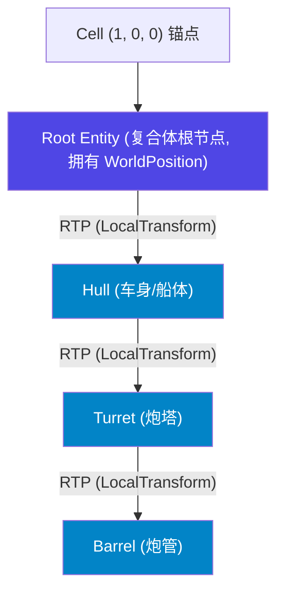

- **RTP (Relative to Parent，相对直接父节点)**：
  - 即标准的 `LocalTransform`（TRS）。
  - 面向骨骼动画、车轮旋转、机械联动等局部层级变换。
- **RTR (Relative to Root，相对大根节点)**：
  - 一栋建筑、一艘航母或整个地块由成千上万个零件组成，**仅最顶层的 Root 实体持有 `WorldPosition`（Cell + Offset）**。
  - 所有子孙实体仅保存相对 Root 的局部坐标；无论航母如何航行，子零件均无需维护各自的 Cell 坐标。

---

### 5.4 Floating Origin 与 Relative to Camera (RTC) 的关系

很多人会疑惑：“既然前面做了 Relative to Camera (RTC)，为什么还需要 Cell 和 Floating Origin？”

**两者不是替代关系，而是“CPU 宏观管理”与“GPU 微观渲染”的上下游接力：**

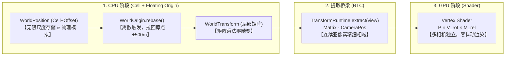

#### 为什么两者缺一不可？

1. **如果只做 RTC，不做 Cell 空间划分**：
   - CPU 物理模拟在 100km 处彻底卡死（Float32 无法表达毫米级位移，刚体碰撞穿模）；
   - 场景图矩阵乘法 $\mathbf{M}_{\text{parent}} \times \mathbf{M}_{\text{local}}$ 在大数值下旋转正交基被破坏，模型发生拉伸形变；
   - 无法按区域进行地形与资产的流式加载。
2. **如果只做 Floating Origin，不做 RTC**：
   - **多相机冲突**：世界原点全局唯一，但场景中往往同时存在主相机、CSM 级联阴影相机、反射相机；只有主相机在原点，其他相机依然面临渲染抖动。RTC 按每个 View 独立提取，彻底解决多视口精度；
   - **帧内连续性**：Rebase 是跨越 1000m 时的离散触发，RTC 则保证每一帧相机微小移动时的连续亚像素平滑。

---

### 5.5 原点重置 (Rebase) 算法与剔除系统联动

当相机跨越当前 Cell 边界时，调用 [runtime.ts](runtime.ts) 的 `rebase(newCell)`：

#### 1. $O(\text{Roots})$ 极速位移算法

1. 计算跳跃位移差值：$\Delta = (newCell - oldCell) \times cellSize$；
2. 筛选顶层根实体：`world.getParent(entity) === null`；
3. **仅修改 Root 实体的平移量**（`translation - delta`），触发 `forceDirty`；
4. **所有子孙节点、骨骼动画与局部刚体完全无需改动**，整棵子树瞬间完成坐标系重置。

#### 2. 与剔除系统（BVH & Frustum Culling）的闭环联动

- **BVH 局部精度保障**：Rebase 后，所有物体的 `WorldTransform` 被重新拉回当前原点周围。Packed BVH 在紧凑坐标系中构建与遍历，6 平面测试（`classifyAabbValues`）拥有极高浮点精度，绝不发生边缘误剔除或漏剔除；
- **Cell 级宏观粗筛**：视锥体包围盒在宏观阶段先与 Cell Grid 求交，快速剔除非活跃 Cell，再将相交 Cell 内部的实体送入 BVH 细筛。

---

## 6. ECS SOA 架构与零 GC 内存管理

### 6.1 AOS vs SOA 内存布局对比

```
AOS (传统面向对象 - 堆碎片化，Cache Miss 严重):
[Entity0 Object] -> [Translation, Rotation, Scale, Matrix]
[Entity1 Object] -> [Translation, Rotation, Scale, Matrix]

SOA (AetherEngine ECS - 紧凑连续 TypedArray 内存):
┌────────────────────────────────────────────────────────────────────────────────┐
│ Chunk ArrayBuffer (Continuous TypedArray Memory)                               │
├────────────────────────────────────────────────────────────────────────────────┤
│ Translation: [X0, Y0, Z0] [X1, Y1, Z1] [X2, Y2, Z2] ...                        │
│ Rotation:    [X0, Y0, Z0, W0] [X1, Y1, Z1, W1] ...                             │
│ Scale:       [SX0, SY0, SZ0] [SX1, SY1, SZ1] ...                               │
│ WorldMatrix: [16 floats for E0] [16 floats for E1] ...                         │
└────────────────────────────────────────────────────────────────────────────────┘
```

### 6.2 分块预分配（Chunk）与 Swap-and-Pop 销毁复用

查看 [src/ecs/table.ts](file:///Users/hgis/myproject/AetherEngine/src/ecs/table.ts)：

1. **分块预分配**：`Table` 按 Chunk 容量（默认 256/1024 实体）预分配大块 `ArrayBuffer`。新增实体直接写入对应 Row 偏移量，**0 堆对象分配**。
2. **Swap-and-Pop 销毁**：实体销毁时，将末尾最后一行的内存数据直接拷贝覆盖到被删除的行（Row），实体计数 `count--`，**内存永远复用，绝不触发 GC 回收**。

---

### 6.3 Direct GPU Upload 全链路流程与源码实现

AetherEngine 拥有完整的 GPU 内存直传（Direct GPU Upload）端到端执行链路。数据从 ECS 连续内存直接推入 GPU 显存，中途**无多余对象包装、无结构转换**：

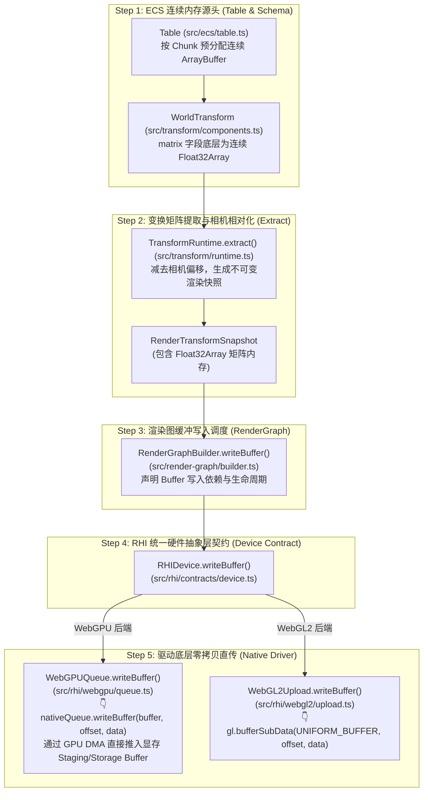

#### 各阶段关键源码定位：

1. **ECS 连续内存源头**：
   - [`src/ecs/table.ts:L33-L76`](file:///Users/hgis/myproject/AetherEngine/src/ecs/table.ts#L33-L76)：`TableColumn.chunks: ArrayBuffer[]`。
   - [`src/transform/components.ts:L21-L58`](file:///Users/hgis/myproject/AetherEngine/src/transform/components.ts#L21-L58)：`WorldTransform` 矩阵切片直接映射在底层 `ArrayBuffer`。
2. **变换提取与相机相对化**：
   - [`src/transform/runtime.ts:L238-L263`](file:///Users/hgis/myproject/AetherEngine/src/transform/runtime.ts#L238-L263)：`extract()` 直接生成包含 `Float32Array` 连续切片的 `RenderTransformSnapshot`。
3. **渲染图缓冲写入调度**：
   - [`src/render-graph/builder.ts:L94`](file:///Users/hgis/myproject/AetherEngine/src/render-graph/builder.ts#L94)：`RenderGraphBuilder.writeBuffer(handle, usage, range)` 追踪缓冲生命周期。
4. **RHI 统一硬件抽象层契约**：
   - [`src/rhi/contracts/device.ts:L40-L41`](file:///Users/hgis/myproject/AetherEngine/src/rhi/contracts/device.ts#L40-L41)：`writeBuffer` / `writeBufferRanges` 统一数据传输接口。
5. **原生驱动层直传（Native GPU Upload）**：
   - **WebGPU 原生通道**：[`src/rhi/webgpu/queue.ts:L115-L123`](file:///Users/hgis/myproject/AetherEngine/src/rhi/webgpu/queue.ts#L115-L123) 与 [`browser/queue-port.ts:L18-L23`](file:///Users/hgis/myproject/AetherEngine/src/rhi/webgpu/browser/queue-port.ts#L18-L23)，直接调用 `nativeQueue.writeBuffer(buffer, offset, data)` 触发底层 DMA 写入。
   - **WebGL2 原生通道**：[`src/rhi/webgl2/upload.ts:L26-L36`](file:///Users/hgis/myproject/AetherEngine/src/rhi/webgl2/upload.ts#L26-L36)，直接调用 `gl.bufferSubData(gl.UNIFORM_BUFFER, offset, data)` 执行连续内存拷贝。

---

## 7. 文件结构与核心 API 速查表

| 文件                                                   | 核心功能与职责                                                                                                           |
| :----------------------------------------------------- | :----------------------------------------------------------------------------------------------------------------------- |
| [`types/transform-types.ts`](types/transform-types.ts) | 变换输入、组件视图、传播统计、渲染快照（`RenderTransformSnapshot`）等强类型契约。                                        |
| [`constants.ts`](constants.ts)                         | Transform 常量字典（`TRANSFORM_OBSERVERS`、`DEFAULT_CELL_SIZE`、`TRANSFORM_EPSILON`）。                                  |
| [`components.ts`](components.ts)                       | `LocalTransform`（写端）与 `WorldTransform`（只读派生端）ECS Schema 定义。                                               |
| [`position.ts`](position.ts)                           | `WorldOrigin` 资源、`normalizeWorldPosition` 规范化与原点相对坐标转换。                                                  |
| [`history.ts`](history.ts)                             | `TransformHistory` 历史重置追踪（瞬移、Rebase、切镜标记）。                                                              |
| [`runtime.ts`](runtime.ts)                             | `TransformRuntime` 核心引擎：`attach`、`setLocal`、`teleport`、`rebase`、`propagate`、`extract`、`reparent`、`despawn`。 |
| [`index.ts`](index.ts)                                 | Transform 子系统公共 API 统一导出出口。                                                                                  |
